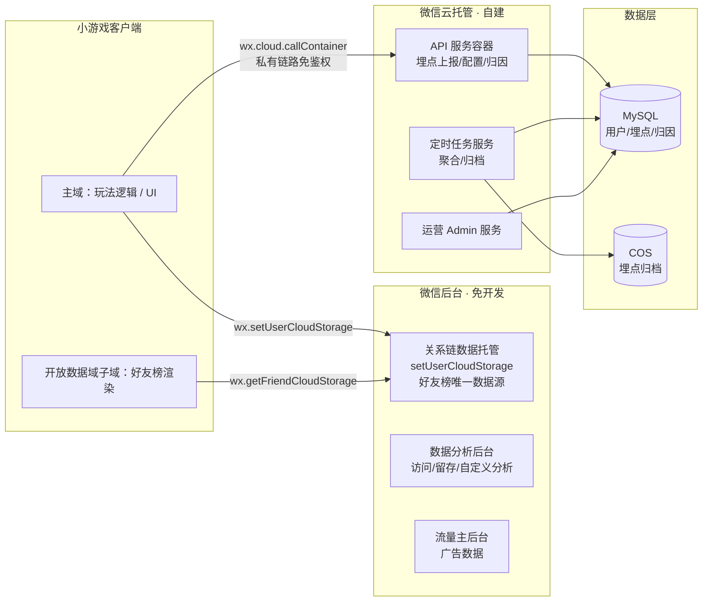

# 微信「跳一跳」类小游戏后台系统技术方案

> 版本：v1.2 ｜ 日期：2026-10-31 ｜ 技术底座：微信云托管（Cloud Run）+ MySQL
> 适用对象：类似"跳一跳"的单局制休闲小游戏，核心玩法为一局一成绩 + **好友排行榜（游戏唯一榜单）**
>
> **v1.1 修订说明**：游戏中不存在"全服榜"概念，本版已删除全部全服榜相关设计（Redis ZSet 榜单、对局防作弊服务、榜单快照/周榜结算等），技术底座同步去掉 Redis；后端职责收敛为"统计、归因与运营支撑"。好友榜为唯一榜单，实现方式为微信开放数据域（见第 7 章）。
>
> **v1.2 修订说明**：数据库 DDL、字段定义与索引迁移至配套文档《MVP数据库与Admin门户设计》v1.0（该文档为唯一权威来源），本文档第 6 章改为表清单与设计要点；补全埋点事件字典、指标口径、聚合 SQL、错误码与数据保留阈值；第 5 章 M3 展开为 Admin 门户页面清单（10 个页面，MVP 首发 6 个）。

---

## 1. 项目概述与设计目标

### 1.1 业务特征

- 单局制玩法：一局一个分数，成绩即时写入好友榜
- 社交驱动：好友排行榜是留存与传播的核心引擎
- 流量尖峰：裂变式增长，DAU 可能短期暴涨数十倍后回落
- 变现以激励视频广告为主（复活、翻倍），数据侧以漏斗分析为主

### 1.2 设计目标

| 目标 | 说明 |
|---|---|
| 自动弹性 | 流量尖峰时无人干预自动扩缩容，无流量时成本趋近于零 |
| 好友榜走微信侧 | 好友榜数据与关系计算完全由微信关系链托管，服务端不参与榜单 |
| 轻量后端 | 服务端只承载统计埋点、回流归因与运营配置，不承载玩法数据 |
| 低运维 | 团队规模小，数据库/日志/监控/CI 尽量用托管能力 |

---

## 2. 总体架构



关键链路说明：

- **好友榜**：完全不走自建服务端。主域对局结束后调用 `wx.setUserCloudStorage` 写入成绩 KV，开放数据域子域调用 `wx.getFriendCloudStorage` 读取好友数据并渲染榜单（详见第 7 章）
- **客户端 → 云托管**：走 `wx.cloud.callContainer`，微信私有链路，请求头自动携带 `X-WX-OPENID` 等可信身份信息，**无需自己实现登录态校验**。仅承载埋点上报、分享归因、运营配置等统计与运营链路
- 成绩不经过服务端计算榜单；服务端收到的成绩仅作为统计事件（用于分数分布分析），不参与任何榜单逻辑

---

## 3. 核心边界：微信后台可配置 vs 必须自建（本文档最重要的一张表）

### 3.1 微信后台可直接配置/查看、无需开发

| # | 能力 | 所在后台 | 说明 |
|---|---|---|---|
| W1 | **好友榜数据托管**（关系链 KV 数据） | 小游戏端 API（数据存微信侧） | `wx.setUserCloudStorage` 写入、`wx.getFriendCloudStorage` 在开放数据域读取好友数据，微信负责存储与好友关系计算——**好友榜的全部数据链路** |
| W2 | 访问趋势/留存分析 | 公众平台 → 统计 → 访问分析 | DAU、新增、打开次数、时长、次日/7 日留存 |
| W3 | 实时统计 | 公众平台 → 统计 → 实时统计 | 当日实时在线、实时新增，活动期盯盘 |
| W4 | 用户画像 | 公众平台 → 统计 → 用户画像 | 性别/年龄/地域/机型分布 |
| W5 | **自定义分析** | 公众平台 → 统计 → 自定义分析 | 后台配置事件与指标后，端上 `wx.reportEvent` 上报即可查询，支持漏斗/留存分析，覆盖对局、卡关、复活等玩法漏斗 |
| W6 | 分享基础数据 | 公众平台 → 统计 | 分享次数、分享人数等总量指标 |
| W7 | 流量主数据 | 公众平台 → 流量主 | 广告展示量、eCPM、收入明细 |
| W8 | 服务器域名 / callContainer 白名单 | 公众平台 → 开发设置 | 云托管环境绑定后免配 request 合法域名 |
| W9 | 云托管环境本身 | 云托管控制台 | 创建环境、开通 MySQL、灰度发布、日志查询、监控告警规则均为控制台操作 |
| W10 | 版本发布/回滚、体验版二维码 | 公众平台 → 版本管理 | 代码审核、发布、回滚 |

### 3.2 必须在云托管自建的功能（微信后台不提供或不可用于本场景）

| # | 功能 | 为什么必须自建 |
|---|---|---|
| S1 | 细粒度玩法事件明细（供运营 SQL/BI 用） | 自定义分析只能看聚合图表，无法导出明细做自定义分析 |
| S2 | 分享回流归因 | 微信后台只有分享总量，无"谁点的谁的链接、回流后行为"明细 |
| S3 | 运营后台（Admin） | 调难度参数、配置公告、发放补偿等运营工具 |
| S4 | 定时任务（数据聚合与归档） | 埋点 T+1 聚合、7 日留存回填、冷数据归档 |

> **边界说明（重要）**：好友榜成绩由客户端直写微信关系链 KV，微信侧负责存储与好友关系计算，服务端**不参与成绩校验与榜单计算**，因此无需自建排行榜服务与配套防作弊体系（这也意味着好友榜分数理论上可被端侧工具篡改，属于该产品形态的固有限制，详见 7.3）。

> 一句话记忆：**"给玩家看的榜单"在微信侧，"给运营看的数据"和"给运营用的工具"在自建侧。**

---

## 4. 微信侧能力详解（免开发部分）

### 4.1 关系链数据托管（好友榜的全部基础）

- 主域调用 `wx.setUserCloudStorage`，将当前玩家成绩写入微信托管的 KV 存储
- 开放数据域（子域）调用 `wx.getFriendCloudStorage`，一次拿到**所有好友**的该 KV 数据（含本人）
- 由于游戏只有好友榜，**KV 写入即榜单数据的唯一来源**，服务端不保存、不计算任何榜单
- 关键限制（设计时必须遵守）：
  - 每个用户最多 **128 个 key**，单个 value ≤ **1024 字节**，key ≤ 128 字节
  - KV 数据**只有开放数据域可读**，主域、服务端均读不到
  - 数据存在微信侧，**无法导出、无法在公众平台后台查看明细**
  - 子域不能使用大部分网络 API，只能做纯展示

### 4.2 自定义分析（玩法漏斗零开发方案）

- 后台配置事件（如 `game_over`、`revive`）+ 参数（分数、局时长、复活次数）
- 端上埋一行 `wx.reportEvent('game_over', { score: 123, cost_ms: 45000 })`
- 后台直接看漏斗与留存，**MVP 阶段可完全替代自建玩法埋点后端**

---

## 5. 云托管自建部分：功能模块与开发内容

### 模块 M1：接入与用户服务

| 开发内容 | 详细说明 |
|---|---|
| 登录态建立 | 从 `callContainer` 请求头读取 `X-WX-OPENID` / `X-WX-UNIONID`，首次请求 upsert 用户表，返回远程运营配置 |
| 用户资料接口 | 查询/更新昵称头像（新规：头像昵称由用户主动填写授权） |
| 限流中间件 | 按 openid 维度令牌桶限流（如 60 req/min），防脚本刷上报接口 |

### 模块 M2：埋点与分享回流归因

| 开发内容 | 详细说明 |
|---|---|
| 批量上报 `POST /report/batch` | 客户端攒批（5~10 条/次、退出时 flush），服务端批量 insert 明细表（按天分表 `event_20261031`）。成绩（score）、局时长等以事件形式上报，**仅用于统计分布分析，不参与榜单** |
| 回流归因 | 分享 path 携带 `?from=share&sid={share_id}&uid={sharer}`；新用户/回流用户首启上报携带该参数，服务端写 `share_attribution` 表（分享者、点击者、时间、回流后 7 日留存回填） |
| 聚合任务 | 定时任务 T+1 聚合到 `stats_daily`（DAU、分享率、回流率、K 因子） |
| 冷数据归档 | 明细表保留 90 天，到期导出 COS（gzip），删除原分区 |

### 模块 M3：运营 Admin 服务

| 开发内容 | 详细说明 |
|---|---|
| 后台 Web（Vue 3 + Element Plus） | 账号密码 + JWT + RBAC（super / ops），自定义域名 + IP 白名单，不接入 callContainer |
| 页面清单（10 个，MVP 首发 6 个） | P1 登录、P2 概览看板、P5 用户查询、P7 配置中心、P9 管理员账号、P10 审计日志为首发；P3 分享与回流、P4 玩法漏斗、P6 埋点明细、P8 公告管理为第二迭代 |
| 审计 | 所有写操作记 `admin_audit_log`（含变更前后值） |
| 详见 | 《MVP数据库与Admin门户设计》第 7 章：页面用途、路由、权限、对应表操作与接口映射 |

### 模块 M4：定时任务服务（云托管定时触发器）

| 任务 | 频率 | 内容 |
|---|---|---|
| 埋点聚合 | 每日 02:00 | 聚合 stats_daily（DAU、分享/回流指标） |
| 留存回填 | 每日 03:00 | 回填 share_attribution 的 7 日留存字段 |
| 数据归档 | 每日 03:30 | 90 天前埋点明细导 COS |

---

## 6. 数据存储设计

### 6.1 MySQL（云托管自带 8.0，最小规格起步，开自动备份）

MVP 共 **7 张表**，字段级 DDL、索引与设计理由见配套文档《MVP数据库与Admin门户设计》第 3~4 章（本文档不重复 DDL，避免两处分叉）。

| # | 表名 | 定位 | 关键字段/索引要点 |
|---|---|---|---|
| 1 | `user` | 玩家表 | `openid` 作主键；`created_at`、`last_seen_at` 建索引 |
| 2 | `event_log` | 埋点明细（单表不分表） | `(event, server_ts)` 支撑漏斗，`(openid, server_ts)` 支撑单用户时间线 |
| 3 | `share_attribution` | 分享回流归因 | `uk(share_id, clicker_openid)` 防重复计数 |
| 4 | `stats_daily` | 每日指标预聚合 | `dt` 主键，看板只查此表 |
| 5 | `game_config` | 运营配置 KV | `k` 主键，`v` 为 JSON，含公告/难度/复活等种子键 |
| 6 | `admin_user` | 后台账号 | `username` 唯一，bcrypt 哈希，角色 super/ops |
| 7 | `admin_audit_log` | 后台操作审计 | 冗余 `admin_name`，`(admin_id, created_at)` 索引 |

> 设计要点：不建外键（一致性由服务层保证）、明细只插不改、配置用 KV+JSON 便于 Admin 通用编辑、公告不单独建表（复用 `game_config.notice.*`）、无道具/货币/内购表（MVP 为纯广告变现）。
>
> MVP 明确不做：分库分表、读写分离、Redis 缓存、AB 实验表、独立反馈表（玩法建议走 `event_log` 的 `feedback` 事件）。

### 6.2 微信关系链 KV（好友榜数据，存微信侧，不占自建资源）

```
score   当日最高分（子域好友榜展示用）
best    历史最高分
```

- 写入时机：对局结束 + 每日首次打开（兜底同步）
- 每个用户最多 128 key / 单 value ≤ 1024 字节，只存这两个 key 即可

### 6.3 COS

仅用于埋点明细冷数据归档，按 gzip 包存储，成本可忽略。

---

## 7. 好友排行榜实现思路（重点 · 游戏唯一榜单）

### 7.1 结论：好友榜必须且只能用"开放数据域"

- 微信不提供任何获取好友 openid 列表的接口，**服务端拿不到"这个人有哪些好友"**
- 因此好友榜的关系计算只能由微信侧完成：数据存微信关系链 KV，在开放数据域中由微信返回好友数据
- 本游戏**没有全服榜**，好友榜即唯一榜单，无需自建任何排行榜存储（无 Redis ZSet、无榜单快照表）

### 7.2 双域结构与数据流

```
主域（游戏逻辑，正常网络权限）
  ① 对局结束 → wx.setUserCloudStorage({ KV: { score: 本局后最高分 } })
  ② 同时将本局成绩/时长作为事件经 report/batch 上报（仅统计用途，不参与榜单）
开放数据域子域（好友榜 UI，仅本地渲染）
  ③ wx.getFriendCloudStorage({ keyList: ['score', 'best'] })
     → 返回本人 + 所有好友的 { openid, avatarUrl, nickname, KV.score }
  ④ 子域 canvas 绘制好友榜（头像、昵称、分数、排名，本地排序）
```

### 7.3 设计要点与坑

| 要点 | 说明 |
|---|---|
| KV 只存必要字段 | `score`（当日最高分）、`best`（历史最高分）两个 key 足够；不要塞业务数据进去（总量 128 key / 1KB 限制） |
| 写入时机 | 对局结束、以及每日首次打开时（兜底同步），保证好友看到的数据不至于整天不更新 |
| 子域与主域通信 | 主域通过 `wx.getOpenDataContext().postMessage()` 通知子域刷新（如"切到好友榜 Tab 了"） |
| 子域无网络权限 | 好友榜内不能请求云托管、不能展示任何需要联网的数据；所有榜单内容来自关系链 KV |
| 排名计算 | 子域收到好友数组后本地排序即可（好友数量有限），无需服务端 |
| 数据不可见性 | 关系链 KV 后台不可见、无法导出——好友榜数据的运营分析依赖第 4.2 节的自定义分析事件，而非榜单本身 |
| 端侧可篡改 | 成绩由客户端直写 KV，服务端无法校验，理论上可被端侧工具篡改；这是"仅好友榜"产品形态的固有限制，运营上通过自定义分析观察分数分布异常（如超高分占比突增）作为参考信号 |
| 审核合规 | 好友数据仅可用于榜单展示，禁止上传自建服务端或用于其他用途 |

### 7.4 常见误区（务必避免）

- ❌ 试图自建好友榜：服务端拿不到好友关系，做不到
- ❌ 让客户端把好友的 openid/分数传给自建服务端：违反关系链数据合规要求，审核会被拒
- ❌ 在子域里请求云托管接口：子域无网络权限
- ❌ 以为后台能看到好友榜明细：看不到，运营分析必须走埋点事件

---

## 8. 接口设计范围（自建 API 清单）

统一约定：`/api/v1` 前缀；JSON；错误码 `{ code, msg, data }`；身份由 `X-WX-OPENID` 头获得。

| 方法 | 路径 | 说明 | 归属模块 |
|---|---|---|---|
| POST | /api/v1/session/init | 首次进入 upsert 用户，返回用户信息 + 远程运营配置 | M1 |
| PUT | /api/v1/user/profile | 更新昵称头像 | M1 |
| POST | /api/v1/share/create | 生成 share_id（回流归因用），返回分享 path | M2 |
| POST | /api/v1/report/batch | 埋点批量上报（含成绩/局时长等统计事件，不参与榜单） | M2 |
| GET | /api/v1/config | 拉取运营配置（难度系数、复活广告次数、活动开关） | M3 |
| — | Admin API（/admin/**） | 看板、参数配置、公告、补偿，独立鉴权，不下发客户端 | M3 |

**不设计的接口（明确边界）**：
- ~~GET /rank/friends~~：好友榜走开放数据域，不走服务端
- ~~POST /match/start、/match/score~~：无全服榜，成绩不经服务端校验与入榜
- ~~GET /rank/global、/rank/me、/rank/yesterday~~：无全服榜相关查询
- ~~POST /reward/claim~~：无榜单结算奖励
- ~~登录换 code2Session~~：callContainer 私有链路已带可信 openid，无需 code2Session

---

## 9. 部署与运维要点

### 9.1 云托管环境规划

- 两个环境：`prod` 与 `test`（同 AppID），测试流量走 test 环境，发布走流水线
- 服务拆分：`game-api`（对外：上报/配置/归因）、`cron-job`（定时任务，不对外暴露公网）、`admin-api`（仅内网访问）
- 容器规格起步：0.25C / 0.5G，最小实例数 1，最大 10（无榜单热点查询，压力远小于重型方案）
- **缩容策略**：夜间允许缩到 1 实例（不缩到 0，避免上报接口冷启动）；大推活动前手动提高最小实例数

### 9.2 数据层运维

- MySQL 最小规格 + 自动备份 + 慢日志告警；埋点明细按天分表，聚合后明细可归档
- MySQL 连接数受容器实例数放大，API 服务内使用连接池并设置 `max 5/实例`

### 9.3 监控与告警（云托管控制台配置，免开发）

- 告警项：CPU > 70% 持续 5min、内存 > 80%、5xx 率 > 1%、实例数 > 8（流量异常信号，可能是裂变或被刷）
- 业务巡检（cron 自检）：每日聚合任务成功标记、MySQL 磁盘水位
- 日志：容器 stdout 直接到云托管日志服务，保留 7 天以上，上报与归因链路打结构化日志

### 9.4 发布与回滚

- 云托管灰度发布：按流量比例灰度（10% → 50% → 100%）
- 小游戏端：体验版 → 审核 → 全量；客户端预留远程开关（game_config），异常玩法逻辑可秒级关闭

### 9.5 成本粗估（月，量级参考）

| 项 | 低负载期（DAU 1 万） | 峰值期（DAU 50 万） |
|---|---|---|
| 云托管（弹性） | 数十元 | 数百~数千元（弹性最贵项，靠缩容控制） |
| MySQL 最小规格 | 约 100 元 | 升配 ~500 元 |
| COS/归档/流量 | 忽略 | 数十元 |
| 微信侧（关系链 KV/自定义分析/广告后台） | 0 | 0 |

> v1.1 已移除 Redis 成本项：好友榜由微信关系链托管，全服榜及其 Redis 依赖不存在。

---

## 10. 开发顺序建议（里程碑）

1. **M1（第 1 周）**：云托管环境搭建 + session/init + config 接口 + 埋点批量上报最小闭环
2. **M2（第 2 周）**：好友榜开放数据域联调（KV 写入 + 子域渲染 + postMessage 通信）
3. **M3（第 3 周）**：share/create + 回流归因落库 + 定时任务（聚合/留存回填/归档）
4. **M4（第 4 周）**：Admin 后台（看板/配置/公告/补偿）+ 监控告警 + 压测（模拟尖峰流量验证扩容）
5. 持续：自定义分析事件在公众平台后台配置并完善对局漏斗

---

## 附：边界速查卡

| 需求 | 去哪做 |
|---|---|
| 看好友排行榜（游戏唯一榜单） | 开放数据域（微信托管，免开发） |
| 看 DAU/留存/画像 | 公众平台统计（免开发） |
| 看对局/成绩漏斗 | 公众平台自定义分析 + wx.reportEvent（免开发） |
| 看广告收入 | 公众平台流量主（免开发） |
| 分享回流归因明细 | 自建：share_attribution 表 + 埋点 |
| 调难度/配公告/发补偿 | 自建 Admin 后台 |
