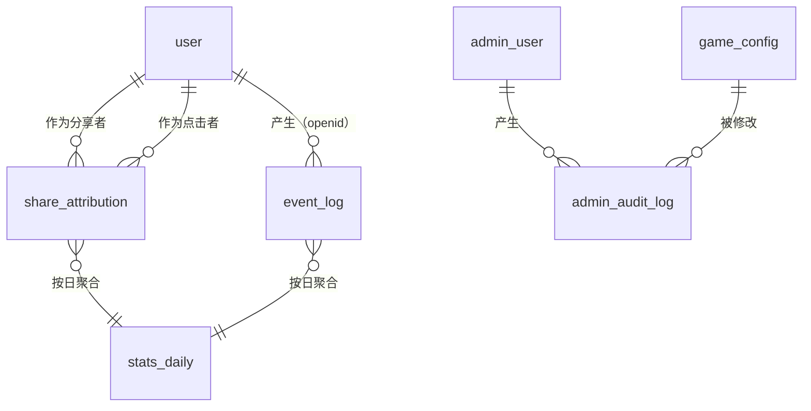

# MVP 数据库设计与 Admin 门户方案

> 版本：v1.0 ｜ 日期：2026-10-31 ｜ 数据库：微信云托管 MySQL 8.0
> 关联文档：《跳一跳类小游戏后台技术方案》v1.2、《加固方案》v0.1
> **权威说明**：本文档为 DDL、字段定义与索引的唯一权威来源；主方案文档第 6 章仅保留表清单与指针，避免两处 DDL 分叉。

---

## 1. 设计原则与 MVP 边界

### 1.1 设计原则

| 原则 | 具体做法 |
|---|---|
| 够用即可 | 单库单表、无分库分表、无 Redis（好友榜在微信侧，无全服榜） |
| 业务主键优先 | `user` 表以 `openid` 直接作主键，不引入无意义自增 ID，避免多一次索引回表 |
| 不建外键 | 云托管 MySQL 上外键带来的锁与迁移成本大于收益，关系由应用层与索引保证 |
| 明细 + 预聚合分离 | 明细表只写入不更新；看板查询走 `stats_daily` 预聚合，避免每次扫百万行 |
| 弹性字段用 JSON | 埋点 `props`、配置 `v` 用 JSON，避免为每个新埋点参数加列 |
| 预留而不实现 | 分表、归档、封禁等能力在文档中标注升级阈值，MVP 不写代码 |

### 1.2 MVP 明确不做（防过度设计清单）

- ❌ 道具/金币/内购相关表（本游戏为纯广告变现，无虚拟货币）
- ❌ 关卡表（跳一跳为无尽单局玩法，无关卡配置实体）
- ❌ 封禁/申诉/工单表（MVP 无 UGC 与社区，违规走微信平台机制）
- ❌ AB 实验表、多语言表、数据仓库
- ❌ Redis 缓存层、读写分离、分库分表、消息队列
- ❌ 独立公告表（复用 `game_config` 的 `notice.*` 键）
- ❌ 独立反馈表（玩法建议走微信客服消息 + `event_log` 的 `feedback` 事件，不建表）

### 1.3 环境与命名规范

| 项 | 约定 |
|---|---|
| 字符集 / 引擎 | `utf8mb4` / `utf8mb4_0900_ai_ci`，InnoDB |
| 时区 | 容器默认 UTC，连接串强制 `time_zone='+08:00'`，全库按东八区存储 |
| 表名/字段名 | 全小写 snake_case；表名用单数（`user`、`event_log`） |
| 时间字段 | 一律 `DATETIME`；需要毫秒的埋点用 `DATETIME(3)` |
| 布尔 | `TINYINT(1)`，0/1 |
| 金额/比率 | 比率 `DECIMAL(6,4)`（如 0.1234），不使用 FLOAT |
| 主键 | 用户类表用业务主键；流水类表用 `BIGINT AUTO_INCREMENT` |

---

## 2. 需要创建的表（共 7 张）

| # | 表名 | 定位 | 写入量级（MVP） | 保留策略 |
|---|---|---|---|---|
| 1 | `user` | 玩家主体 | 增量（新增用户数） | 永久 |
| 2 | `event_log` | 埋点明细（唯一明细表） | 高（DAU × 15~25 条/日） | 90 天，超期归档 COS 后删除 |
| 3 | `share_attribution` | 分享点击回流归因 | 中（分享点击量） | 永久（体量小） |
| 4 | `stats_daily` | 每日指标预聚合 | 1 行/天 | 永久 |
| 5 | `game_config` | 运营配置 KV | 极低 | 永久 |
| 6 | `admin_user` | 后台账号 | 极低 | 永久 |
| 7 | `admin_audit_log` | 后台操作审计 | 低 | 1 年 |

---

## 3. 逐表字段设计

### 3.1 `user` —— 玩家表

| 字段 | 类型 | 允许空 | 默认 | 说明 |
|---|---|---|---|---|
| openid | VARCHAR(64) | 否 | — | 主键；微信 openid（28 位，留余量） |
| unionid | VARCHAR(64) | 是 | NULL | 同主体多应用打通用，MVP 仅存储不参与逻辑 |
| nickname | VARCHAR(64) | 是 | NULL | 玩家昵称（用户主动填写授权后写入） |
| avatar_url | VARCHAR(512) | 是 | NULL | 头像地址 |
| first_sid | VARCHAR(64) | 是 | NULL | 首次进入来源的 share_id，用于新手来源粗归因 |
| created_at | DATETIME | 否 | CURRENT_TIMESTAMP | 注册时间（首次 session/init） |
| last_seen_at | DATETIME | 否 | CURRENT_TIMESTAMP | 最近活跃时间，每次启动更新 |

索引：`PRIMARY KEY (openid)`、`KEY idx_created (created_at)`、`KEY idx_last_seen (last_seen_at)`

```sql
CREATE TABLE `user` (
  `openid`       VARCHAR(64)  NOT NULL COMMENT '微信 openid，业务主键',
  `unionid`      VARCHAR(64)  NULL COMMENT '微信 unionid',
  `nickname`     VARCHAR(64)  NULL COMMENT '昵称',
  `avatar_url`   VARCHAR(512) NULL COMMENT '头像地址',
  `first_sid`    VARCHAR(64)  NULL COMMENT '首次进入来源 share_id',
  `created_at`   DATETIME     NOT NULL DEFAULT CURRENT_TIMESTAMP COMMENT '注册时间',
  `last_seen_at` DATETIME     NOT NULL DEFAULT CURRENT_TIMESTAMP COMMENT '最近活跃时间',
  PRIMARY KEY (`openid`),
  KEY `idx_created` (`created_at`),
  KEY `idx_last_seen` (`last_seen_at`)
) ENGINE=InnoDB DEFAULT CHARSET=utf8mb4 COMMENT='玩家表';
```

### 3.2 `event_log` —— 埋点明细表（单表，不分表）

| 字段 | 类型 | 允许空 | 默认 | 说明 |
|---|---|---|---|---|
| id | BIGINT UNSIGNED | 否 | AUTO_INCREMENT | 主键 |
| openid | VARCHAR(64) | 否 | — | 玩家标识（服务端从请求头取，不信客户端） |
| event | VARCHAR(32) | 否 | — | 事件名，见 7.1 事件字典 |
| props | JSON | 是 | NULL | 事件参数（score、duration_ms、sid 等） |
| client_ts | DATETIME(3) | 是 | NULL | 客户端事件时间（仅参考，可能不准） |
| server_ts | DATETIME(3) | 否 | CURRENT_TIMESTAMP(3) | 服务端落库时间（统计口径以此为准） |

索引：`PRIMARY KEY (id)`、`KEY idx_event_time (event, server_ts)`、`KEY idx_openid_time (openid, server_ts)`

```sql
CREATE TABLE `event_log` (
  `id`        BIGINT UNSIGNED NOT NULL AUTO_INCREMENT,
  `openid`    VARCHAR(64)  NOT NULL COMMENT '玩家 openid',
  `event`     VARCHAR(32)  NOT NULL COMMENT '事件名',
  `props`     JSON         NULL COMMENT '事件参数',
  `client_ts` DATETIME(3)  NULL COMMENT '客户端时间',
  `server_ts` DATETIME(3)  NOT NULL DEFAULT CURRENT_TIMESTAMP(3) COMMENT '服务端落库时间',
  PRIMARY KEY (`id`),
  KEY `idx_event_time` (`event`, `server_ts`),
  KEY `idx_openid_time` (`openid`, `server_ts`)
) ENGINE=InnoDB DEFAULT CHARSET=utf8mb4 COMMENT='埋点明细';
```

> 为什么 MVP 不分表：10k DAU × 20 条 ≈ 20 万行/天，90 天约 1800 万行、2~3GB，单表配索引完全够用；**升级阈值：日增 > 100 万行或单表 > 5000 万行时再按天分表**（结构不变，仅表名加日期后缀）。

### 3.3 `share_attribution` —— 分享回流归因表

| 字段 | 类型 | 允许空 | 默认 | 说明 |
|---|---|---|---|---|
| id | BIGINT UNSIGNED | 否 | AUTO_INCREMENT | 主键 |
| share_id | VARCHAR(64) | 否 | — | 分享链路 ID（服务端 /share/create 生成） |
| sharer_openid | VARCHAR(64) | 否 | — | 分享者 |
| clicker_openid | VARCHAR(64) | 否 | — | 点击者（回流者） |
| is_new_user | TINYINT(1) | 否 | 0 | 点击者是否当日新用户 |
| scene | VARCHAR(32) | 是 | NULL | 来源场景（会话/朋友圈/群聊，取自启动参数） |
| clicked_at | DATETIME | 否 | CURRENT_TIMESTAMP | 点击回流时间 |
| retained_d7 | TINYINT(1) | 是 | NULL | 7 日留存回填：1 留存 / 0 流失 / NULL 未到期 |

索引：`PRIMARY KEY (id)`、`UNIQUE KEY uk_share_clicker (share_id, clicker_openid)`（防重复计数）、`KEY idx_sharer_time (sharer_openid, clicked_at)`、`KEY idx_clicked (clicked_at)`

```sql
CREATE TABLE `share_attribution` (
  `id`             BIGINT UNSIGNED NOT NULL AUTO_INCREMENT,
  `share_id`       VARCHAR(64) NOT NULL COMMENT '分享链路 ID',
  `sharer_openid`  VARCHAR(64) NOT NULL COMMENT '分享者 openid',
  `clicker_openid` VARCHAR(64) NOT NULL COMMENT '点击者 openid',
  `is_new_user`    TINYINT(1)  NOT NULL DEFAULT 0 COMMENT '点击者是否新用户',
  `scene`          VARCHAR(32) NULL COMMENT '来源场景',
  `clicked_at`     DATETIME    NOT NULL DEFAULT CURRENT_TIMESTAMP COMMENT '点击时间',
  `retained_d7`    TINYINT(1)  NULL COMMENT '7日留存 1/0/NULL',
  PRIMARY KEY (`id`),
  UNIQUE KEY `uk_share_clicker` (`share_id`, `clicker_openid`),
  KEY `idx_sharer_time` (`sharer_openid`, `clicked_at`),
  KEY `idx_clicked` (`clicked_at`)
) ENGINE=InnoDB DEFAULT CHARSET=utf8mb4 COMMENT='分享回流归因';
```

### 3.4 `stats_daily` —— 每日指标预聚合表

| 字段 | 类型 | 允许空 | 默认 | 说明 |
|---|---|---|---|---|
| dt | DATE | 否 | — | 主键，统计日期（东八区自然日） |
| dau | INT | 否 | 0 | 日活跃用户数（口径见 7.2） |
| new_users | INT | 否 | 0 | 当日新增用户 |
| game_users | INT | 否 | 0 | 当日有对局的用户数 |
| game_cnt | INT | 否 | 0 | 当日对局局数 |
| avg_score | DECIMAL(10,2) | 是 | NULL | 当日平均分 |
| revive_users | INT | 否 | 0 | 当日触发复活（看完广告）人数 |
| revive_rate | DECIMAL(6,4) | 是 | NULL | 复活率 = revive_users / game_users |
| share_users | INT | 否 | 0 | 当日分享人数 |
| share_cnt | INT | 否 | 0 | 当日分享次数 |
| click_back | INT | 否 | 0 | 当日回流点击数（去重人数） |
| back_new_users | INT | 否 | 0 | 回流带来的新用户数 |
| k_factor | DECIMAL(6,4) | 是 | NULL | K 因子（口径见 7.2） |
| updated_at | DATETIME | 否 | CURRENT_TIMESTAMP | 最近聚合时间（ON UPDATE） |

```sql
CREATE TABLE `stats_daily` (
  `dt`             DATE          NOT NULL COMMENT '统计日期',
  `dau`            INT           NOT NULL DEFAULT 0,
  `new_users`      INT           NOT NULL DEFAULT 0,
  `game_users`     INT           NOT NULL DEFAULT 0,
  `game_cnt`       INT           NOT NULL DEFAULT 0,
  `avg_score`      DECIMAL(10,2) NULL,
  `revive_users`   INT           NOT NULL DEFAULT 0,
  `revive_rate`    DECIMAL(6,4)  NULL COMMENT '复活率',
  `share_users`    INT           NOT NULL DEFAULT 0,
  `share_cnt`      INT           NOT NULL DEFAULT 0,
  `click_back`     INT           NOT NULL DEFAULT 0,
  `back_new_users` INT           NOT NULL DEFAULT 0,
  `k_factor`       DECIMAL(6,4)  NULL COMMENT 'K 因子',
  `updated_at`     DATETIME      NOT NULL DEFAULT CURRENT_TIMESTAMP ON UPDATE CURRENT_TIMESTAMP,
  PRIMARY KEY (`dt`)
) ENGINE=InnoDB DEFAULT CHARSET=utf8mb4 COMMENT='每日指标聚合';
```

> 广告收入/eCPM 不入库：数据在公众平台流量主后台，避免双份口径。

### 3.5 `game_config` —— 运营配置表

| 字段 | 类型 | 允许空 | 默认 | 说明 |
|---|---|---|---|---|
| k | VARCHAR(64) | 否 | — | 主键，配置键（如 `difficulty.coef`） |
| v | JSON | 否 | — | 配置值（标量也用 JSON 表示，如 `1.2`） |
| remark | VARCHAR(255) | 是 | NULL | 配置说明（给运营看） |
| updated_by | VARCHAR(64) | 是 | NULL | 最后修改人（admin username） |
| updated_at | DATETIME | 否 | CURRENT_TIMESTAMP | 修改时间（ON UPDATE） |

```sql
CREATE TABLE `game_config` (
  `k`          VARCHAR(64)  NOT NULL COMMENT '配置键',
  `v`          JSON         NOT NULL COMMENT '配置值',
  `remark`     VARCHAR(255) NULL COMMENT '说明',
  `updated_by` VARCHAR(64)  NULL COMMENT '修改人',
  `updated_at` DATETIME     NOT NULL DEFAULT CURRENT_TIMESTAMP ON UPDATE CURRENT_TIMESTAMP,
  PRIMARY KEY (`k`)
) ENGINE=InnoDB DEFAULT CHARSET=utf8mb4 COMMENT='运营配置';
```

**初始种子数据（MVP 必需）**

| k | v 示例 | 用途 |
|---|---|---|
| `difficulty.coef` | `1.0` | 全局难度系数 |
| `revive.enabled` | `true` | 复活功能总开关 |
| `revive.ad_limit` | `1` | 单局最多复活次数 |
| `share.title` | `"我拿了 328 分，来挑战我"` | 分享文案模板 |
| `notice.text` | `""` | 公告内容（空则客户端不展示） |
| `version.min` | `"1.0.0"` | 最低支持版本（强更用） |

### 3.6 `admin_user` —— 后台账号表

| 字段 | 类型 | 允许空 | 默认 | 说明 |
|---|---|---|---|---|
| id | INT UNSIGNED | 否 | AUTO_INCREMENT | 主键 |
| username | VARCHAR(32) | 否 | — | 登录名，唯一 |
| password_hash | VARCHAR(100) | 否 | — | bcrypt 哈希（cost 10），永不存明文 |
| display_name | VARCHAR(32) | 是 | NULL | 显示名 |
| role | VARCHAR(16) | 否 | 'ops' | 角色：super / ops |
| status | TINYINT(1) | 否 | 1 | 1 启用 / 0 停用 |
| last_login_at | DATETIME | 是 | NULL | 最近登录时间 |
| last_login_ip | VARCHAR(45) | 是 | NULL | 最近登录 IP |
| created_at | DATETIME | 否 | CURRENT_TIMESTAMP | 创建时间 |

```sql
CREATE TABLE `admin_user` (
  `id`            INT UNSIGNED NOT NULL AUTO_INCREMENT,
  `username`      VARCHAR(32)  NOT NULL COMMENT '登录名',
  `password_hash` VARCHAR(100) NOT NULL COMMENT 'bcrypt 哈希',
  `display_name`  VARCHAR(32)  NULL,
  `role`          VARCHAR(16)  NOT NULL DEFAULT 'ops' COMMENT 'super/ops',
  `status`        TINYINT(1)   NOT NULL DEFAULT 1 COMMENT '1启用 0停用',
  `last_login_at` DATETIME     NULL,
  `last_login_ip` VARCHAR(45)  NULL,
  `created_at`    DATETIME     NOT NULL DEFAULT CURRENT_TIMESTAMP,
  PRIMARY KEY (`id`),
  UNIQUE KEY `uk_username` (`username`)
) ENGINE=InnoDB DEFAULT CHARSET=utf8mb4 COMMENT='后台账号';
```

### 3.7 `admin_audit_log` —— 后台操作审计表

| 字段 | 类型 | 允许空 | 默认 | 说明 |
|---|---|---|---|---|
| id | BIGINT UNSIGNED | 否 | AUTO_INCREMENT | 主键 |
| admin_id | INT UNSIGNED | 否 | — | 操作人 id（逻辑关联 admin_user.id） |
| admin_name | VARCHAR(32) | 否 | — | 操作人登录名（冗余，防账号删除后失联） |
| action | VARCHAR(64) | 否 | — | 动作，如 `config.update`、`user.query` |
| target | VARCHAR(128) | 是 | NULL | 操作对象（配置键/用户 openid 等） |
| detail | JSON | 是 | NULL | 变更前后值等上下文 |
| ip | VARCHAR(45) | 是 | NULL | 操作 IP |
| created_at | DATETIME | 否 | CURRENT_TIMESTAMP | 操作时间 |

```sql
CREATE TABLE `admin_audit_log` (
  `id`         BIGINT UNSIGNED NOT NULL AUTO_INCREMENT,
  `admin_id`   INT UNSIGNED NOT NULL,
  `admin_name` VARCHAR(32)  NOT NULL COMMENT '冗余登录名',
  `action`     VARCHAR(64)  NOT NULL,
  `target`     VARCHAR(128) NULL,
  `detail`     JSON         NULL,
  `ip`         VARCHAR(45)  NULL,
  `created_at` DATETIME     NOT NULL DEFAULT CURRENT_TIMESTAMP,
  PRIMARY KEY (`id`),
  KEY `idx_admin_time` (`admin_id`, `created_at`),
  KEY `idx_action_time` (`action`, `created_at`)
) ENGINE=InnoDB DEFAULT CHARSET=utf8mb4 COMMENT='后台审计';
```

---

## 4. 表间关系与设计理由

### 4.1 关系图



说明：`share_attribution` 与 `user` 存在两条逻辑关系（分享者、点击者），均以 `openid` 关联，不做物理外键。

### 4.2 设计理由

| 决策 | 理由 |
|---|---|
| `user.openid` 作主键，不设自增 id | openid 是唯一天然主键；省掉一次二级索引查找，用户查询直接主键命中 |
| `event_log` 单表 + 双索引 | MVP 数据量小，单表最简单；`(event, server_ts)` 支撑漏斗聚合，`(openid, server_ts)` 支撑单用户时间线 |
| 明细表只插不改 | 埋点不可变，避免更新带来的锁与 binlog 膨胀；归档靠按时间 DELETE/导出 |
| `share_attribution` 加唯一键 | 同一分享被同一人重复点击只记一次，防止归因指标虚高（与客户端重试解耦） |
| `stats_daily` 预聚合 | 看板、日报只查 1 行/天，避免每次扫描百万级明细；代价是 T+1 延迟，可接受 |
| `game_config` 用 KV + JSON | 配置项会持续增加，加列成本高；KV 结构让 Admin 配置页可做成通用编辑器 |
| 公告不建表 | 单条公告 + 开关，放 `game_config` 的 `notice.*` 足够；多公告/定向推送属后期需求 |
| 审计表冗余 `admin_name` | 账号删除/改名后审计仍可读，符合审计不可变原则 |
| 全库不用外键 | 云托管 MySQL 上外键约束会阻碍后续分表与在线变更；一致性由服务层事务保证 |

### 4.3 容量与性能预估（MVP）

| 指标 | 估算（10k DAU） | 结论 |
|---|---|---|
| 日增埋点行数 | 约 20 万 | 单表可承受 |
| 90 天明细体积 | 约 2~3 GB | 1C2G 云数据库够用 |
| 看板查询 | 命中 `stats_daily` 主键，<5ms | 无需缓存 |
| 漏斗查询 | 命中 `idx_event_time`，百万行级秒级 | 加时间范围强制约束 |

---

## 5. 初始化、迁移与运维

### 5.1 建表顺序

`user` → `event_log` → `share_attribution` → `stats_daily` → `game_config` → `admin_user` → `admin_audit_log`（无外键，顺序仅为可读性）

### 5.2 迁移管理

- 使用轻量迁移工具（Node 侧推荐 `knex` 或 `node-pg-migrate` 同类方案），SQL 文件入库版本管理
- 所有变更走 `migrations/` 目录，禁止手工在生产改表；每次发布前 `migrate:latest` 自动执行
- 破坏性变更（删列/改类型）遵循"先加新列 → 双写 → 回填 → 删旧列"三步

### 5.3 备份与恢复

- 云托管 MySQL 开启自动备份（每日），保留 7 天
- 每周手动导出一次全库到 COS（`mysqldump --single-transaction`），保留 8 周
- 恢复演练：每季度一次，在 test 环境验证备份可用（**未演练的备份等于没有备份**）

### 5.4 环境变量清单（补全）

| 变量 | 说明 |
|---|---|
| `MYSQL_HOST` / `MYSQL_PORT` | 云托管内网地址 |
| `MYSQL_USER` / `MYSQL_PASSWORD` | 应用账号（最小权限：仅 DML） |
| `MYSQL_DATABASE` | 库名 |
| `DB_POOL_MAX` | 连接池上限（建议 5/实例） |
| `TZ` | `Asia/Shanghai`（配合连接 `time_zone`） |
| `ADMIN_JWT_SECRET` | 后台 JWT 密钥 |
| `ADMIN_IP_WHITELIST` | 后台访问白名单（逗号分隔） |
| `EXPORT_MAX_ROWS` | 导出上限（默认 50000） |

---

## 6. 补全主文档缺失的内容

### 6.1 埋点事件字典（原文档缺失，MVP 8 个事件）

| 事件名 | 触发时机 | props 字段 | 用途 |
|---|---|---|---|
| `app_launch` | 每次启动 | `scene`, `from_share`(bool), `sid` | DAU 口径、来源分析 |
| `game_start` | 点击开始/重开 | `mode` | 开局量、流失点 |
| `game_over` | 单局结束 | `score`, `duration_ms`, `perfect_cnt`, `combo_max` | 分数分布、时长、难度评估 |
| `revive_show` | 复活广告曝光 | `score`, `pos` | 广告曝光漏斗 |
| `revive_done` | 看完广告复活成功 | `score`, `ad_result` | 复活率、变现核心指标 |
| `share_create` | 点分享并成功调起 | `sid`, `channel` | 分享率、K 因子分子 |
| `share_open` | 通过分享卡片进入 | `sid`, `sharer_uid`, `is_new` | 回流率 |
| `feedback` | 提交玩法建议（可选） | `text_len`, `scene` | 轻量反馈统计，不建表 |

约束：`props` 单条 ≤ 2KB；事件名白名单校验（服务端拒绝未登记事件，防灌库）。

### 6.2 指标口径定义（原文档缺失）

| 指标 | 口径 |
|---|---|
| DAU | 当日 `app_launch` 去重 openid 数 |
| 新增用户 | `user.created_at` 落在当日的人数 |
| 分享率 | 当日 `share_create` 去重人数 / DAU |
| 人均分享次数 | `share_create` 总次数 / DAU |
| 回流率 | 当日 `share_open` 去重 clicker / 当日 `share_create` 去重 share_id（近似值） |
| K 因子 | 当日由分享带来的新增用户数 / 当日 DAU |
| 复活率 | `revive_done` 去重人数 / `game_over` 去重人数 |
| 7 日留存（归因用） | 点击后第 7 日仍有 `app_launch` 记为 1 |

### 6.3 聚合任务 SQL（原文档仅写"聚合"，补全执行逻辑）

```sql
-- 示例：DAU / 新增 / 对局指标（每日 02:00 执行，dt = 昨日）
INSERT INTO stats_daily (dt, dau, new_users, game_users, game_cnt, avg_score)
SELECT
  DATE(CONVERT_TZ('2026-10-31 00:00:00','+00:00','+08:00')) AS dt,
  COUNT(DISTINCT CASE WHEN event='app_launch' THEN openid END),
  (SELECT COUNT(*) FROM user WHERE DATE(created_at) = '2026-10-31'),
  COUNT(DISTINCT CASE WHEN event='game_over' THEN openid END),
  SUM(event='game_over'),
  AVG(CASE WHEN event='game_over' THEN CAST(JSON_EXTRACT(props,'$.score') AS DECIMAL(10,2)) END)
FROM event_log
WHERE server_ts >= '2026-10-31 00:00:00' AND server_ts < '2026-11-01 00:00:00'
ON DUPLICATE KEY UPDATE dau=VALUES(dau), new_users=VALUES(new_users),
  game_users=VALUES(game_users), game_cnt=VALUES(game_cnt), avg_score=VALUES(avg_score);

-- 7 日留存回填（每日 03:00）
UPDATE share_attribution sa
SET retained_d7 = EXISTS(
  SELECT 1 FROM event_log e
  WHERE e.openid = sa.clicker_openid AND e.event='app_launch'
    AND e.server_ts >= DATE_ADD(sa.clicked_at, INTERVAL 7 DAY)
    AND e.server_ts <  DATE_ADD(sa.clicked_at, INTERVAL 8 DAY)
)
WHERE sa.retained_d7 IS NULL AND sa.clicked_at < DATE_SUB(NOW(), INTERVAL 7 DAY)
LIMIT 5000;
```

### 6.4 数据保留与归档（补全阈值）

| 数据 | 保留 | 归档 |
|---|---|---|
| `event_log` | 90 天 | 每日 03:30 导出前一日到期分区到 COS（gzip parquet/csv），随后 DELETE |
| `share_attribution` | 永久 | — |
| `stats_daily` | 永久 | — |
| `admin_audit_log` | 1 年 | 到期导出 COS 后清理 |

### 6.5 错误码表（补全）

| 码 | 含义 | HTTP |
|---|---|---|
| 0 | 成功 | 200 |
| 1001 | 参数缺失/非法 | 400 |
| 1002 | 事件名未登记 | 400 |
| 1003 | props 超限 | 400 |
| 2001 | 未授权（后台） | 401 |
| 2002 | 权限不足 | 403 |
| 2003 | 登录失败次数超限 | 429 |
| 3001 | 请求过于频繁 | 429 |
| 5000 | 服务内部错误 | 500 |

---

## 7. Admin Web Portal 整体设计

### 7.1 定位与选型

- **定位**：内部运营工具，非面向玩家；只读为主、少量写操作（配置、公告、账号）
- **形态**：前后端分离 SPA。前端 Vue 3 + Vite + Element Plus；后端在云托管独立服务 `admin-api`（Node.js），与 `game-api` 物理隔离，互不影响
- **鉴权**：账号密码（bcrypt）+ JWT（有效期 8h，无 refresh，过期重登）；角色 RBAC（super / ops）
- **网络**：不接入 `callContainer`；绑定独立自定义域名 + IP 白名单，不对外宣传、不被客户端引用
- **部署**：前端静态资源走云托管静态资源存储；`admin-api` 最小实例 1，内网访问 MySQL

### 7.2 安全设计

| 项 | 措施 |
|---|---|
| 密码 | bcrypt cost 10；禁止弱口令；初始账号首次登录强制改密 |
| 登录防爆破 | 同账号 5 次失败锁 15 分钟（计数落库）；登录成功/失败均记审计 |
| 会话 | JWT + `jti` 黑名单（登出即失效） |
| 越权 | 每个接口做角色校验，前端菜单隐藏不作为权限依据 |
| 数据导出 | 单次 ≤ 5 万行；导出行为记审计；文件不落服务器磁盘，流式响应 |
| 写操作 | 二次确认弹窗 + 记录变更前后值（`detail` 字段） |
| 传输 | 全站 HTTPS（云托管自定义域名自带证书） |

### 7.3 信息架构

```
登录
└─ 概览看板（首页）
   ├─ 数据分析
   │   ├─ 分享与回流
   │   └─ 玩法与变现漏斗
   ├─ 数据查询
   │   ├─ 用户查询
   │   └─ 埋点明细
   ├─ 运营配置
   │   ├─ 配置中心
   │   └─ 公告管理
   └─ 系统管理
       ├─ 管理员账号
       └─ 审计日志
```

### 7.4 页面清单（用途 + 数据表操作）

| # | 页面 | 路由 | 用途 | 数据表操作 | 权限 | MVP 优先级 |
|---|---|---|---|---|---|---|
| P1 | 登录 | `/login` | 账号密码登录、失败锁定 | `admin_user` SELECT；UPDATE `last_login_at`/`last_login_ip`；INSERT `admin_audit_log` | 公开 | 必做 |
| P2 | 概览看板 | `/dashboard` | 今日实时核心指标 + 近 30 天趋势（DAU/新增/分享率/复活率/K 因子） | `stats_daily` SELECT；`event_log` 聚合（今日实时，限时间范围） | super/ops | 必做 |
| P3 | 分享与回流 | `/analytics/share` | 分享漏斗、Top 分享者、回流质量（7 日留存对比） | `share_attribution` 聚合 SELECT；`stats_daily` SELECT | super/ops | 第二迭代 |
| P4 | 玩法与变现漏斗 | `/analytics/funnel` | `game_start → game_over → revive_show → revive_done` 漏斗、分数分布直方图 | `event_log` 聚合 SELECT（按 `event` + 时间） | super/ops | 第二迭代 |
| P5 | 用户查询 | `/users` | 按 openid/昵称检索，查看注册时间、最近活跃、来源、单用户事件时间线 | `user` SELECT；`event_log` SELECT（`openid` + 时间）；`share_attribution` SELECT | super/ops | 必做 |
| P6 | 埋点明细 | `/events` | 按事件名/时间/用户过滤查明细，CSV 导出（≤5 万行） | `event_log` SELECT（`idx_event_time`） | super/ops | 第二迭代 |
| P7 | 配置中心 | `/config` | 查看/编辑 `game_config`（难度、复活、分享文案、强更版本），带 JSON 校验与变更预览 | `game_config` SELECT/INSERT/UPDATE；写 `admin_audit_log` | super/ops（ops 可改非版本类配置） | 必做 |
| P8 | 公告管理 | `/notice` | 编辑 `notice.text` 与开关，预览客户端展示效果 | `game_config` 中 `notice.*` 键 CRUD；写 `admin_audit_log` | super/ops | 可后置 |
| P9 | 管理员账号 | `/admins` | 新建/停用账号、重置密码、分配角色 | `admin_user` CRUD（不物理删除，仅 `status=0`）；写 `admin_audit_log` | 仅 super | 必做 |
| P10 | 审计日志 | `/audit` | 按人/动作/时间检索操作记录，追溯配置变更 | `admin_audit_log` SELECT | super/ops（ops 仅看自己） | 必做 |

**MVP 首发页面集合（6 个）**：P1、P2、P5、P7、P9、P10；P3/P4/P6 放第二迭代；P8 视运营需求。

### 7.5 页面与接口映射

| 页面 | 接口 | 说明 |
|---|---|---|
| P1 | `POST /admin/auth/login`、`POST /admin/auth/logout` | 返回 JWT、角色、菜单 |
| P2 | `GET /admin/stats/overview?days=30`、`GET /admin/stats/realtime` | 前者读 `stats_daily`，后者聚合当日 `event_log` |
| P3 | `GET /admin/analytics/share?from=&to=` | 分享/回流聚合 |
| P4 | `GET /admin/analytics/funnel?from=&to=` | 事件漏斗与分数分布 |
| P5 | `GET /admin/users?kw=&page=`、`GET /admin/users/:openid`、`GET /admin/users/:openid/events` | 列表 + 详情 + 时间线 |
| P6 | `GET /admin/events?event=&from=&to=&page=`、`GET /admin/events/export`（流式 CSV） | 明细与导出 |
| P7 | `GET /admin/configs`、`PUT /admin/configs/:k` | 配置读写，服务端校验 JSON schema |
| P8 | `GET /admin/notice`、`PUT /admin/notice` | 复用配置表 |
| P9 | `GET/POST/PUT /admin/admins`、`POST /admin/admins/:id/reset-password` | 仅 super |
| P10 | `GET /admin/audit?admin=&action=&from=&to=` | 审计查询 |

### 7.6 关键页面交互要点

- **P2 看板**：默认展示今日实时 + 近 30 天趋势；实时区每 60s 轮询（不做 WebSocket，避免过度设计）；指标口径 hover 显示 6.2 的定义，避免运营误读
- **P5 用户查询**：openid 精确查询走主键；昵称模糊查询 `LIKE '%kw%'` 限 100 条且提示"仅支持前 100 条"；时间线按 `server_ts` 倒序分页
- **P7 配置中心**：JSON 编辑器 + 服务端 schema 校验（防手滑写入非法配置）；保存时展示 old→new diff 并要求二次确认；高风险键（`version.min`）仅 super 可改
- **P10 审计**：默认展示近 7 天；`detail` 以可展开 JSON 呈现，配置变更高亮 diff

### 7.7 开发量估算（MVP）

| 部分 | 人日 |
|---|---|
| 后台框架（登录、布局、路由、权限、请求封装） | 2 |
| 6 个首发页面 + 对应接口 | 5~6 |
| 第二迭代 3 个页面 | 3 |
| 部署联调（域名、白名单、静态资源） | 1 |

---

## 8. 落地检查清单

- [ ] 7 张表建完，字符集/时区/注释符合 1.3 规范
- [ ] `game_config` 6 个种子键已写入，客户端能拉到
- [ ] 首个 super 管理员已创建，强制改密逻辑生效
- [ ] 事件字典 8 个事件在服务端白名单登记，未登记事件被拒
- [ ] 聚合任务（6.3 SQL）在 test 环境跑通，`stats_daily` 数据与手工核对一致
- [ ] 备份已开启，且完成一次 test 环境恢复演练
- [ ] Admin 域名 + IP 白名单生效，未授权 IP 无法访问
- [ ] 所有写操作可在审计日志中查到
