# 开发详细设计文档（MVP）

> 版本：v1.0 ｜ 日期：2026-10-31 ｜ 覆盖范围：小游戏端 5 个已启用接口 + 管理端 20 个接口 + 4 类后台任务 + 1 组预留接口
> 一致性基线：
> - 《MVP数据库与Admin门户设计》v1.0（表/字段权威）
> - 《接口说明文档》v1.0（请求/响应/错误码权威）
> - 《跳一跳类小游戏后台技术方案》v1.2（架构与边界）
> - 《加固方案》v0.1（预留接口，当前未启用）
>
> 本文不重复字段级定义，只描述**调用关系、执行顺序、事务边界与异常分支**；三者冲突时以《接口说明文档》为准并回改本文。

---

## 目录

1. 文档定位与术语
2. 运行视图（服务划分与边界）
3. 接口调用关系总览
4. 小游戏端业务流程时序
5. 管理端业务流程时序
6. 后台任务时序
7. 预留接口时序（未启用）
8. 横切设计（事务/超时/重试/幂等/限流/日志）
9. 接口—表—模块映射矩阵
10. 待确认事项

---

## 1. 文档定位与术语

| 术语 | 含义 |
|---|---|
| 主域 | 小游戏正常运行环境，有网络权限，可 `callContainer` |
| 子域 | 开放数据域，仅能渲染，无网络权限，可读关系链 KV |
| game-api | 面向小游戏的云托管服务，仅暴露 `/api/v1/**` |
| admin-api | 管理端服务，暴露 `/admin/**`，仅内网/白名单访问 |
| cron-job | 定时任务容器，不对外暴露端口 |
| KV | 微信关系链数据（`wx.set/getUserCloudStorage`），好友榜唯一数据源 |
| 信封 | 统一响应 `{code, msg, data, trace_id}` |

**调用原则**：主域不直连 MySQL；子域不发起任何网络请求；admin 侧不调用 game-api（两者只共享 MySQL）。

---

## 2. 运行视图

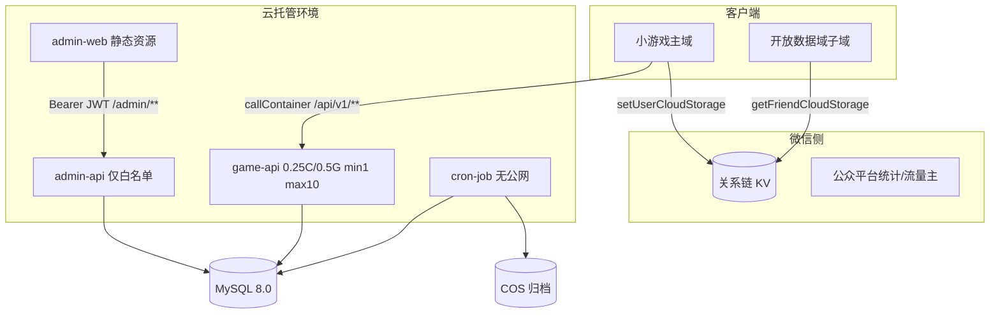

**边界约束**：

| 约束 | 原因 |
|---|---|
| 子域无任何 `callContainer` | 平台限制，且避免关系链数据外传（合规） |
| admin-api 不接 callContainer | 防止客户端探测后台接口；仅域名 + IP 白名单 |
| cron-job 不暴露公网 | 只被云托管定时触发器调用 |
| 所有写操作必须经服务端 | 客户端不直连数据库 |

---

## 3. 接口调用关系总览

### 3.1 调用图

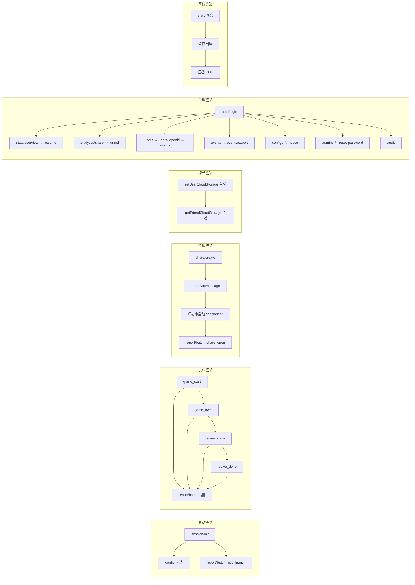

### 3.2 调用矩阵（谁调谁）

| 调用方 | 被调方 | 接口/动作 | 触发时机 | 同步性 |
|---|---|---|---|---|
| 主域 | game-api | `/session/init` | 冷/热启动 | 同步（阻塞首屏） |
| 主域 | game-api | `/user/profile` | 用户授权后 | 同步 |
| 主域 | game-api | `/share/create` | 点击分享 | 同步（需 sid 拼 path） |
| 主域 | game-api | `/report/batch` | 攒批满 10 条 / `onHide` | 异步（不阻塞玩法） |
| 主域 | game-api | `/config` | 切前台、强更检查 | 异步 |
| 主域 | KV | `setUserCloudStorage` | 对局结束、每日首开 | 异步 |
| 子域 | KV | `getFriendCloudStorage` | 打开好友榜 Tab | 同步（本地） |
| admin-web | admin-api | 20 个 `/admin/**` | 用户操作 | 同步 |
| cron-job | MySQL/COS | 聚合/回填/归档 | 每日 02:00 / 03:00 / 03:30 | 离线 |
| game-api | MySQL | 读写 | 每次请求 | 同步 |
| admin-api | MySQL | 读写 | 每次请求 | 同步 |

---

## 4. 小游戏端业务流程时序

### 4.1 启动与会话初始化

**前置**：小游戏已 `wx.cloud.init({env})`。
**涉及接口**：`POST /api/v1/session/init`、可选 `GET /api/v1/config`、`POST /api/v1/report/batch`（`app_launch`）。
**涉及表**：`user`（UPSERT、`first_sid`）、`game_config`（SELECT）、`event_log`（INSERT）。

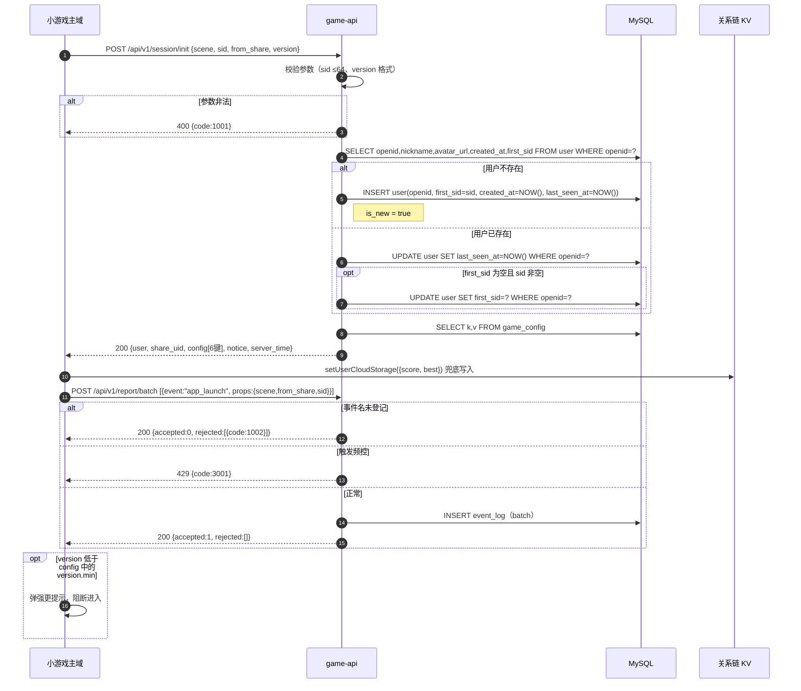

**异常分支表**

| 分支 | 触发条件 | 服务端行为 | 客户端行为 |
|---|---|---|---|
| E1 参数非法 | sid 超长 / version 非 `x.y.z` | 返回 1001，不写库 | 以空参数重试 1 次 |
| E2 数据库不可用 | 连接失败/超时 3s | 返回 5000 | 走本地缓存配置，允许进入单机玩法，稍后重试 |
| E3 频控 | >60 次/分钟 | 429 + 3001 | 指数退避，最多 3 次 |
| E4 上报失败 | `report/batch` 超时 | — | 队列回填，`onHide` 再 flush |

**关键点**：`session/init` 是唯一阻塞首屏的接口，P95 目标 <300ms；`game_config` 一次全量下发，避免二次请求。

---

### 4.2 用户资料更新

**涉及接口**：`PUT /api/v1/user/profile`。**涉及表**：`user`（UPDATE）。

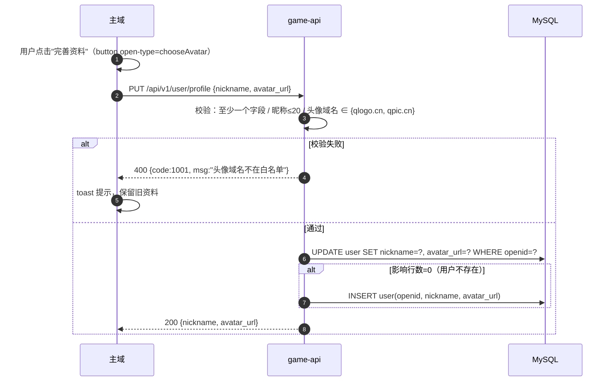

**异常分支**：1001（校验失败，不重试）、5000（重试 1 次）、越权写他人（不存在该入参，openid 只来自请求头）。

---

### 4.3 分享创建与回流归因

**涉及接口**：`POST /api/v1/share/create` → 客户端 `wx.shareAppMessage` → 好友 `POST /api/v1/session/init` + `POST /api/v1/report/batch`（`share_open`）。
**涉及表**：`game_config`（读 `share.title`）、`user`（写 `first_sid`）、`event_log`（`share_open`）、`share_attribution`（UPSERT）。

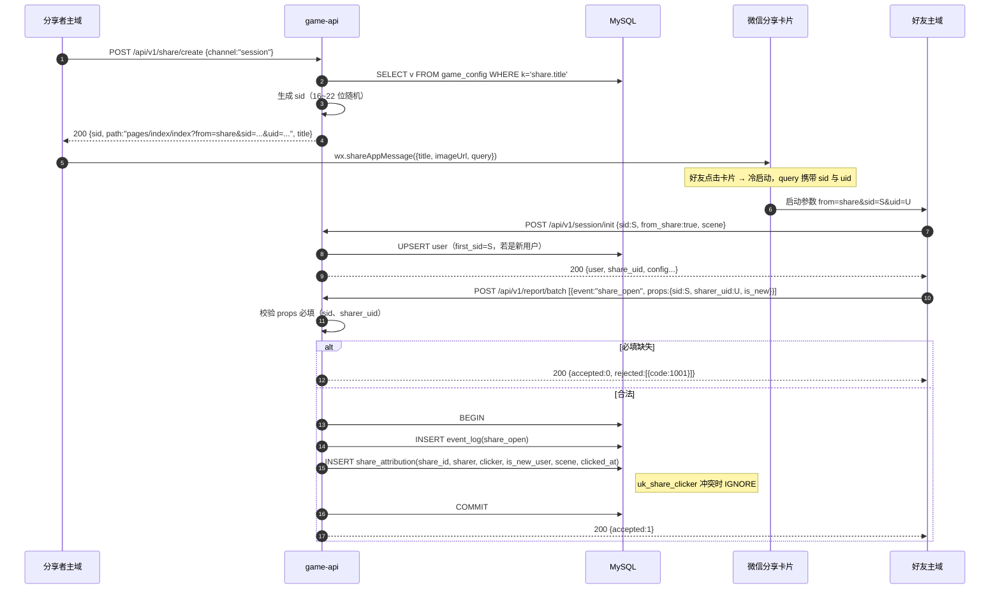

**异常分支表**

| 分支 | 条件 | 行为 |
|---|---|---|
| E1 sid 伪造 | `sid` 未在本服务生成 | MVP 不校验（无 sid 表），仅记录；加固阶段改为 HMAC 校验 |
| E2 uid 伪造 | `uid` 不存在于 `user` | 仍写归因但 `sharer_openid` 标为可疑（按「不在 user 表」判断，落 `is_suspect` 逻辑留待加固），不进 Top 分享者统计 |
| E3 重复点击 | 同 `(sid, clicker)` 二次上报 | 唯一键冲突 → 忽略归因，`event_log` 仍记一条（用于点击量统计） |
| E4 分享被取消 | 用户关掉分享面板 | 不产生 `share_create`，无归因，属正常流失 |

**归因口径提醒**：`share_cnt`（分享次数）来自 `event_log.share_create`；`click_back`（回流）来自 `share_attribution` 去重行数，两者不可互相推导。

---

### 4.4 单局玩法与埋点上报

**涉及接口**：`POST /api/v1/report/batch`（多次攒批）。
**涉及表**：`event_log`（INSERT）、`user`（`app_launch` 时更新 `last_seen_at`）。

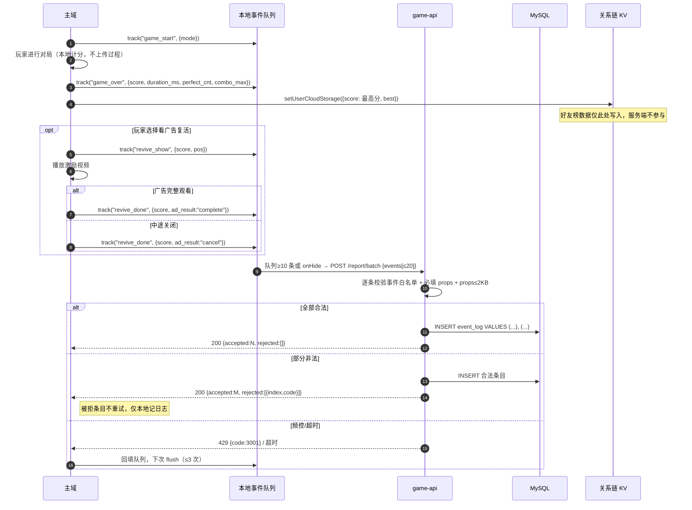

**异常分支**：1002 事件名未登记（丢弃）、1003 props 超限（客户端截断后下次重试）、3001 频控（退避）、5000（重试 1 次）、网络中断（回填，`onHide` 兜底）。

**设计要点**：
- 埋点永远不阻塞玩法；队列上限 200 条，超出丢最旧
- `game_over` 必带 `score` 与 `duration_ms`，是分数分布与难度评估的唯一来源
- 服务端**不做分数校验**（MVP），因此 `/report/batch` 的报告值不具权威性，仅用于统计

---

### 4.5 好友榜展示（双域，无 HTTP 调用）

**涉及接口**：无（微信平台能力）。
**涉及存储**：关系链 KV（`score`、`best`）。

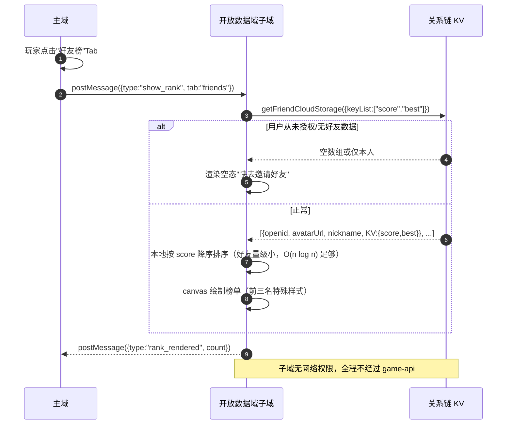

**异常分支**：KV 读取失败（微信侧异常）→ 子域渲染重试按钮；无好友 → 空态 + 分享引导；本人未写分数 → 显示"暂无成绩，去挑战"。

**合规约束**：子域拿到的 `openid`/昵称/头像禁止通过 `postMessage` 传给主域再上传，仅用于本地渲染。

---

## 5. 管理端业务流程时序

### 5.1 登录、失败锁定与登出

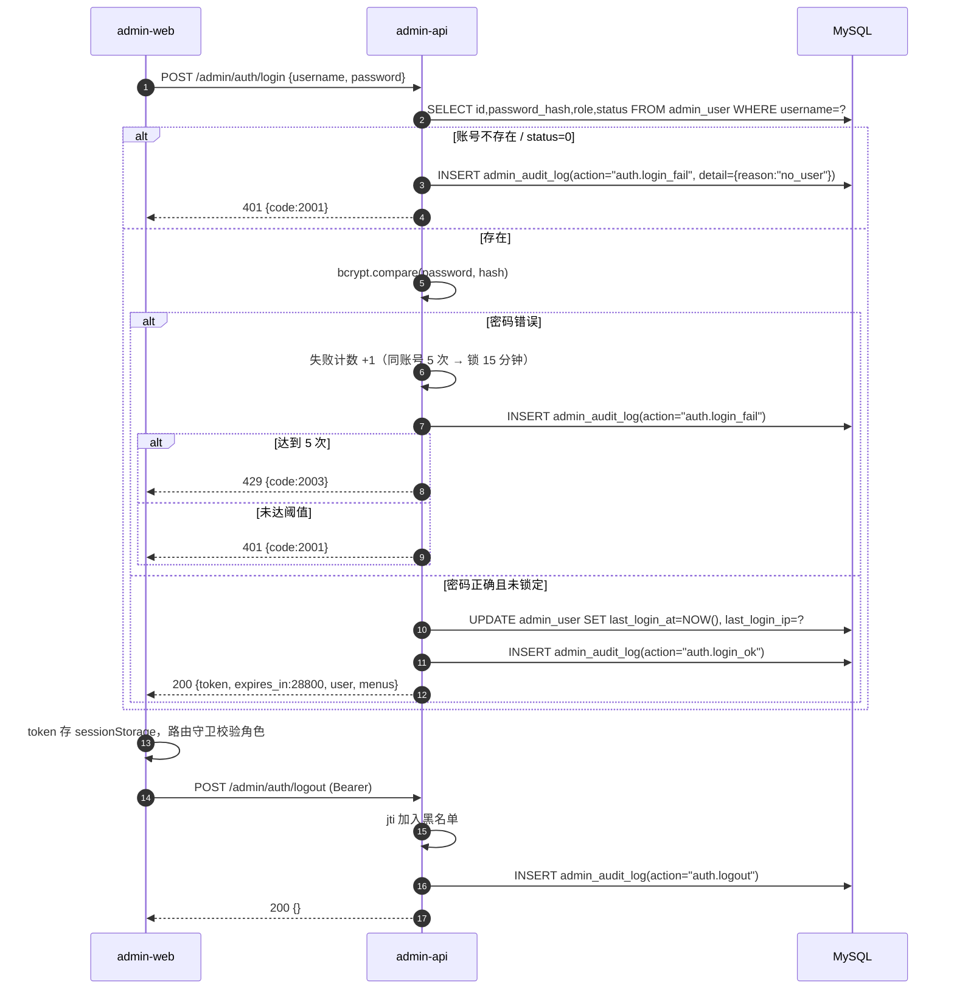

**异常分支**：token 过期 → 任意接口 401/2001 → 前端跳登录；角色不足 → 403/2002（前端菜单隐藏不作为权限依据）。

---

### 5.2 看板：概览与实时

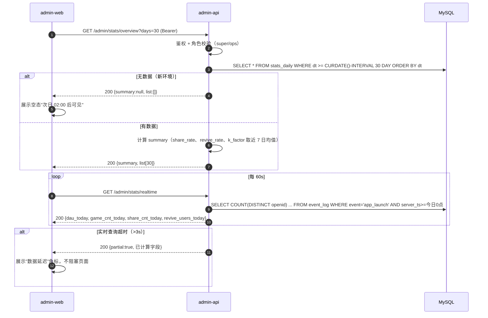

**异常分支**：days 非法（>90 或 ≤0）→ 1001；`event_log` 全表扫描风险 → 强制时间下界 + `idx_event_time`；ops 无看板权限 → 2002。

---

### 5.3 分析与漏斗

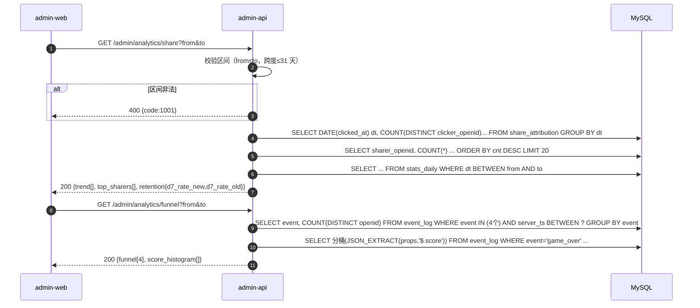

**异常分支**：漏斗中间步骤缺失（如 `revive_show` 为 0）→ 返回 0 并标注 `insufficient_data`；跨度超 31 天 → 1001（防止拖垮库）。

---

### 5.4 用户查询与事件时间线

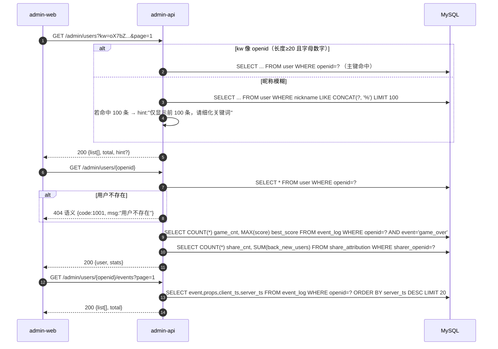

**异常分支**：昵称模糊查询被滥用 → 限 100 条 + 频控；`openid` 未 URL 编码导致查不到 → 前端 `encodeURIComponent`；事件时间线跨 90 天以上无数据（已归档）→ 提示"明细已归档，见 COS"。

---

### 5.5 埋点明细与导出

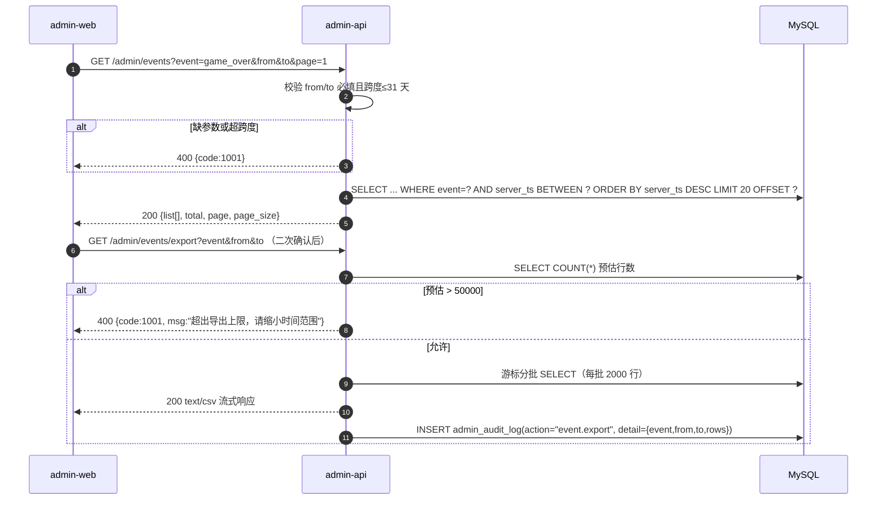

**异常分支**：导出中途连接断开 → 服务端停止游标，不落临时文件（流式，无残留）；导出被审计记录（含筛选条件与行数）。

---

### 5.6 配置中心与公告

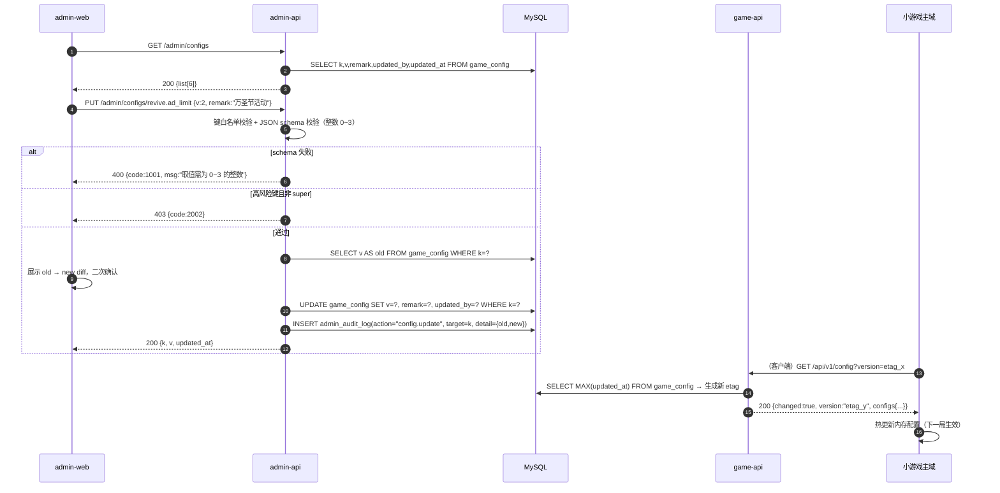

**异常分支**：配置写入后客户端未生效 → 客户端 5 分钟缓存 / 切前台强制刷新；误配高风险值 → 审计可回滚（按 `detail.old` 手工回写）；公告为空串 → 客户端不展示。

**公告流程（与配置同构，不单独画图）**：`GET /admin/notice` 读取 `game_config` 的 `notice.text` 与 `notice.enabled` 两个键；`PUT /admin/notice` 在同一事务内写两个键并落一条审计（action=`notice.update`）；客户端仍通过 `/api/v1/config` 拉取生效，链路同上图后半段。

---

### 5.7 管理员管理与密码重置

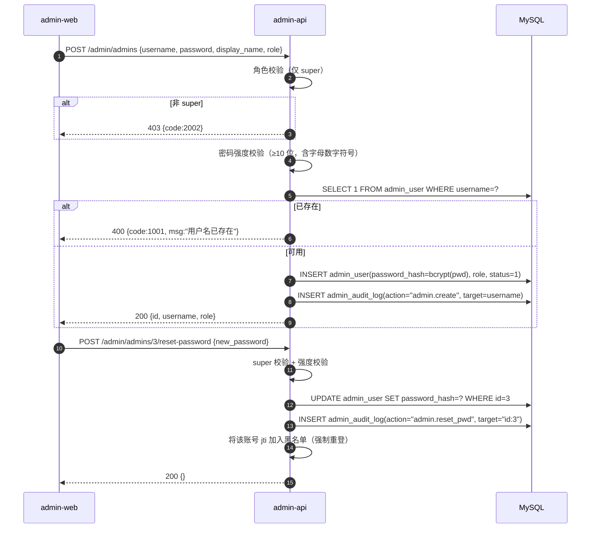

**异常分支**：停用账号（`status=0`）仍持有旧 token → 每次鉴权校验 `status`，返回 2001；不能停用自己 → 1001（防锁死）。

---

### 5.8 审计查询

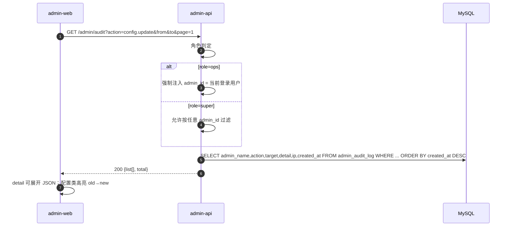

**异常分支**：默认区间近 7 天（未传 from/to）；跨度 >90 天 → 1001；`detail` 含敏感信息 → 仅展示白名单字段。

---

## 6. 后台任务时序

### 6.1 每日指标聚合（02:00）

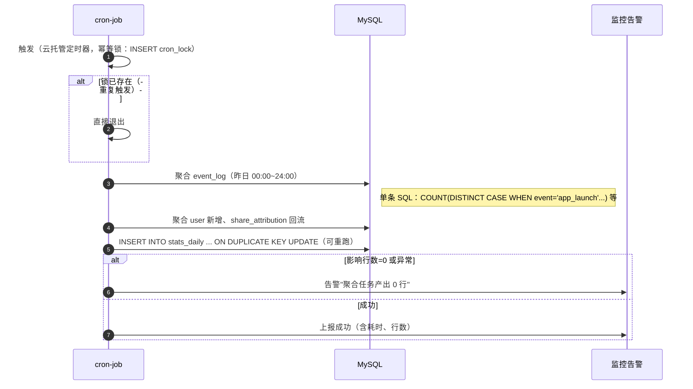

### 6.2 7 日留存回填（03:00）

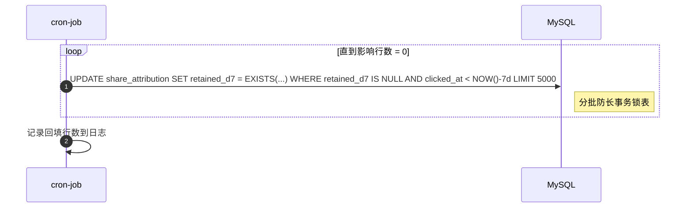

### 6.3 冷数据归档（03:30）

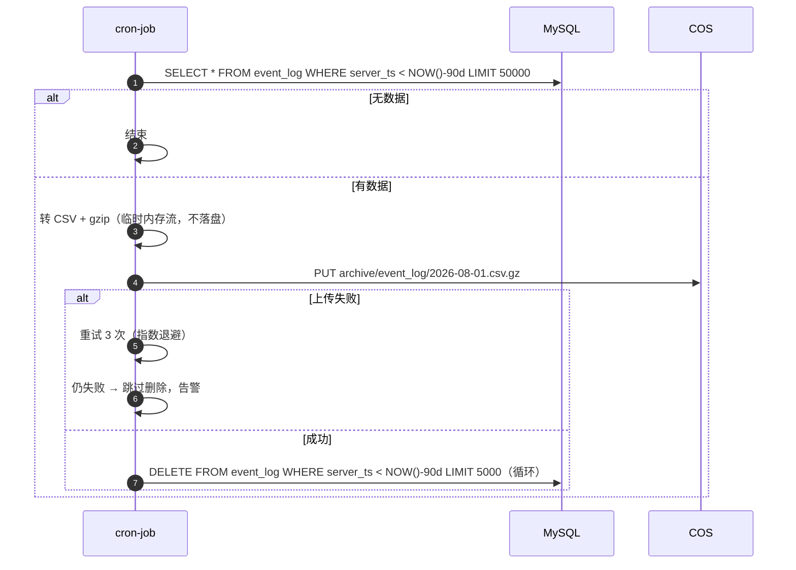

**设计要点**：先归档成功再删除，绝不"先删后传"；删除分批（5000/批）避免大事务与主从延迟。

---

## 7. 预留接口时序（未启用）

> 依据《加固方案》v0.1，MVP 不实现，以下为启用时的目标流程，用于校验协议完整性。

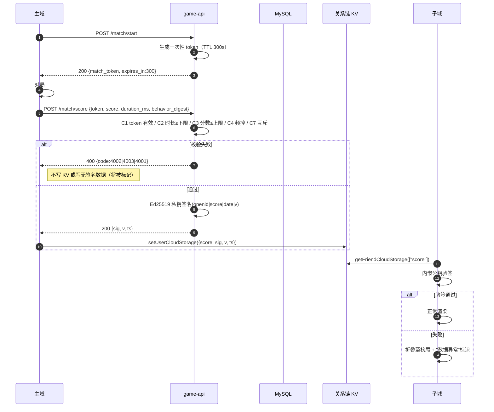

---

## 8. 横切设计

### 8.1 事务边界

| 流程 | 事务范围 | 说明 |
|---|---|---|
| `/report/batch` | `event_log` 批量 INSERT + `share_attribution` UPSERT 同一事务 | 保证"点击率"与"归因"数据一致；单批 ≤20 条，事务极短 |
| `/session/init` | `user` UPSERT + `first_sid` 更新同一事务 | `game_config` 读取放在事务外（只读） |
| `/user/profile` | 单条 UPDATE，自动提交 | — |
| `/admin/configs/{k}` | UPDATE + 审计 INSERT 同一事务 | 保证"改了必有据" |
| cron 聚合 | 单条 `INSERT ... ON DUPLICATE KEY UPDATE` | 天然幂等，可重跑 |
| cron 归档 | 不强求事务（先传后删） | 失败可重试，不产生数据丢失 |
| 管理员登录 | UPDATE 登录信息 + 审计 INSERT 同一事务 | 失败计数用独立 UPDATE，避免锁竞争 |

### 8.2 超时与重试

| 调用 | 超时 | 重试 | 退避 |
|---|---|---|---|
| 主域 → game-api（首屏接口） | 3s | 1 次 | 立即 |
| 主域 → game-api（上报） | 5s | 3 次 | 1s / 2s / 4s |
| game-api → MySQL | 2s（查询）/ 3s（写入） | 0（由上游重试） | — |
| admin-api → MySQL | 5s | 0 | — |
| cron → COS | 30s | 3 次 | 10s / 30s / 60s |

### 8.3 幂等策略

| 接口/任务 | 幂等方式 |
|---|---|
| `/report/batch` | 无事件级幂等（已知取舍），统计用去重口径；被拒条目客户端不重试 |
| `/share/create` | 每次生成新 sid，天然无幂等需求（限流防刷） |
| `/session/init` | 天然幂等（UPSERT + 更新时间） |
| `/admin/configs/{k}` | 覆盖写，天然幂等 |
| cron 聚合 | `ON DUPLICATE KEY UPDATE` |
| 登录锁定 | 计数窗口 15 分钟，重复失败累加 |

### 8.4 限流

| 维度 | 阈值 | 超限响应 |
|---|---|---|
| openid 维度 | 60 次/分钟 | 3001 |
| IP 维度（admin） | 120 次/分钟 | 3001 |
| 导出接口 | 3 次/小时/账号 | 3001 |
| 登录 | 5 次失败锁 15 分钟 | 2003 |

### 8.5 日志与链路

- 每请求生成 `trace_id`（UUID 前 8 位），写入响应、访问日志与错误日志
- 结构化日志字段：`trace_id, openid(脱敏), path, method, code, cost_ms, err`
- 服务端**不记录** `props` 原文中的昵称等 User 内容；`openid` 在日志中保留前 6 位 + `***`
- 慢查询阈值 200ms，超阈值打 `slow_sql` 标记

### 8.6 异常处理分级

| 级别 | 场景 | 处理 |
|---|---|---|
| L1 参数类 | 1001/1002/1003 | 直接返回，不告警，不重试 |
| L2 业务类 | 2001/2002/2003 | 返回 + 记审计；2003 告警（可能被爆破） |
| L3 容量类 | 3001、实例数 > 8 | 返回 429 + 告警（可能是裂变或被刷） |
| L4 系统类 | 5000、DB 超时 | 5xx 率 > 1% 告警，自动重启/扩容 |

---

## 9. 接口—表—模块映射矩阵

| 接口 | game-api | admin-api | cron | 读表 | 写表 |
|---|---|---|---|---|---|
| POST /api/v1/session/init | ● | | | user, game_config | user |
| PUT /api/v1/user/profile | ● | | | | user |
| POST /api/v1/share/create | ● | | | game_config | — |
| POST /api/v1/report/batch | ● | | | — | event_log, share_attribution, user |
| GET /api/v1/config | ● | | | game_config | — |
| POST /admin/auth/login | | ● | | admin_user | admin_user, admin_audit_log |
| POST /admin/auth/logout | | ● | | | admin_audit_log |
| GET /admin/stats/overview | | ● | | stats_daily | — |
| GET /admin/stats/realtime | | ● | | event_log | — |
| GET /admin/analytics/share | | ● | | share_attribution, stats_daily | — |
| GET /admin/analytics/funnel | | ● | | event_log | — |
| GET /admin/users | | ● | | user | — |
| GET /admin/users/{openid} | | ● | | user, event_log, share_attribution | — |
| GET /admin/users/{openid}/events | | ● | | event_log | — |
| GET /admin/events | | ● | | event_log | — |
| GET /admin/events/export | | ● | | event_log | admin_audit_log |
| GET /admin/configs | | ● | | game_config | — |
| PUT /admin/configs/{k} | | ● | | game_config | game_config, admin_audit_log |
| GET /admin/notice | | ● | | game_config | — |
| PUT /admin/notice | | ● | | game_config | game_config, admin_audit_log |
| GET /admin/admins | | ● | | admin_user | — |
| POST /admin/admins | | ● | | admin_user | admin_user, admin_audit_log |
| PUT /admin/admins/{id} | | ● | | | admin_user, admin_audit_log |
| POST /admin/admins/{id}/reset-password | | ● | | admin_user | admin_user, admin_audit_log |
| GET /admin/audit | | ● | | admin_audit_log | — |
| （定时）日聚合 | | | ● | event_log, user, share_attribution | stats_daily |
| （定时）留存回填 | | | ● | event_log | share_attribution |
| （定时）归档 | | | ● | event_log | event_log（DELETE）, COS |

---

## 10. 待确认事项

| # | 事项 | 影响范围 | 建议 |
|---|---|---|---|
| 1 | `share_uid` 是否允许下发明文 openid 到客户端 | 分享归因、合规 | MVP 接受（仅用于拼 path）；加固阶段改 HMAC sid |
| 2 | 分享被拒归因（`uid` 不在 user 表）是否计入 Top 分享者 | 分析准确性 | 建议排除，标注可疑 |
| 3 | 实时看板轮询频率 60s 是否足够 | 运营体验 | 活动期可降到 30s，注意 `event_log` 压力 |
| 4 | `event_log` 90 天保留是否满足运营回溯 | 数据可用性 | 如需全年对比，改为 180 天并提前评估容量 |
| 5 | 强更版本号比较规则（语义化版本 vs 数字） | 客户端兼容 | 建议语义化 `x.y.z` 严格比较 |
| 6 | cron 任务是否需在 Admin 提供手动重跑入口 | 运维效率 | 建议 P2 增加"重跑昨日聚合"按钮，需 super 权限 |
