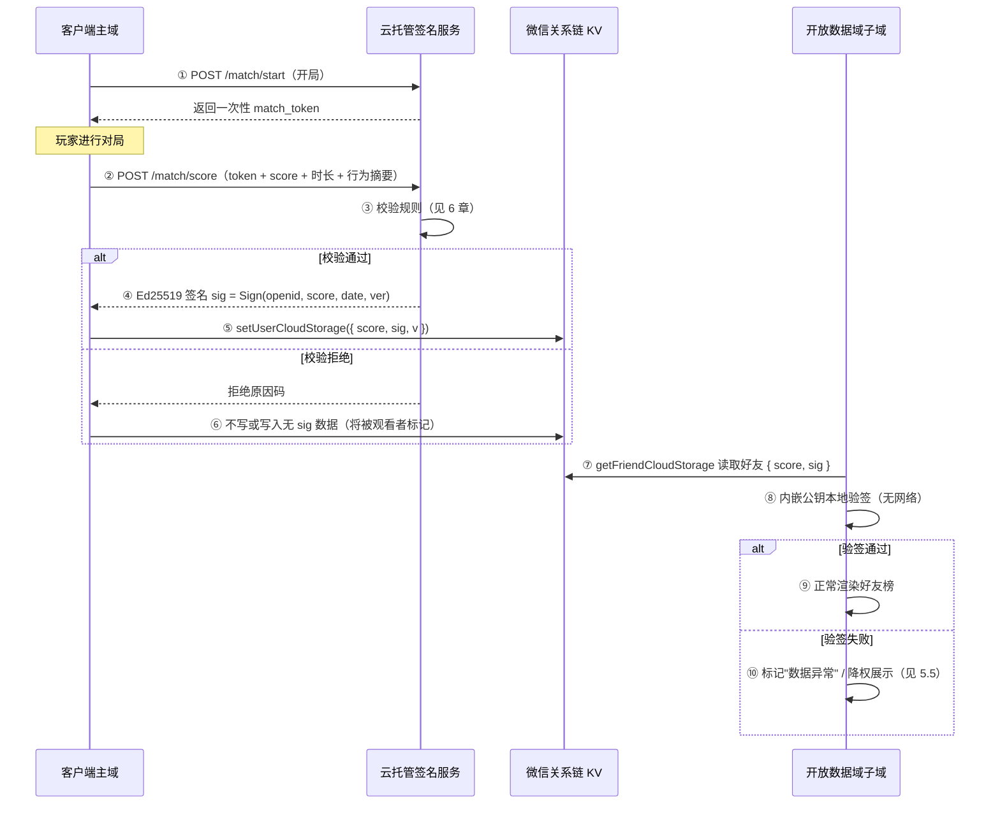

# 好友排行榜真实性功能加固方案

> 文档代号：加固方案 ｜ 版本：v0.1（草案）｜ 日期：2026-10-31
> 关联文档：《跳一跳类小游戏后台技术方案》v1.1（架构与模块背景见该文档）
> 当前状态：**MVP 阶段延后实现**（MVP 验证目标为变现模型，见第 2.4 节决策记录），本方案为启动实现时的执行蓝图
>
> 阅读约定：正文中标注 **【待补充】** 的章节为后期升级预留位，实现或设计明确后回填内容并递增版本号。

---

## 1. 背景与问题定义

### 1.1 背景

- 本游戏**好友排行榜是唯一榜单**，成绩由客户端在对局结束后直写微信关系链 KV（`wx.setUserCloudStorage`），服务端不参与成绩校验与榜单计算
- 该机制下存在刷分风险：作弊者可通过 hook 游戏逻辑、伪造 API 写入、破解包体等方式，**不玩游戏即可把任意分数写上好友榜**，导致榜单失真
- 微信不提供任何服务端写/读关系链 KV 的接口（读权限仅在开放数据域），服务端既无法在写入前校验，也无法事后清除被篡改的数据

### 1.2 问题定义

在不改变"好友榜走开放数据域"这一产品形态的前提下，让**伪造分数无法以有效成绩身份出现在好友的好友榜中**，并让绕过机制写入的脏数据**可识别、可降权**。

---

## 2. 目标与决策记录

### 2.1 目标

| # | 目标 | 衡量方式 |
|---|---|---|
| G1 | 伪造/篡改分数拿不到合法签名，无法通过观看者侧验签 | 验签失败率与作弊举报数 |
| G2 | 脏数据在好友榜上可见地失效（标记/降权），形成社交威慑 | 脏数据展示策略上线率 |
| G3 | 合法玩家体验无感知（签名流程对正常用户透明，无额外等待） | 对局结算耗时 P95 |
| G4 | 方案可平滑升级（密钥轮换、规则加严、旧版本兼容） | 版本迁移无断榜事故 |

### 2.2 非目标（明确不做）

- 不阻止作弊者篡改自己设备的单机体验（纯客户端游戏的固有属性）
- 不承诺清除已写入的关系链脏 KV（微信无服务端写接口，只能等覆盖）
- 不自建好友榜、不将好友关系数据上传自建服务端（合规红线）
- MVP 阶段不追求根除"脚本玩得像真人"的真实分数自动化（见 11.3 治理预留）

### 2.3 信任模型

- **成绩的可信判定权在服务端**：只有服务端校验通过的成绩才获得签名
- **验证执行在观看者的官方客户端**：开放数据域子域内嵌公钥本地验签。作弊者只能篡改自己设备上的程序，无法影响好友设备上的验签过程——这是本方案的结构性安全保障
- **签名算法选非对称（Ed25519）**：客户端只有公钥，即使包体被逆向也只能"验"不能"签"

### 2.4 MVP 决策记录（2026-10-31）

- 结论：**延后实现**。MVP 仅做轻量规则（上报分数上限 + 限流 + 幂等 + 分数分布监控），KV 结构预留 `sig` 字段位
- 理由：MVP 验证目标为变现模型（广告 ARPDAU），指标均为用户个体维度，与榜单真实性正交；签名方案约 2~4 人日 + 3~7 天联调，延后可换取更快的验证周期
- **启动触发条件（满足任一立即启动本方案）**：
  - [ ] 分数分布监控出现异常（不可能分数 / 突刺占比 > 1%）
  - [ ] 计划投入分享裂变推广或买量
  - [ ] 榜单开始关联奖励或竞争性活动
- 启动时的历史数据兼容策略见 5.6

---

## 3. 适用范围

| 维度 | 说明 |
|---|---|
| 适用的数据 | 好友榜成绩 KV（`score` / `best` 两个 key）的写入与展示 |
| 适用的链路 | 客户端对局结算 → 服务端校验签发 → KV 写入 → 子域读取验签展示 |
| 适用的角色 | 全部活跃玩家；签名服务覆盖所有提交成绩的用户 |
| 不适用 | 单机玩法表现、广告逻辑、分享链路、运营埋点（这些由各自模块治理） |
| 环境范围 | prod / test 双环境，test 环境使用独立密钥对 |

---

## 4. 总体设计

### 4.1 方案概览



### 4.2 数据格式约定

关系链 KV value 统一为 JSON 字符串（单 value ≤ 1024 字节，余量充足）：

```json
{
  "score": 1234,
  "sig": "base64(Ed25519签名)",
  "v": 1,
  "ts": 1793487600
}
```

- `score`：当日最高分（另一 key `best` 结构相同，存历史最高）
- `sig`：服务端签名，内容为 `openid | score | 日期(yyyyMMdd) | 方案版本号 v`
- `v`：方案版本号，用于密钥轮换与多版本兼容（见 11.5）
- `ts`：签名时刻时间戳，供子域做基础时效检查

---

## 5. 关键实现要点

### 5.1 对局会话（match/start）

- 开局时客户端请求服务端创建对局会话，签发**一次性** `match_token`（TTL 5 分钟内须提交，提交后即作废）
- 服务端记录开局时间，作为时长校验基准
- 同一 openid 并发开局进行互斥（Redis `SETNX` 或 MySQL 唯一约束）

### 5.2 成绩提交与签名签发（match/score）

- 客户端提交 `{ token, score, duration_ms, 行为摘要 }`
- 服务端按第 6 章校验规则逐条校验，全部通过后用**服务端私钥**签发 Ed25519 签名
- 校验拒绝时返回原因码（客户端据此决定是否写入无签名数据）

### 5.3 签名服务

- 算法：Ed25519（验签快、公钥短、无长度 padding 问题）
- 签名内容：`openid | score | yyyyMMdd | v`，序列化方式固定并写入版本号，杜绝字段歧义
- 私钥仅存于云托管服务端环境变量/密钥管理，**永不进客户端代码、永不进日志**
- 公钥内嵌于子域代码包（可硬编码，泄露无风险）

### 5.4 KV 写入约定（客户端主域）

- 仅在拿到签名后写入 `{ score, sig, v, ts }`；被拒绝时**不写入**（或按 5.6 兼容策略写入无 sig 数据）
- 每日首次打开执行兜底写入（用最近一次合法签名），保证榜单数据不过期失活
- 写入失败重试 ≤ 3 次，失败不阻塞玩家继续游戏

### 5.5 子域公钥验签（开放数据域）

- 子域读取好友 KV 后，对每条 `{ openid, score, date, v }` 用内嵌公钥验签
- **严格校验全部字段**：openid 与 KV 归属一致、日期为当日（跨日旧分允许但标记时效）、版本号在支持列表内
- 验签失败的展示策略（产品决策，二选一，默认前者）：
  - 方案 A：折叠至榜尾并显示"数据异常"标识（保留社交威慑）
  - 方案 B：直接隐藏该条目
- 子域包体注意：Ed25519 验签库需精简（纯 JS 实现约数 KB），纳入首包/子包体积预算

### 5.6 兼容与迁移策略（上线切换时执行）

- 阶段 1（切签名的首个版本起）：客户端开始写 `{ score, sig }`；子域对**无 sig 的旧数据按"旧版本合法数据"正常展示**，并打迁移期标记
- 阶段 2（迁移期 2~4 周后）：子域版本升级，无 sig 数据改为"数据异常"展示
- 版本判断依据 KV 中 `v` 字段，保证新旧客户端混存期间互不影响

---

## 6. 校验机制汇总（服务端签发前逐条执行）

| # | 校验点 | 规则 | 失败处理 |
|---|---|---|---|
| C1 | token 有效性 | 一次性、未过期、归属 openid 匹配 | 拒绝，记 audit |
| C2 | 对局时长 | server 实测时长 ≥ 关卡配置的理论最短时间 | 拒绝 |
| C3 | 分数上限 | score ≤ min(静态上限， 当日 Top1 × 1.5 动态上限) | 拒绝 |
| C4 | 频控 | 单 openid 签名请求 ≤ N 次/分钟、M 次/小时 | 限流拒绝 |
| C5 | 幂等 | 同 token 重复提交直接返回首次结果 | 幂等返回 |
| C6 | 行为摘要格式 | 摘要字段齐全、格式合法（内容校验为 11.1 预留升级位） | 拒绝 |
| C7 | 并发互斥 | 同 openid 无并发提交（KV 锁） | 拒绝 |
| C8 | 账号状态 | 新号/可疑名单账号适用降档规则（见 11.3，MVP 阶段仅记录） | 记录并放行/降档 |

> MVP 阶段先行落地的轻量版 = C3 分数上限 + C4 频控 + C5 幂等（挂在 report/batch 上），不含签名链路。

---

## 7. 密钥与配置管理

- 密钥对：prod 与 test 各一套；私钥存云托管环境变量（后续可迁腾讯云 KMS，**【待补充】** KMS 接入细节）
- 公钥分发：内嵌子域代码包；**支持同时内置多把公钥**（当前 + 上一代），为轮换预留
- 密钥轮换：见 11.5（预留章节，MVP 不实现）

---

## 8. 部署与变更流程

- 签名服务为云托管独立服务（或 game-api 内独立路由组），不暴露公网
- 发布顺序：服务端（先）→ 客户端写签名（后）→ 子域验签加严（最后），三步节奏与 5.6 迁移策略对齐
- 回滚策略：子域验签策略受远程开关控制（game_config 下发），异常时可临时退回"全部正常展示"

---

## 9. 监控与告警

| 监控项 | 途径 | 告警阈值（初版） |
|---|---|---|
| 全量分数分布 | report/batch 事件 → 自定义分析/自建看板 | 突刺占比 > 1% |
| 签名拒绝率 | 服务端结构化日志 | > 5% 且持续 1h |
| 验签失败率 | 子域上报统计事件（经主域聚合） | > 2% |
| token 申请/提交比 | 服务端日志 | 异常偏低（说明大量开局未结算） |

---

## 10. 残余风险（如实声明）

1. 本地单机体验被篡改无法阻止（不影响他人）
2. 脏 KV 写入无法远程清除，只能标记/等待下次合法写入覆盖
3. "玩得像真人的脚本"产出真实高分无法根除（持续对抗，见 11.3）
4. 小号污染社交关系链只能压制（门槛 + 举报），无法杜绝
5. 子域验签逻辑若存在实现缺陷可能被绕过（需代码审计与混淆）

---

## 11. 后续升级预留章节（**【待补充】**总览）

> 以下章节为升级扩展预留位，每节启动时回填设计并递增文档版本。

### 11.1 行为摘要与操作一致性校验 **【待补充】**
- 待明确：行为摘要的具体字段（操作序列、输入时间间隔分布）、与得分路径的一致性规则、采样率与性能预算
- 对应风险：第 1 条"Hook 游戏逻辑改分"的自动化变体

### 11.2 设备指纹与账号关联图谱 **【待补充】**
- 待明确：可用设备特征维度（在微信生态内的限制下）、单设备多账号识别规则、关联封控阈值
- 对应风险：破解客户端作为脚本载体、批量小号

### 11.3 小号治理与门槛策略 **【待补充】**
- 待明确：新号签名降档的具体参数（注册时长门槛、每日写入次数上限）、账号等级/活跃度与榜单展示权限的关系
- 对应风险：第 4 条"脚本批量小号"（本方案唯一无法根治的项，持续对抗）

### 11.4 举报与人工审核流程 **【待补充】**
- 待明确：好友举报入口的产品形态、举报数据落表、审核工作流（Admin 模块扩展）、误判申诉
- 对应风险：机器规则漏判的兜底

### 11.5 密钥轮换与多版本签名 **【待补充】**
- 待明确：轮换周期、双公钥并行期时长、旧签名失效策略、KMS 接入
- 依赖：KV 中 `v` 字段与子域多公钥支持（5.5 已预留）

### 11.6 服务端影子榜与离群检测 **【待补充】**
- 待明确：基于上报事件的影子排行（不展示给玩家、仅供运营比对）、离群账号自动标记规则
- 价值：在不展示全服榜的前提下，保留一个运营侧的"真实性对照组"

### 11.7 与奖励/活动系统的联动 **【待补充】**
- 待明确：榜单关联奖励时的防刷加严清单（本方案升级为必选项的触发场景之一）、奖励发放以服务端数据为准的具体规则

---

## 附录 A：接口定义草案

| 方法 | 路径 | 请求 | 响应 |
|---|---|---|---|
| POST | /api/v1/match/start | —（身份取 X-WX-OPENID） | `{ match_token, expires_in }` |
| POST | /api/v1/match/score | `{ token, score, duration_ms, behavior_digest }` | 通过：`{ sig, v, ts }`；拒绝：`{ code, reason }` |

错误码约定：`4001 token 无效` / `4002 时长校验失败` / `4003 分数超限` / `4029 触发限流` / `4090 行为摘要非法`。

## 附录 B：与主方案的接口清单联动

本方案启用后，《跳一跳类小游戏后台技术方案》第 8 章"不设计的接口"中的 `match/start`、`match/score` 移出该清单，以**签名服务**身份回归接口清单（非计分用途，好友榜仍走开放数据域）。
