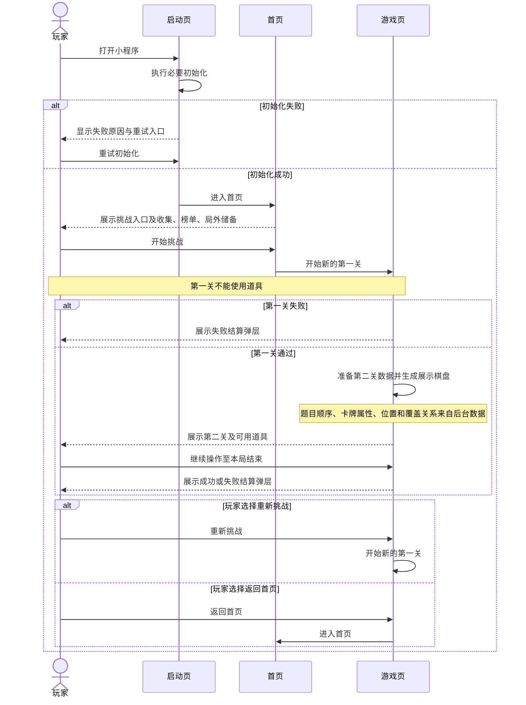
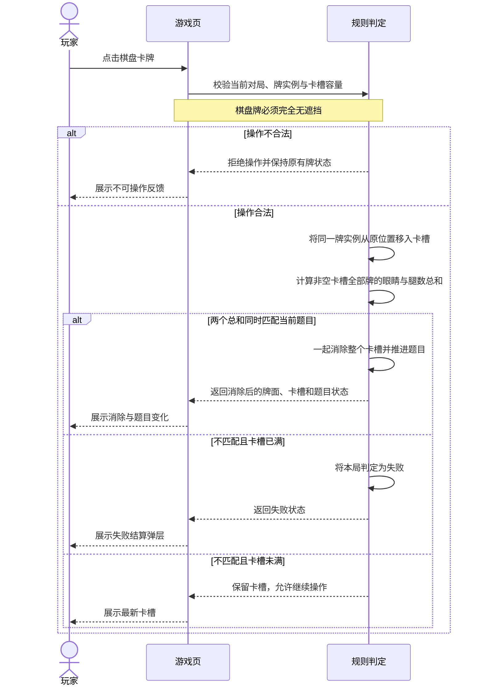
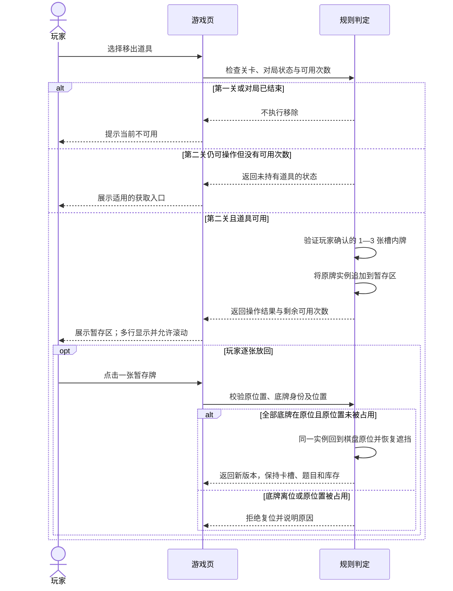
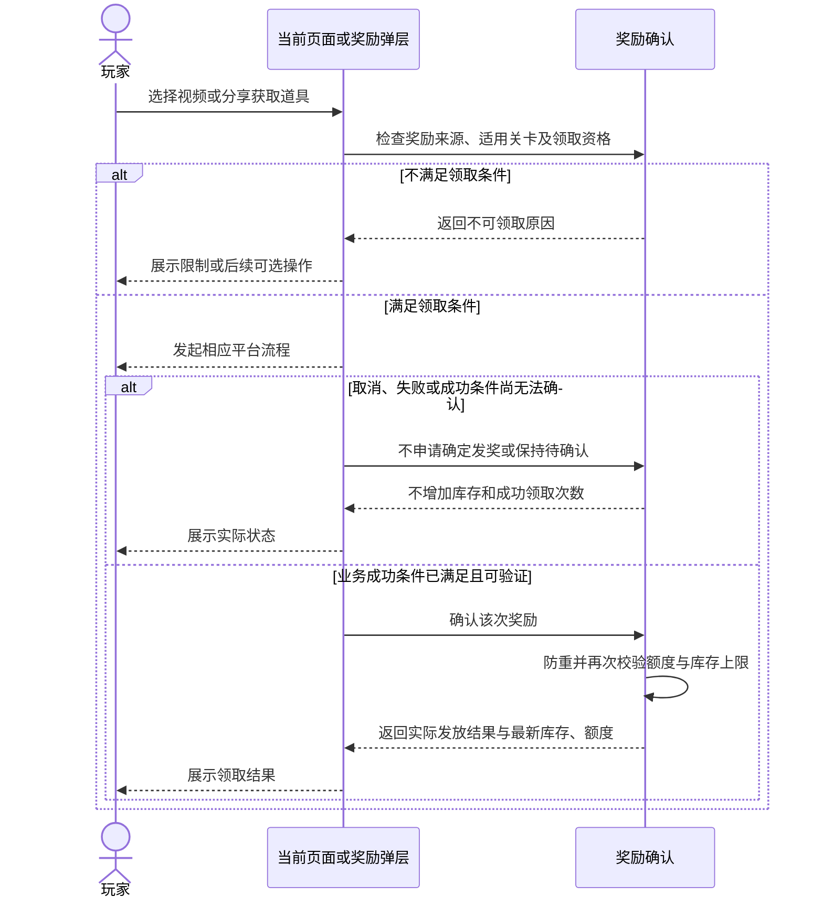
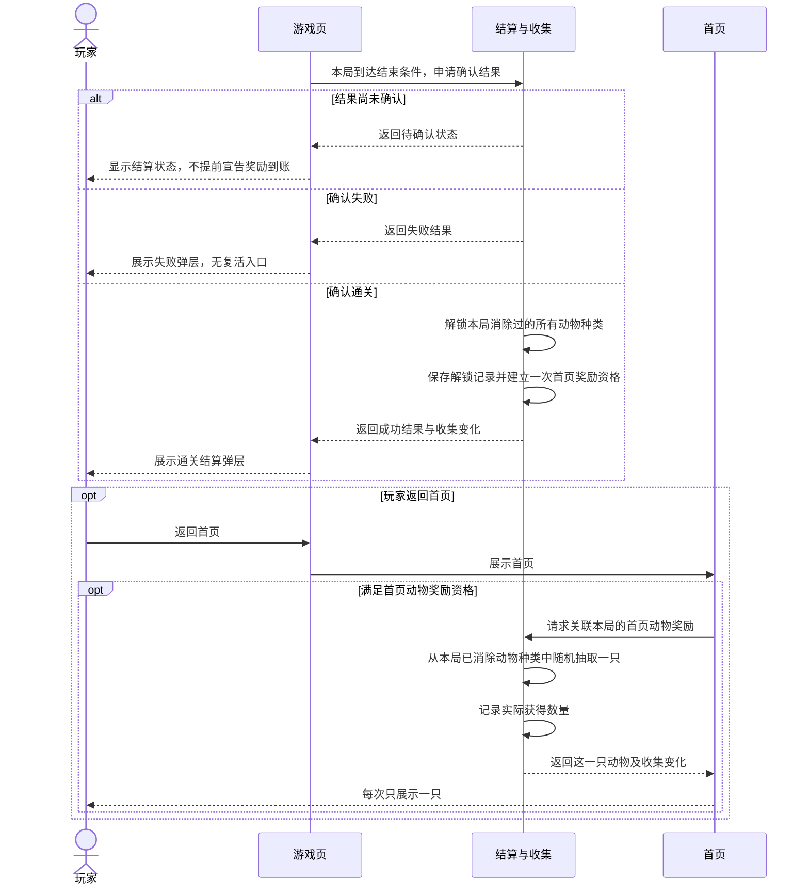

# 腿了个腿游戏需求

## 产品与范围

《腿了个腿》是微信动物卡牌求和消除游戏，微信小游戏客户端的工程名为 `eyes-and-legs`。仅有启动页、首页、游戏页三个页面；结算、分享、奖励和提示以弹层或页面区域承载，不增加独立页面。没有复活功能。

本文重新编写当前需求，不恢复归档文档。明确确认的规则与仍需细化的参数分开记录。当前代码包含可运行的 Cocos 客户端、本地两关预览和部分后端领域判定，正式对局、平台领奖及统计服务仍待接入。

## 页面与挑战流程

- 启动页完成必要初始化并进入首页，提供加载与失败反馈。
- 首页承载开始挑战、动物收集、榜单、分享和局外道具储备展示。
- 每次重新挑战必须先过第一关，再进入第二关。第一关为教学关，共 3 题、12 张牌，完成全部题目且消除全部牌后通过。第一关不能使用道具，进入第二关后才能使用。
- 第二关主要由后台提供题目与布局数据，前端生成并展示棋盘。
- 游戏成功或失败后进行本局结算；不存在通过复活延续失败对局的分支。

## 卡牌与消除

每张动物卡牌包含眼睛数与腿数。动物可以是卡通形象，允许多种眼睛与腿数组合，不能只按现实动物的固定属性设计。当前内容使用 24 种卡通动物，眼睛数为 1—6，腿数为 0、1、2、3、4、5、6、8；动物编号及属性表由关卡设计工具统一维护，客户端和后端校验保持一致。

玩家只可点击完全没有被其他牌覆盖的卡牌，将其放入卡槽。题目提供目标眼睛数和目标腿数。

- 必须整个卡槽中所有动物的眼睛总数与腿数总和同时等于当前题目，卡槽中的牌才一起消除。
- 不允许在卡槽中仅挑选部分牌匹配题目后消除。
- 卡槽未满且不匹配时继续操作，为玩家保留修改机会。
- 卡槽满且不匹配时直接失败；满槽但匹配时先按消除处理，不误判失败。

卡槽容量当前领域实现为 7，属于现有设计参数；如调整，判定、客户端和关卡生成须使用同一配置。

## 题目与布局

第二关固定 48 张牌、12 题，界面显示当前题和下一题。有效游戏时长以 4—6 分钟为设计目标，不包含广告播放和切后台停留；该目标仍需真人试玩验证。

布局允许按半格错位形成一盖二、一盖四和多盖一。每张牌占 2×2 个定位小格，小格只用于排布，点击和消除仍以完整牌为单位。初始上层只需至少一处与紧邻下层的实际重叠支撑，不要求四个小格都被托住；只有边缘相碰不算覆盖或支撑。

题目及顺序在开局时确定。生成时从最后一题的解法开始，自底向上反向铺牌。布局允许多个山峰与彼此分离的牌堆，不要求全部相连。

开局保证存在一条完整解法。玩家选用了其他合法组合，导致后续无法完成，可以作为挑战的一部分；不要求每条合法操作路径都有解。完全无遮挡的点击条件与参考解法必须一致。

## 道具与暂存区

第二关进行中可使用已获得的三种道具：

- **移出**：玩家从卡槽选 1—3 张牌，确认后按原入槽顺序追加到暂存区，并重新判定剩余非空卡槽。暂存区可多次追加，无固定张数上限，多行滚动，逐张免费复位到棋盘原位置。
- **纠错**：对局仍进行时，寻找可证明修复的历史题目起点，纠正组合并重放到原当前题。保留题序和题目进度，已消费库存及视频次数不回退。
- **重排**：保留卡槽、暂存区、剩余题目和牌属性，重新布置棋盘余牌，同时保护暂存牌原位置及底牌复位约束。先验证剩余关卡能完整消除，再生效。找不到方案或搜索达到上限时保留原状态与库存。

无效操作不消耗道具。同种道具优先消耗当局库存。每种局外储备最多 1 次，进入第二关后可用，未使用的储备保留到之后的挑战。

第二关通过激励视频领取道具。观看前选择道具，每次成功观看获得所选道具 1 次，三种合计每局最多成功获取 10 次，使用次数不另设每种 2 次的上限。局内不提供分享领道具。通关结算提供一次局外道具选择机会，储备已满的道具不可选，全部已满时提示玩家。第一关或第二关失败均不发放道具或动物奖励。

首页分享每天最多成功领取 3 次，以北京时间 00:00 为日界。只有微信小游戏提供可验证的分享成功证据时才开放领道具入口。失败、取消或无法确认时不增加库存和成功次数。首页和结算奖励共享同种局外储备上限，局外储备与局内视频额度分别计账。

## 动物收集与榜单

通关后解锁本局消除过的所有动物种类。解锁表示首次获得该种类，和累计获得次数分别记录。每次通关产生一次首页动物奖励资格，领取时从本局消除过的不同动物种类中等概率抽取一只，每次只展示一只。每次实际领取使该种类的获得数量加一，重复获得也累计。候选集合为空时不发奖并记录异常。

当周及历史榜单均按当周实际获得的动物数量降序排列，同数量按首次达到该数量的时间升序排列，展示前 100 名和玩家自己的排名。周期采用北京时间，从周一 00:00 至下周一 00:00（不含）。当前业务表只记录当周数量，历史数据进入归档表。跨周后新获得数量计入新周，上周数据在归档完成前仍按上周周期可查。

## 页面体验与交互反馈

### 启动与首页

- 启动页展示游戏品牌、动物与加载进度。乌龟动效随加载进度前进，初始化成功后自动进入首页。加载失败时保留错误提示和重试入口。页面底部预留正式发布所需的合规信息和适龄提示位置，具体内容按最终平台和发布资质核对。
- 首页以动物园广场为主场景，展示本周实际领取的动物及其日常动效。北京时间周一 00:00 切换广场展示周期，永久图鉴和累计获得记录继续保留。尚未领取动物时显示空状态和挑战入口。
- 图鉴以弹层展示已解锁动物的图标、名称和简短介绍，按图鉴编号排序。本周首次解锁标记为 NEW，跨周清除标记。无已解锁动物时显示收集引导。
- 榜单弹层区分本周与历史，标示前三名和自己的名次，支持滚动及加载、空榜、失败重试状态。

### 设置与弹层

- 首页和游戏页均提供设置。音乐与音效独立调节，调整即时生效并保存到本地，设为 0 时静音。提供问题反馈、联系客服及儿童隐私保护声明入口，具体接入能力按最终微信端验证。隐私说明支持滚动阅读。
- 游戏页设置提供放弃挑战入口。确认放弃后结束本局并返回首页，取消后继续原对局。首页设置不展示该入口。
- 同时只显示一个模态弹层，打开下一弹层前关闭当前弹层。点击遮罩不关闭。游戏中模态弹层阻止棋盘输入并暂停有效计时，关闭后恢复对应页面和进度。

### 游戏与结算

- 游戏页从上到下展示题目、棋盘、暂存区、卡槽和道具区。第二关突出当前题，下一题以次要样式预览。题目分别标出眼睛与腿数，棋盘区分可取牌与被覆盖牌。卡槽按入槽顺序展示，提供入槽和整槽消除反馈。暂存区扩展后可滚动，仍须保留棋盘和卡槽操作空间。
- 第一关道具置灰并说明第二关可用，不提供获取入口。第二关显示三种道具的可用数量，零库存时可查看效果说明与适用的激励视频入口。获取失败、取消或达到额度时显示对应状态。
- 第一关通过后给出进入第二关的提示。通关和失败使用独立的结算反馈及熊猫演出。结算提供回到首页和重新挑战，重新挑战从第一关开始。通关展示收集变化及适用的道具奖励入口，失败显示原因。待确认结果期间展示处理状态。
- 游戏提供背景音乐以及开局、消除、胜利和失败音效。切后台暂停播放，恢复时按当前页面和设置继续，避免重复播放已经结束的事件音效。
- 普通分享与领奖分开。首页支持分享动物园，结算支持分享通关战绩或失败求助。普通分享不发放局内道具，首页分享领奖仍按既定成功证据与额度执行。

## 体验统计

- 记录开局来源、关卡进入和通过、失败原因、有效用时、消除进度、放弃及恢复。第二关按关卡配置版本统计通过率、时长和退出进度，供难度校准。
- 记录道具使用、获取来源和结果、视频失败及额度拦截、图鉴解锁和首页奖励领取。区分分享发起、可验证的分享结果与可识别的分享回流。奖励与结算统计按业务结果去重。

## 待确认的体验范围

- 榜单参与范围是微信好友还是全服，历史按周查询。现行按实际获得动物数量排名的口径继续适用。
- 第一关是否支持离线、布局模板和最大叠层、是否保留旧稿的剩余腿数提示。首次第一关第一题展示整槽同时满足眼睛与腿数的引导。
- 结算是否直接展示榜单摘要、关闭榜单后是否展示广告，以及是否开放按时段切换难度或稀有动物演出。

## 玩家操作时序

以下时序表达业务顺序，不指定判定代码运行在客户端还是服务端，也不表示对应功能已经实现。“规则判定”和“奖励确认”是逻辑职责，不是新增页面。网络协议、操作上报粒度与平台能力的选择不由这些图决定。

### 页面进入与两关挑战

第二关数据准备失败时提供错误反馈，不能把未完整加载的棋盘作为可操作对局。加载失败时允许重试同一份数据，尚未成功生成时可重新申请，也可放弃本局。退出或断线后保存已确认的进度，重新进入时可继续挑战或放弃本局。继续时恢复同一棋盘、题目、库存和暂存区，两关切换与结算同样按已确认的进度恢复。结算可重试且不得重复发奖。结算始终使用弹层或现有页面区域，失败后没有复活分支。

### 棋盘取牌与整槽判定

满槽时必须先判断是否匹配；失败判定一旦成立，不能在结算前插入一次道具操作来延续本局。暂存牌复位不进入卡槽，保持原实例、题目进度和库存。第二关最后一题完成后，棋盘、卡槽和暂存区全部为空才算通关。还有剩余牌时判定失败并向玩家说明原因。动画或操作确认期间锁定相关输入，期间的点击不排队。奖励确认期间锁定该奖励入口。

### 移出道具与暂存区

### 免费原位复位

暂存牌点击后回到取走时的棋盘位置。其原来下方的牌必须全部仍在棋盘上的原位置，卡牌身份与 x、y、层级均须一致。任意底牌离位时等待，底牌全部归位后恢复可复位状态。底层牌先复位，再逐层向上恢复。原位置若被其他同层牌占用，同样拒绝复位。

复位使用原牌实例并重新形成遮挡，保持卡槽、题目进度、已消除牌及道具库存。已消除的底牌不通过免费复位恢复。可复位牌明亮并显示免费复位提示，受阻牌灰显，点击时说明需要归位的底牌。复位确认后播放回到棋盘的动画。

重排须保护暂存牌的原位置、底牌实例与其原坐标。暂存牌和槽内待移出的牌保留取走时的复位信息，重排不能占用其保留位置，也不能换走其所需底牌。无法同时满足这些约束与完整剩余解时不生效、不扣库存。纠错属于历史组合修复，修复后的新快照必须重新提供一致的复位信息，不退还已消费额度。

### 视频与分享领取道具

### 结束、动物解锁与首页展示

## 内容制作与验证

- 制作首批动物内容表，明确每种动物的眼睛数与腿数。
- 通过真人试玩校准第二关的难度与有效时长。
- 验证微信小游戏的分享成功证据、激励视频回调、登录与榜单相关能力。
