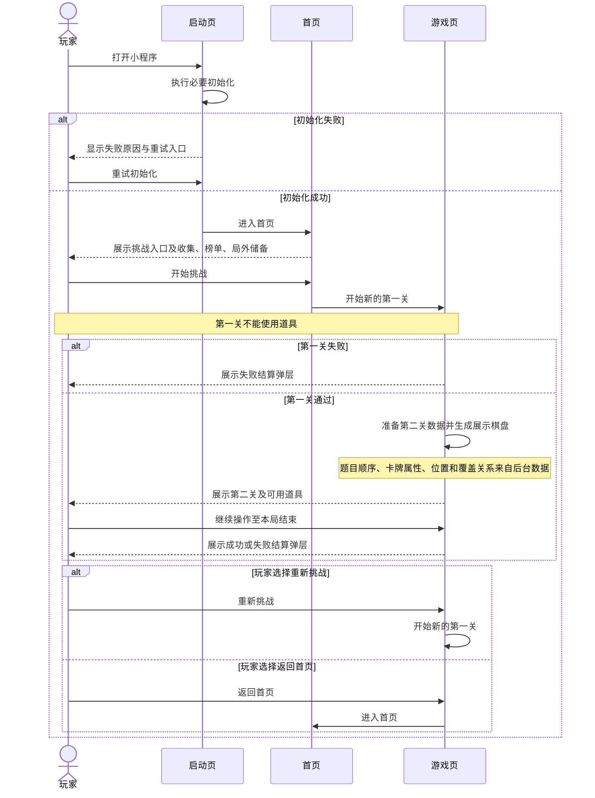
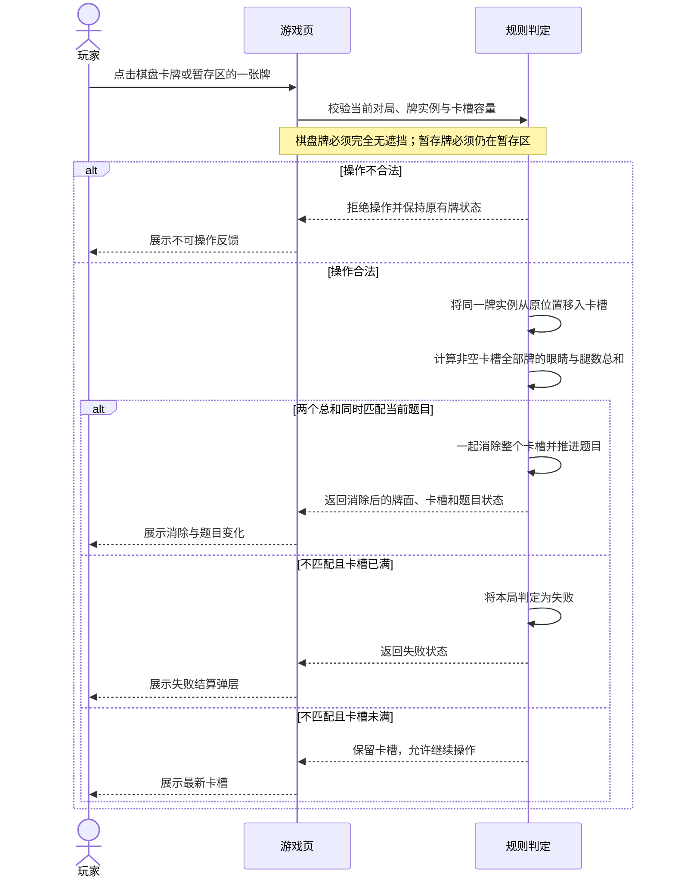
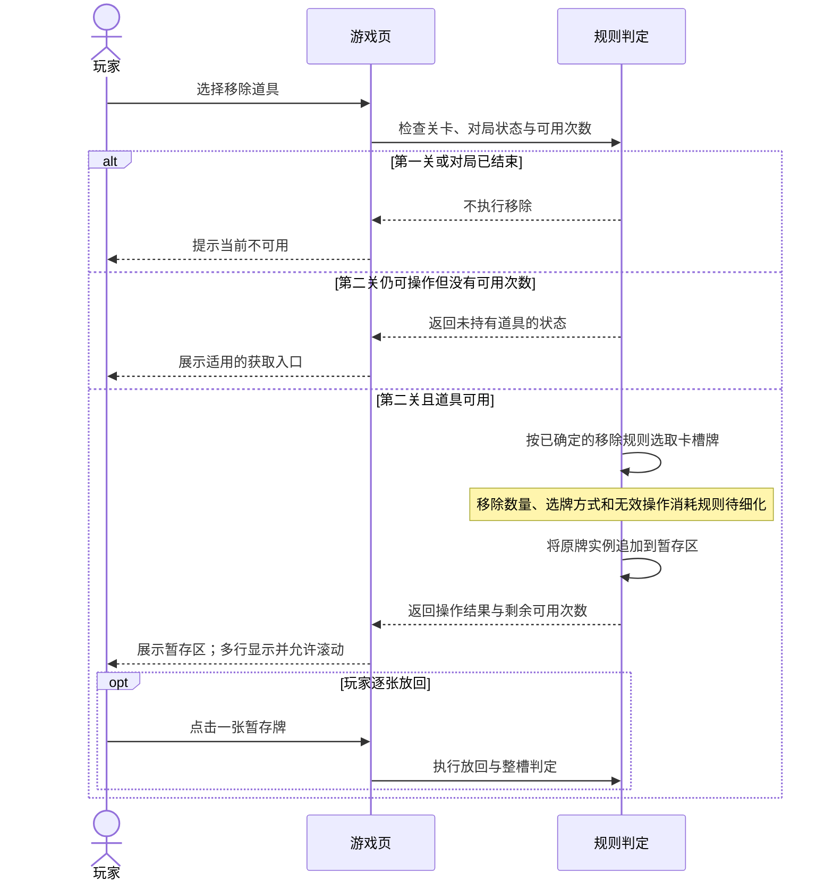
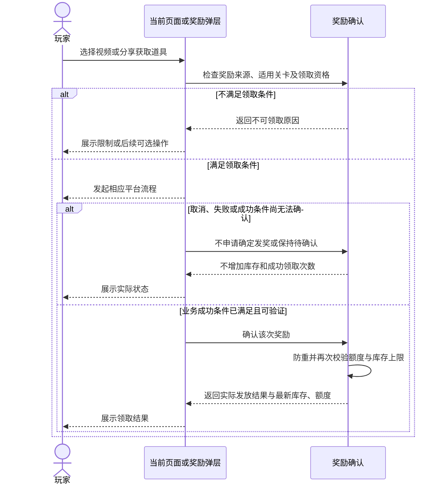
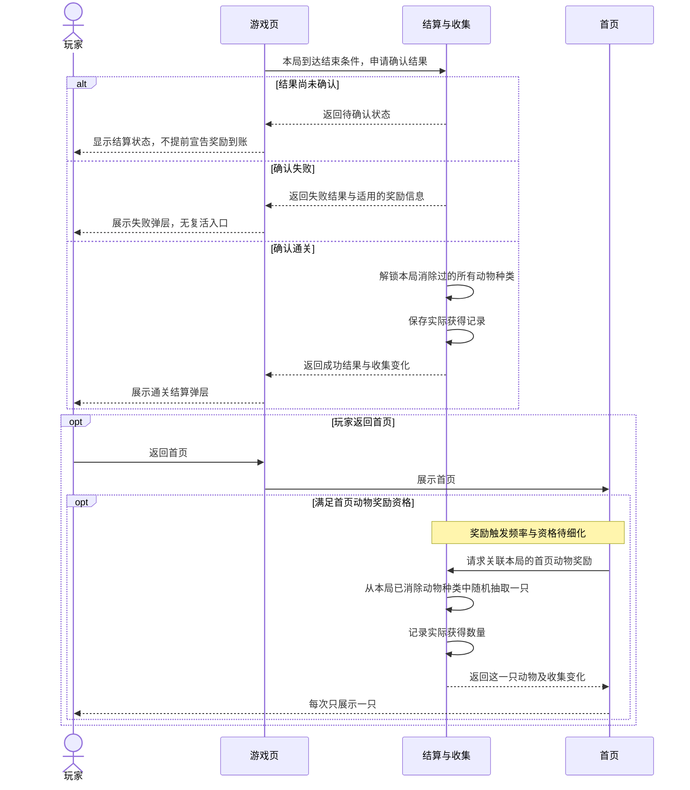

# 腿了个腿游戏需求

## 产品与范围

《腿了个腿》是微信动物卡牌求和消除游戏，英文工程名 pretzel。客户端为原生微信小程序。仅有启动页、首页、游戏页三个页面；结算、分享、奖励和提示以弹层或页面区域承载，不增加独立页面。没有复活功能。

本文重新编写当前需求，不恢复归档文档。明确确认的规则与仍需细化的参数分开记录。当前代码仅包含游戏入口骨架及部分领域判定，不代表本文功能已经实现。

## 页面与挑战流程

- 启动页完成必要初始化并进入首页，提供加载与失败反馈。
- 首页承载开始挑战、动物收集、榜单、分享和局外道具储备展示。
- 每次重新挑战必须先过第一关，再进入第二关。第一关不能使用道具，进入第二关后才能使用。
- 第二关主要由后台提供题目与布局数据，前端生成并展示棋盘。
- 游戏成功或失败后进行本局结算；不存在通过复活延续失败对局的分支。

## 卡牌与消除

每张动物卡牌包含眼睛数与腿数。动物可以是卡通形象，允许多种眼睛与腿数组合，不能只按现实动物的固定属性设计。眼睛数允许 1、2、3、4 或更多，具体动物集合需要内容设计。

玩家只可点击完全没有被其他牌覆盖的卡牌，将其放入卡槽。题目提供目标眼睛数和目标腿数。

- 必须整个卡槽中所有动物的眼睛总数与腿数总和同时等于当前题目，卡槽中的牌才一起消除。
- 不允许在卡槽中仅挑选部分牌匹配题目后消除。
- 卡槽未满且不匹配时继续操作，为玩家保留修改机会。
- 卡槽满且不匹配时直接失败；满槽但匹配时先按消除处理，不误判失败。

卡槽容量当前领域实现为 7，属于现有设计参数；如调整，判定、客户端和关卡生成须使用同一配置。

## 题目与布局

第二关固定 48 张牌、12 题，界面显示当前题和下一题。有效游戏时长以 4—6 分钟为设计目标，不包含广告播放和切后台停留；该目标仍需真人试玩验证。

布局允许按半格错位形成一盖二、一盖四和多盖一。每张牌占 2×2 个定位小格，小格只用于排布，点击和消除仍以完整牌为单位。初始上层只需至少一处与紧邻下层的实际重叠支撑，不要求四个小格都被托住；只有边缘相碰不算覆盖或支撑。

题目及顺序在开局时确定。生成时从最后一题的解法开始，自底向上反向铺牌。布局允许多个山峰与彼此分离的牌堆，不要求全部相连。

开局保证存在一条完整解法。玩家选用了其他合法组合，导致后续无法完成，可以作为挑战的一部分；不要求每条合法操作路径都有解。完全无遮挡的点击条件与参考解法必须一致。

## 道具与暂存区

局内共有三种道具，使用前必须通过相应获取流程获得。已经确认的移除行为：移出的牌进入暂存区，玩家可逐张点击放回卡槽。

- 每局三种道具通过视频合计最多获取 10 次，不按道具分别计 10 次。
- 取消旧的每种道具每局最多使用 2 次限制。
- 每种局外储备最多 1 次，保留到下一次挑战，只能在第二关使用。
- 首页分享每天最多领取 3 次；取消分享不占领取次数。
- 局外同种储备不叠加，不能因重复奖励突破 1 次。
- 暂存区没有 12 张上限，允许多次追加，多行显示，超出可视区域时滚动查看。
- 分享与视频奖励必须以实际成功条件发放；失败或取消不能虚增库存和成功次数。

结算或首页获得的局外储备与局内视频获取分别计账。其他两种道具的操作语义、局内分享额度和奖励选择交互，不能仅凭常见同类游戏做法认定，实施前需要明确。

## 动物收集与榜单

通关后解锁本局消除过的所有动物种类。首页动物奖励从本局消除过的动物种类中随机抽取，每次仅展示一只。后台记录实际已经获得的数量，而不只记录页面当前展示项。

榜单需要包含历史榜单。当前业务表只记录当周数量，历史数据进入归档表。周切换、归档和查询必须使用一致的周期标识，避免把历史累计写回当周数量。

## 玩家操作时序

以下时序表达业务顺序，不指定判定代码运行在客户端还是服务端，也不表示对应功能已经实现。“规则判定”和“奖励确认”是逻辑职责，不是新增页面。网络协议、操作上报粒度与平台能力的选择不由这些图决定。

### 页面进入与两关挑战

第二关数据准备失败时提供错误反馈，不能把未完整加载的棋盘作为可操作对局。自动重试、退出后恢复和是否重新生成数据的策略仍待确定。结算始终使用弹层或现有页面区域，失败后没有复活分支。

### 取牌、暂存牌放回与整槽判定

满槽时必须先判断是否匹配；失败判定一旦成立，不能在结算前插入一次道具操作来延续本局。暂存牌放回复用同一判定顺序，不复制牌实例。最后一题消除后如何联合牌面、卡槽和暂存区确认完整通关，仍属于待细化条件。

### 移除道具与暂存区

道具效果、库存消耗与界面展示需保持一致。局外储备与当局获取次数的使用优先级、储备转入当局的时点尚未确定，图中不选择其中一种方案。其他两种道具不能仅套用本图的移除效果。

### 视频与分享领取道具

获取额度按奖励来源计账；首页分享与结算获得的同种局外道具共同受一份储备上限约束，不能因来源不同各存一份。局内视频获取计数与局外储备分别校验。满储备时的奖励选择交互、局内分享额度及平台可验证的成功条件仍待细化；图中的成功分支不承诺微信存在可直接用于发奖的分享成功回调。

### 结束、动物解锁与首页展示

失败结算不能套用通关解锁流程。首页动物奖励仍需先满足最终确定的资格，不能把“返回首页”本身等同于一次领奖。已解锁种类的再次获得如何计数，需要与实际获得记录的口径一起明确。

## 待细化与平台验证

- 动物及眼睛、腿数组合的最终内容表、第一关题目数量，以及第二关的难度与时长参数校准。
- 三种道具的最终名称、移除数量和选牌方式、其他两种道具的精确效果，以及无效操作是否消耗。
- 连续点击、动画期间输入与待确认操作如何排队；同一次操作不得重复改变牌或消耗库存。
- 第一关通过、第二关通关对牌面、卡槽和暂存区的完整条件，以及失败结算奖励资格。
- 两关切换或结算期间退出后的恢复方式，及断线后的继续、重试或放弃策略。
- 局外储备转入当局的时点、不同库存来源的使用优先级。
- 局内分享额度、分享成功证据、无法确认结果时的交互、奖励选择与满库存处理。
- 首页动物奖励资格、触发频率、空候选集合处理，以及解锁与重复获得的计数口径。
- 日周周期的时区与切换边界、归档期间的查询口径、榜单排序字段、同值排序与展示范围。
- 微信分享成功判断、激励视频回调、登录与榜单可用能力，需按原生小程序的平台实际能力验证，不能直接套用小游戏专属能力。
