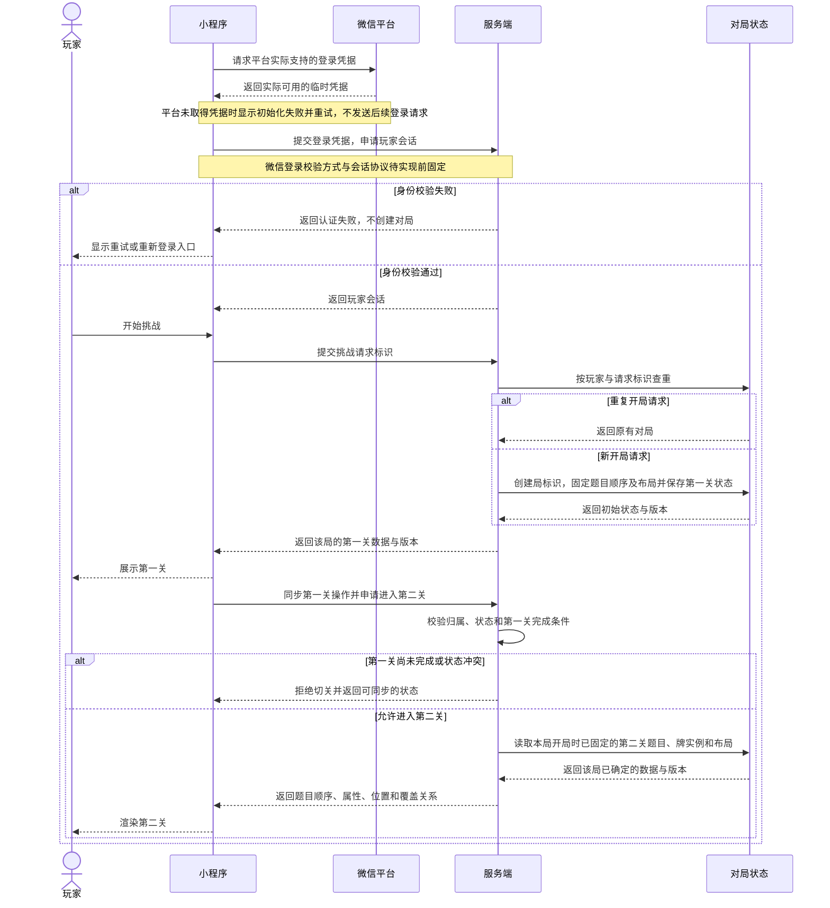
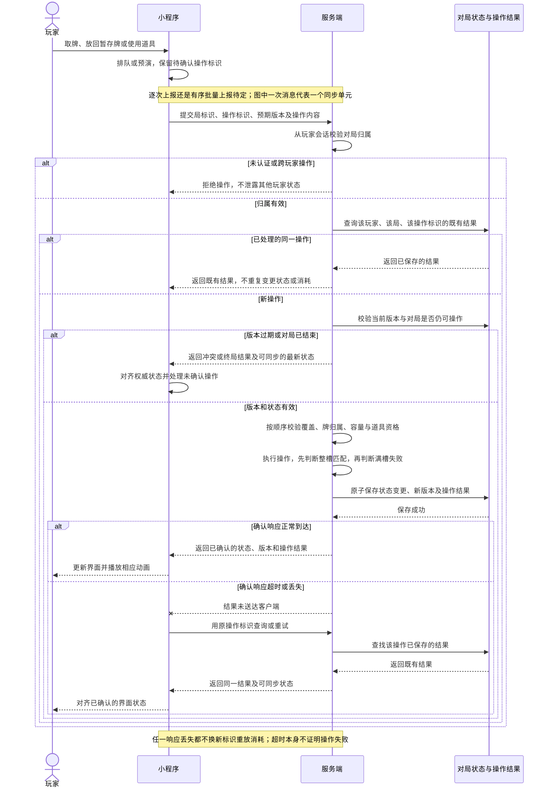
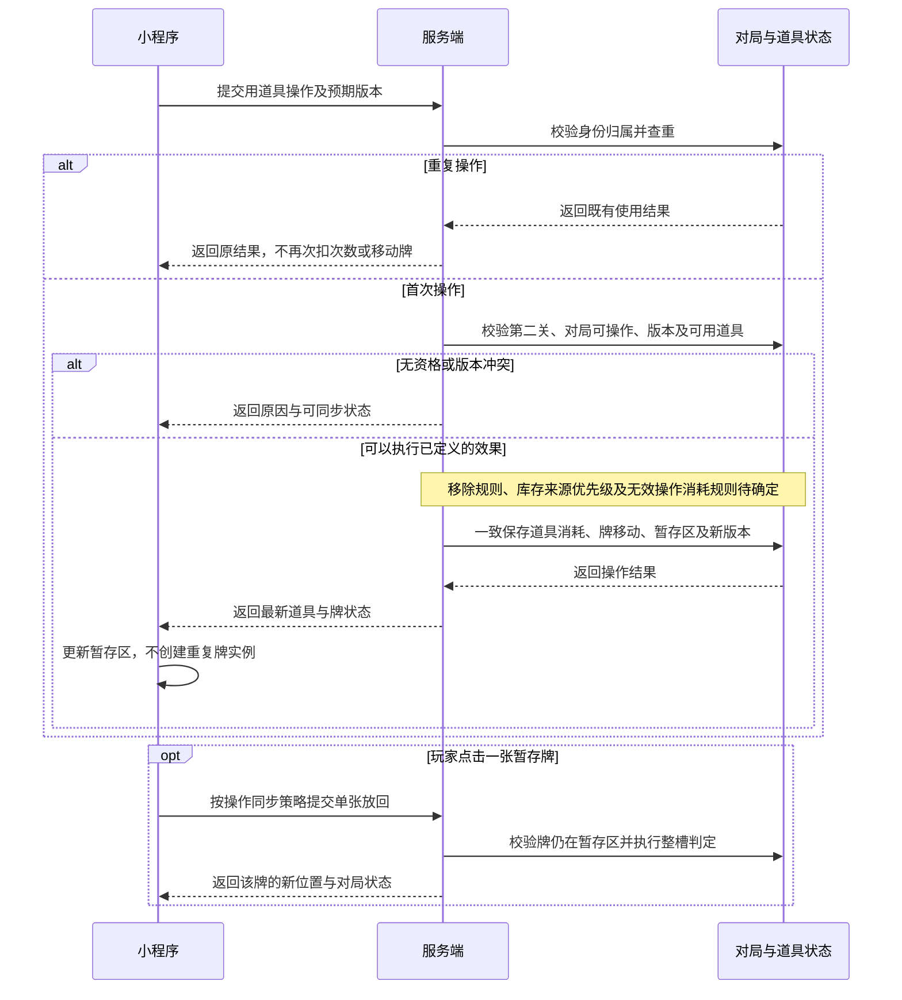
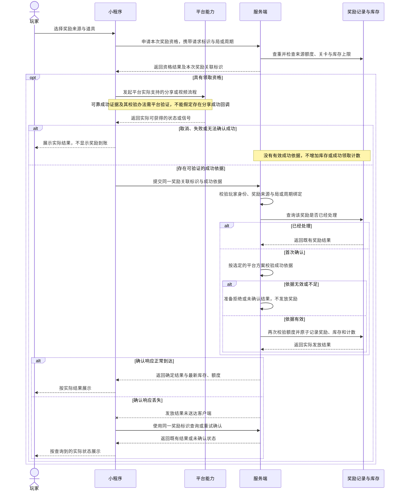
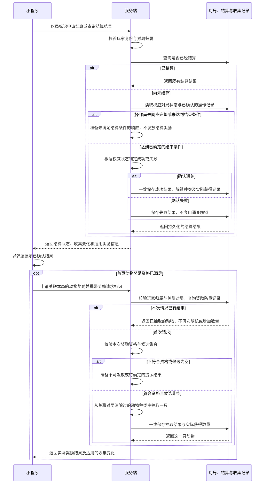
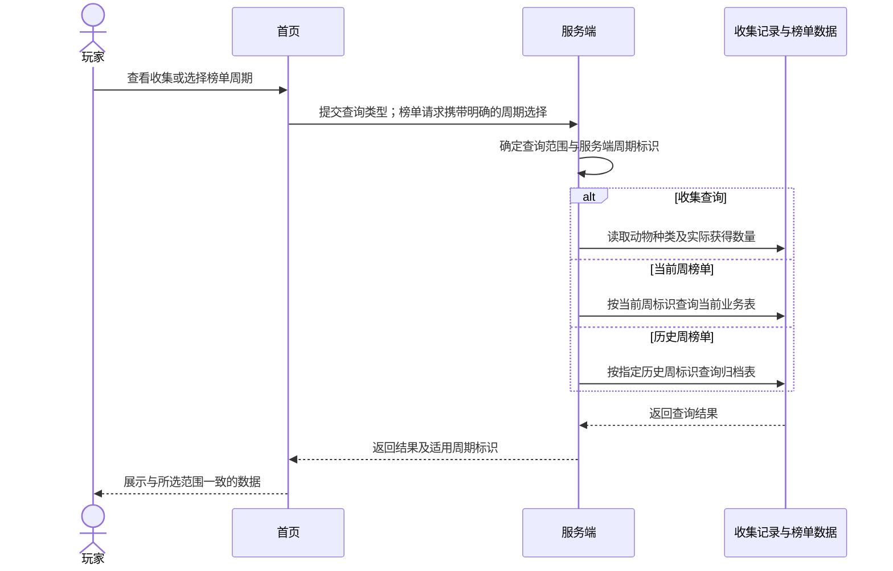

# 游戏交互契约设计

本文描述待实现接口的职责和数据语义，不声称已经发布对应 HTTP 路由。最终路由与字段类型在实现前固定，并以契约测试验证。

## 开局

客户端提交玩家身份与挑战请求标识；后台创建独立局标识，返回关卡状态与可公开配置。进入第二关时提供开局确定的题目顺序、卡牌实例、动物种类及属性、布局位置和覆盖关系。

参考完整解法仅供服务端生成与验证，不作为正常客户端响应字段。

## 游戏操作

取牌、放回暂存牌和道具操作以局标识、操作标识和状态版本定位。服务端拒绝跨玩家、过期版本、重复消耗与已结束对局操作；客户端按返回的最新版本更新界面，不能凭动画完成认定结算成功。

## 奖励

视频、分享、结算奖励记录奖励来源、玩家、局或周期、道具类型、幂等键与处理结果。获取上限与库存上限分开校验；同一成功回调重复到达只记一次。取消或失败不发奖。

## 结算与查询

服务端确认对局状态和消除记录后执行结算，返回结果、收集变更与适用奖励。重复结算返回既有结果。收集查询返回动物种类及获得数量；榜单查询显式指定当前周或历史周，不混合两个存储口径。

上述防重、版本与服务端校验属于实现设计，具体操作上报粒度及离线支持尚需结合客户端交互确定。

## 服务端交互时序

以下为待实现的逻辑契约，不定义已经存在的 HTTP 路由、表结构或微信 API。图中的服务端、状态存储、规则校验和结算都是职责划分，不要求拆成独立服务。玩家身份由认证结果确定，不能信任请求自行声明的玩家 ID。

### 身份建立、开局与进入第二关

第二关数据一旦为本局确定，重复请求必须复用同一份数据，不因响应丢失重新随机生成；参考完整解法不下发。题目及顺序遵循开局确定的规则，切关只提供该局已确定的数据，不把切关作为重新抽题的机会。

开局请求超时应先用原请求标识确认结果，不立即用新标识再创建一局。登录失败、数据加载失败和对局失败是不同状态，不能混为一类结算结果。

### 操作同步、防重与版本冲突

幂等查重在通过身份与归属校验之后、对新操作做版本校验之前执行，避免“成功写入但响应丢失”的重试被误判为新的消耗。相同操作标识携带不同内容时拒绝，不把它当作合法重试。

批量上报须保留操作顺序、各操作标识及起始版本。整批原子接受还是允许返回已接受前缀、连续输入和动画期间如何排队、是否支持离线积累操作，均待确定；当前不能据此宣称支持离线游戏。客户端是否预演不改变服务端权威结算与库存事实。

### 道具使用与暂存牌放回

本图复用操作同步的防重与版本规则，不新增逐次网络往返的产品要求。库存消耗与牌移动不能分别报告成功。局外储备的迁入时点未选定前，不把“进入第二关”直接解释为已经扣除或消耗储备。

### 分享与激励视频奖励确认

平台信号不直接等于服务端发奖。成功证据不足时采用等待确认还是明确拒绝，以及如何向玩家说明，须随平台方案一起确定；不能通过信任客户端布尔值补齐缺失能力。并发领取必须在确认发放时再次校验上限，不能只依赖进入平台流程前的资格检查。同种局外储备的上限跨奖励来源共同校验，不能按来源拆成多个储备槽。奖励已确认后才在界面显示到账，查询资格和轮询结果不重复扣成功领取次数。查重须先验证玩家归属和奖励绑定；已有发放结果不能因当前额度已用尽或原成功依据已过期而被重新判为失败。

### 结算、动物解锁与首页动物奖励

结算以局标识保证同一局只结算一次，不能仅用每次新生成的请求标识防重。首页奖励是否可领取由最终确定的触发资格决定；同一请求的重试返回同一只动物，不重新抽取。候选集合为空时不执行随机抽取，具体提示与资格处理待定。通关解锁、实际获得数量、结算道具奖励与首页动物奖励分别保存语义，不把一次弹层展示当作全部获得记录。

### 收集、当周与历史榜单查询

查询不触发新奖励，不把当前展示动物当作完整收集数据。日、周周期的时区与边界、榜单排序和同值规则、周切换期间的归档可见性仍待固定；周期切换不能把历史累计写回当周数量，也不能把未完成归档误报为空榜。查询失败应保留可重试状态，不使用空结果冒充成功。

## 待固定的时序契约

| 项目       | 需要明确的内容                                                           |
| ---------- | ------------------------------------------------------------------------ |
| 玩家认证   | 微信凭据校验、会话有效期、失效后的重新认证及待处理请求如何关联原玩家     |
| 关卡准备   | 第一关完成条件、开局数据固定与重复请求复用、加载失败后的恢复             |
| 操作同步   | 逐次或批量、批次接受语义、连续输入、预演与权威状态冲突时的处理、离线支持 |
| 道具使用   | 完整效果、库存来源优先级、局外储备迁入时点、无效操作消耗和失败回滚       |
| 奖励确认   | 平台可用能力、有效成功依据、无法确认时的处理、满库存选择及来源额度       |
| 对局结算   | 完整结束条件、未同步操作的补齐、结算失败重试、解锁与实际获得的计数口径   |
| 查询与归档 | 日周周期边界、历史周归档可见性、榜单排序及空结果和错误的区分             |

实现前须将上述选择收敛为固定契约并增加相应验证。当前时序图中的待定分支不能当作已经确认的产品能力或已完成的服务端实现。
