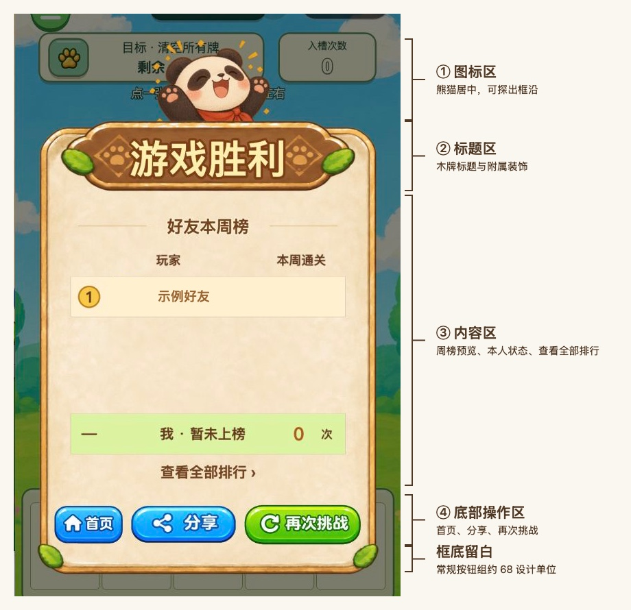

# Flip Zoo 游戏设计

## 客户端组织

Flip Zoo 使用一个 Cocos Creator 工程，用同一份场景、资源和 TypeScript 核心构建 Web Demo 和微信小游戏。Web Demo 用于本地设计、调参和调试，微信小游戏构建用于微信开发者工具验收和发布。两种产物分别输出到 `build/web-mobile` 和 `build/wechatgame`。

棋盘、消除、卡槽、道具等规则由两种构建共用。平台差异留在入口、数据来源与平台服务。调试入口、调参接口和模拟奖励只在开发预览中使用。正式 AppID 由该游戏的私有构建环境提供。

## 分享渠道数据

未配置云环境时，`wechat-platform.ts` 直接使用原始卡片并开放菜单，不启动身份跟踪或生成虚构渠道；配置云环境后，菜单仍在身份就绪后开放，分享记录规则保持不变。

首页、胜利结算、失败复活、道具领取、扩槽及微信菜单均直接进入微信原生分享流程，不增加游戏内分享确认对话框。道具和扩槽在成功调起分享后发放，复活在返回游戏后清槽；Web Demo 直接模拟对应操作。

`wechat-platform.ts` 统一生成带渠道参数的分享卡片，`share-tracking.ts` 先写本地待上传队列，再上传到独立云函数 `flipZooShares`。菜单分享必须同步返回参数，因此先获取当前调用者身份，再开放右上角转发入口。每次点击产生一个独立 `eventId`，渠道值为 `MD5(openid + ":" + shareTime + ":" + eventId)`；即使同一毫秒点击也不会复用渠道。云端使用 `getWXContext()` 的 openid 重新计算并校验，忽略客户端提交的用户身份。

CloudBase 集合 `flipZooShares` 保存 `openid`、`shareTime`、`channel`，`flipZooShareOpens` 保存 `openid`、`openTime`、`channel`。两表附带 `appid`、`eventId`、服务器接收时间 `receivedAt`，文档 ID 由应用、调用者、动作和事件 ID 计算，以便网络重试幂等。点击和打开时间是客户端 Unix 毫秒时间，服务器接收时间用于核对，不将客户端时钟作为可信安全依据。仅保存携带有效渠道的进入记录，无渠道和格式无效的进入不写入 `flipZooShareOpens`。

小游戏通过 `getEnterOptionsSync()`（不可用时读取启动参数）读取当前入口，通过 `onShow` 读取后续进入；只有 `query.share_channel` 是合法 MD5 时才写入队列。上传失败保留本地队列，每 5 秒重试；账号变化时不将原账号队列上传成新用户记录。两表仅云函数可读写，不对客户端提供浏览其他用户 openid 的接口。

`flipZooShares` 云函数的 `stats` 动作按 `appid + channel` 关联两表，并核对调用者是该渠道分享者。返回 `openCount`（带渠道进入次数）、`uniqueOpenUsers`（独立进入人数）、`returnCount`（排除分享者后的回流次数）、`returnUsers`（排除分享者后的独立回流人数）、`selfOpenCount`、`hasReturn` 及首次／最近进入时间。统计单位是带渠道进入事件，不以分享 API 返回代表真实转发成功；无渠道事件不参与统计。两表建立 `appid_channel` 联合索引。

## 界面与动效

欢迎页使用蓝天草地背景，居中展示双行标题、动物合照和黄色「开始游戏」按钮。关卡上方展示关卡号与剩余牌数，青绿牌桌居中，卡槽与道具位于下方。

教学关清盘提示复用设置与结算的纸感外框、木牌标题和金色描边字。熊猫绘制在纸框后，向上爬出框沿，纸框遮住下半身，配合星光庆祝；下方使用无文字的小动物走向园门插画，移除进入第二关的正文和独立爪印；插画位于纸框内，复用首页分包加载，保持原始宽高比。提示整体按视口适配，停留 1.25 秒后自动进入第二关，不增加按钮。第二关胜负结算使用设置页同系纸感边框、描边标题和从设计定稿裁切的按钮，展示熊猫、好友周榜前三及独立高亮的本人排名。胜负排行区域均使用透明布局节点，取消内层纸框与榜单木牌；暖棕文字标题两侧用细线分区，前三名和本人高亮行直接呈现在外层纸面上。榜单字号与行距保持不变，查看全部与操作按钮向上收紧，外框随内容缩短，普通结算的最底部按钮与外框底边保留约 68 个设计单位。有结算提示时单独增加底部高度，提示与按钮分区；适配按弹窗实际高度计算。胜利保留首页／分享／再次挑战按钮。失败仅保留标题、排行和首页／复活／重新挑战按钮。分享复活与清槽按下节执行。第二关牌身使用白面、浅灰侧壁和浅绿底带的贴图，动物头像居中并保持正方形，背面保留爪印。牌身亮度区分可取与受压状态。三消时槽内牌浮现亮边和星光，随后缩小淡出。设置页用独立滑杆控制音乐与音效。

界面用牌和空槽呈现卡槽占用，并显示剩余牌数。只剩一格时提示「下一张必须三消」。Web Demo 额外显示入槽次数和首消时机。每局按全部牌的外接矩形居中，取牌期间牌桌位置固定。第二关按偏移后的绘制轮廓从上到下查找触摸命中的牌，再按原牌局坐标判断遮挡和取牌资格。槽内牌和桌面牌使用相同基础尺寸。牌桌先按可用区域适配，微信第二关再单独增加纵向高度。牌桌在基准缩放下每张牌宽 94、高 118 个设计单位，同一牌位每升一层，绘制轮廓向上错开 8 个设计单位。

## 对话框标准

### 基类与职责

游戏内对话框直接继承 `Dialog`。基类管理全屏层、底层触摸拦截、遮罩及打开、关闭、销毁的生命周期，并提供默认的纸框样式、分区布局、视口适配和底部按钮组。具体子类提供内容和有序按钮列表，游戏场景负责发起打开并传入业务回调。底部按钮的尺寸、间距和位置由 `Dialog` 统一计算。每个操作只传入带字的按钮图片 `image: SpriteFrame` 和点击回调 `onPress: () => void`。同一时间只展示一个游戏内对话框。首页设置与局内设置共用一个子类，胜利与失败共用结算子类。下列名称为目标设计。

```text
Dialog
├── SettingsDialog
├── ConfirmAbandonDialog
├── LeaderboardDialog
├── RoundResultDialog
├── TutorialClearDialog
├── HomeCollectionDialog
└── ChildPrivacyDialog
```

家园使用默认纸框布局，标题与底部「返回」使用字图。隐私声明复用全屏层和生命周期，使用白底文档布局和全屏页顶栏的「返回」。碎片结算和园门过场按临时浮层处理。兑换诊断由微信原生 `wx.showModal` 渲染。

### 默认纸框分区与按钮

```text
Dialog
├── 全屏遮罩
│   └── 压暗背景，拦截底层触摸
└── 面板
    ├── 图标区（可选）
    │   └── 图标水平居中，可探出纸框上沿
    ├── 标题区
    │   ├── 居中木牌底图与标题字图
    │   └── 随木牌定位的标题插画（可选）
    ├── 内容区
    │   └── 说明、插画、列表、表单及其局部操作
    └── 底部操作区（可选）
        └── 按钮列表：单行等距，由 Dialog 布局
```

- 纸框弹窗通过 `titleImage: SpriteFrame` 传入预制标题字图。`Dialog` 负责木牌底图及标题字图的居中显示，字图等比缩放。标题文案烘焙在图片资源内。可选标题插画与标题字图分别传递。
- 图标区为空或底部没有按钮时，收起该区及其间距。独立于木牌且在其上方的熊猫归图标区。附着于木牌的插画归标题区。
- 「返回」统一使用左向回转箭头，图标在文字左侧。家园与好友榜共用带蓝色立体图标的叶饰按钮图片，隐私声明的白底顶栏采用同形单色图标。
- 游戏内对话框禁止放置独立关闭按钮，包括标题区和面板边缘的「×」。底部操作区按场景提供动作，例如放弃确认的「继续」。
- 首页和局内设置通过点击遮罩退出，底部操作区收起。仅处理从遮罩开始、在遮罩内结束的点击。面板内的空白处和滑杆等内容区域拦截触摸。
- 整体操作集中在底部，内容操作靠近对应内容。`Dialog` 按列表顺序将底部按钮排成单行，整组居中并对齐基线。按钮等比显示，尺寸按图片计算。按钮框和内容区等宽。扣除按钮宽度后，剩余横向空间按权重分配，左右边距各为 0.5，相邻按钮间距各为 1。以三个按钮为例，布局为 `0.5 - 按钮 - 1 - 按钮 - 1 - 按钮 - 0.5`。按钮文字和图标预制在图片中，接口不接收 `label`。只有一个按钮时居中。
- 常规底部按钮组的可见下沿与纸框底边留约 68 个设计单位。结算提示可以在按钮组下方独立占位，纸框随之增高，按钮组保持单行。没有底部按钮时，由内容区底部内边距收尾。
- 面板尺寸由实际分区决定，并等比适配视口。短屏先约束可滚动的内容区，标题和底部操作保持可触达。排行榜随内容高度从底部向上伸缩，页签随标题移动，只有好友行滚动。
- 排行榜遵循同一分区契约。纸框、标题、页签和好友数据继续在微信开放数据域绘制，主域管理浮层、底部操作和触摸转发。好友记录、身份和行数留在开放数据域。结算内的榜单预览属于内容区。

### 胜利弹窗标注



标注图取自微信开发者工具中的胜利结算预览。榜单好友信息已替换为示例文字。胜利弹窗同时展示四个区，作为纸框布局的校对基准。

### 当前纸框弹窗校对

| 弹窗               | 当前分区与按钮                                                                                                               | 与标准的差异                                                                                   |
| ------------------ | ---------------------------------------------------------------------------------------------------------------------------- | ---------------------------------------------------------------------------------------------- |
| 首页设置           | 木牌标题字图、音量滑杆、反馈与客服、隐私链接与版本。点击遮罩退出。                                                           | 已接入 `Dialog`，根据内容高度布局。                                                            |
| 局内设置           | 沿用首页设置的分区，内容列表增加「放弃挑战」。                                                                               | 与首页设置共用 `SettingsDialog`。                                                              |
| 放弃挑战确认       | 木牌标题字图、单句说明、底部「继续／放弃」字图，两张按钮图片共用叶饰纸底，分别烘焙绿色播放图标与棕字、橙红禁止图标与红棕字。 | 已接入 `Dialog`，按钮单行排列，留白权重 0.5 : 1 : 0.5。                                        |
| 好友本周榜／历史榜 | 开放数据域绘制纸框、标题字图、页签、好友列表和本人状态。                                                                     | 已接入 `LeaderboardDialog`。主域底部「返回／刷新」使用带字图片，单行留白权重为 0.5 : 1 : 0.5。 |
| 胜利结算           | 四区齐全。熊猫、胜利木牌、周榜预览与「查看全部排行」、底部「首页／分享／再次挑战」。                                         | 已接入 `Dialog`。标题和按钮使用字图，底部按钮由基类单行等距布局。                              |
| 失败结算           | 四区齐全。失落熊猫、失败标题字图、周榜预览与「查看全部排行」、底部「首页／复活／重新挑战」。                                 | 已接入 `Dialog`。三个带字按钮按单行布局，按钮框留白权重为 0.5 : 1 : 1 : 0.5。                  |
| 教学完成           | 熊猫从纸框后探出，木牌显示标题字图，内容区显示园门插画，1.25 秒后自动继续。                                                  | 已接入 `TutorialClearDialog`，省略底部操作区。                                                 |

家园已接入 `HomeCollectionDialog`。内容区保留六行动物和每行右侧的兑换控件。碎片低于兑换所需数量时，新的兑换按钮置灰且不可点击。已发起的订单仍可继续领取或重试确认。读取失败时在列表末尾显示「重试」，纸框随内容增高，底部「返回」仍由基类布局。

当前客户端通过 `Dialog` 共用全屏层、遮罩与触摸拦截，胜负结算共用 `RoundResultDialog`，首页和局内设置共用 `SettingsDialog`，均采用基类的纸框分区和底部操作布局。放弃确认也采用基类布局。好友榜的标题字图和榜单由开放数据域绘制，主域复用 `Dialog` 的底部操作布局。教学完成通过 `TutorialClearDialog` 使用基类布局和标题字图。胜负结算已使用带字切图。校对依据为当前源码与微信开发者工具预览，短屏和真机安全区适配尚未统一验证。

## 分享复活与清槽

交互与牌局规则以需求中的「复活」「清槽」「分享与来源记录」为准。客户端直接调起分享，不创建分享确认弹窗；清槽道具与复活共用补牌计划和动画。

| 责任         | 实现与约束                                                                                                                                                                                                                                                                         |
| ------------ | ---------------------------------------------------------------------------------------------------------------------------------------------------------------------------------------------------------------------------------------------------------------------------------- |
| 分享返回     | `wechat-platform.ts/openRevivalShare()` 在调起分享前注册 `onShow`，下一次返回时注销并只回调一次，不要求先收到 `onHide`。返回事件不代表真实转发成功。                                                                                                                               |
| 当前牌局校验 | `start-screen.ts/requestRevive()` 限定当前失败结算、当前牌局且无进行中的复活分享。调起失败可重试；关闭结算或销毁组件时注销监听，迟到返回不影响新牌局。                                                                                                                             |
| 补牌计划     | `Round.slotClearGroups()` 按槽内类型顺序累计需要补齐的张数，优先选桌面高层同款，连带选择完整绑定组，直到涉及的每种类型总数都为三的倍数。计划全部可行才由 `applySlotClear()` 更新牌局；失败时不移牌、不扣道具。Map／Set 使用 `Array.from()` 遍历，保持 Creator 正式产物与源码一致。 |
| 复活状态     | `Round.revive()` 只允许第二关失败且槽内有牌时调用，保留槽位容量和道具状态。`completeRevive()` 记录一次 `revive` 后关闭失败结算、锁定操作，再启动清槽动画；规则已更新也必须等动画完成才执行后续结算。                                                                               |
| 三消批次     | `start-screen.ts/playSlotClear()` 将补牌计划按每组三张拆分，包括绑定牌多取后产生的第二组及高级绑定连带类型；每组消除完成后再处理下一组。                                                                                                                                           |
| 同款叠放     | 当前组三张加其余待消牌不超过已开放槽位容量时正常入槽，否则只保留当前组已有牌和全部待消牌的实际槽位，补牌叠到当前组同款上；没有已有同款时先在现有空位落下一张作为基底。不得以界面共有七格代替已开放容量判断，不占用锁定格，不临时增加槽位。                                         |
| 动画对象     | `card-effects.ts/flyCardToSlot()` 按 `stackLevel` 将叠牌在目标槽局部坐标中每层右移 3、上移 9 个设计单位，并换算到特效层。叠牌落地后保留节点，`playMatch()` 对实际槽位牌和叠牌共三张统一播放特效，随后销毁叠牌节点；其余待消牌始终可见。                                            |
| 服务端回放   | `flipZooFragments/verifyWin()` 使用相同 `Round` 从真实失败状态回放 `revive`，复活不转换为扩槽或道具动作；客户端动画不参与服务端规则判定。                                                                                                                                          |

### 验证边界

- `test/share.test.mjs` 验证直接分享、返回回调一次性、失败重试及迟到回调；清槽动画检查 6／7 格、剩余 0／1 个空位的每个中间帧，全部待消牌与叠牌可见、每组三张、槽位容量不变、动画结束前不恢复操作，并覆盖绑定牌连续两组三消。
- `test/revival.test.mjs` 验证服务端真实失败后的复活回放、普通与高级绑定，以及当前固定牌库参考解。
- `build-cocos.mjs` 在微信构建中自动调用 `verify-built-revival.mjs`，直接运行 Creator 输出的 `Round`，检查 6／7 格和剩余 0／1 格四种情况均可补齐并清空；源码测试与正式产物检查分别执行。
- 开发者工具已检查本地边界牌局的满槽、剩余一格叠牌及最终清空画面。真机微信分享返回、实际消息发送及生产服务端部署另行验证，模拟器与构建通过不代表这些事项已完成。

## 好友周榜与历史榜

排行榜复用设置弹窗的羊皮纸外框、木牌标题与叶饰按钮。本周榜与历史榜使用深浅木牌区分选中状态；榜单采用浅色圆角行、金银铜奖牌与暖金成绩数字，本人行以浅绿色高亮。底部按钮使用 `home/ranking-buttons/` 的带字切图，由 `Dialog` 布局。「返回」和「刷新」共用叶饰纸底及蓝色立体图标风格，刷新使用环形箭头。开放数据域的外框使用 `open-data/panel.png` 本地图集，标题使用 `open-data/title.png` 字图。本周榜和历史榜各有深浅两张带字页签切图，由开放数据域从 `open-data/tabs.png` 按选中状态绘制。返回与刷新并列放置，按钮下沿距离面板底边 68 个设计单位，标题避开微信胶囊区域。榜单按实际可见人数调整，面板最小高度为 720 个设计单位，高度最多容纳五行；本人不在当前可见行中时，在列表下方补充本人状态行。行高与字号保持固定，外框、标题和页签随内容高度调整，本人状态与底部按钮共同沿面板底部排列；空榜保留空态和本人状态。完整榜单的外框、页签与好友行统一在开放数据域绘制，主域仅保留底部操作按钮并转发触摸坐标；面板以底部操作区为锚点向上伸缩，不向主域回传好友记录或人数。

完整榜单的本周榜与历史榜均可切换、刷新、滚动和定位本人。本周榜使用 `mgrank`，按北京时间周一切换；历史榜使用 `mgrank_total`，展示累计第二关通关次数，时间戳不参与累计归零。结算页预览继续展示本周前三及本人行。

独立只读云函数 `flipZooRank` 用当前 AppID 与 openid 计算牌局 owner，统计 `flipZooFragments` 中该 owner 的 `granted`、`limit` 结算数。结算文档按牌局幂等，因此重试不会重复累计；碎片用尽后的有效通关仍计入累计。客户端启动、结算成功和读取历史榜时获取累计，再通过 `sync-history` 消息同步开放数据域。开放数据域串行写入托管数据，防止同一客户端较旧响应覆盖较新累计；写入失败明确展示刷新提示，不用周分数拼出总分。

完整榜单打开及非拖动点击后，主域通过已有触摸转发入口尝试同步累计，同一视图合并进行中的云请求，不读取好友数据或人数。开放数据域写入累计成功后，仅在当前完整历史榜刷新好友数据；周榜和结算预览保持原视图。完整榜单的页签交互状态独立于加载数据，加载中或失败后仍可切换本周／历史榜。

历史切换的异步云请求和开放数据域好友数据请求都按当前视图校验，避免旧请求覆盖新榜单。历史累计可从现存云端有效结算恢复；尚未运行新版的好友在首次同步累计前不会伪造历史分数。

## 牌局来源与翻牌对照

微信固定牌局采用 7 列 × 8 行、最多九层的沙漏布局，牌库按沙漏 01～10 分组，每类 A/B/C/D 四个变种，共 40 副。每副共 240 张牌，每张上层牌须与紧邻下层至少一张牌有正面积重叠。各层牌数呈底部较宽、中部收窄、顶部展开的分布，逐副牌位以配置为准。

教学牌桌采用 4 列 × 3 行。Web Demo 使用三层 7 × 9 网格，相邻层横纵各错半张牌，并提供「去第二关」调试入口。Web Demo 默认进入 C 组，可切换 A、B、C 比较同一牌序和布局。

| 第二关组别 | 开局与后续亮面规则                                                     |
| ---------- | ---------------------------------------------------------------------- |
| A          | 开局全暗。取牌翻开同层上下左右四邻，以及这次移牌后完全无遮挡的下层牌。 |
| B          | 完全无遮挡的牌自动亮面。随着上层牌移走，完全露出的下层牌也会亮面。     |
| C          | 开局预亮 12 张无遮挡牌，后续按 A 组规则翻牌。                          |

第二关由 `BoardApi.loadMainBoard()` 提供布局和按牌 ID 排列的动物编号。配置云环境的微信构建由云函数签发固定牌局；未配置云环境时从包内牌库抽取。Web Demo 通过 `GET /api/board` 读取普通配牌。

## 牌型与难度配置

配牌按“几何牌位 → 高级绑定 AB → 普通绑定 AA → 普通单牌 A → 参考解验证 → 难度校准”执行。牌型为 AB / AA / A。高级绑定 AB 连接两张不同类型的牌，普通绑定 AA 连接两张同类型的牌，A 为单牌。正式牌库不预留命门牌种，每种动物至少六张、总数为三的倍数。倒数第 2、3、4 层每层至少一组高级绑定，最底层不放任何绑定。前 15% 牌量为 36 张，从顶部累计覆盖这些牌量所涉及的各层，每层最多 12 种动物。

教学关开始后在后台读取第二关牌局。清盘后先显示短暂庆祝，待第二关牌局就绪，园门沿两侧打开，0.3 秒内露出第二关牌桌；过场结束后可操作。预加载失败时，进入第二关会重新请求牌局。Web Demo 使用无命门预留的普通配牌，不再提供命门难度后台。

## 微信第二关固定牌库

每副固定牌局在牌库中配置 `bindings`，数组长度是该布局的锁定牌组数，每项记录一对牌 ID。每副最多 20 组，高级 AB 在倒数第 2、3、4 层各至少一组、普通 AA 至少一组，最底层无绑定；同一张牌不得重复绑定，组数由合法牌位、三消配额、六格参考解及难度目标共同约束。客户端、本地模拟与云端回放共用 `Round` 的绑定规则，云签发的牌局快照携带绑定牌组。校验参考顺序时，在首次遇到绑定组时整对取走，仍须符合布局配置指南的参考解要求。锁链在该对牌所在层渲染，高层牌可遮挡锁链。

微信第二关固定牌库最多九层。`layout` 与 `Card.layer` 自底向上排列，文档中的各层统计从最高层向下列出。

### 牌面分配与校验

固定牌库目前有十类布局，每类 A/B/C/D 四副。后续配置的参数范围、配牌顺序与验收条件见布局配置指南 `FLIP-ZOO-LAYOUT-GUIDE.md`。

遮挡规模可通过每层可计算牌数分析。从该层所有牌出发，沿直接遮挡关系向上递归，收集直接或间接压住它们的上层牌。将本层和收集到的上层牌按牌 ID 去重，多峰共享的遮挡牌只计一次。

### 可用动物种类

普通绑定、高级绑定和单牌共用同一动物目录。正式牌库每副使用 10～20 种动物，每种至少六张且为三的倍数，不预留仅三张的专用种类。

## 难度推演

### 难度目标

微信第二关开局开放六格。玩家点击第七格并调起微信转发后，本局解锁第七格，云端按签发时的卡槽配置回放该操作。当前固定牌库的模拟和布局验收以六格为默认条件。

微信第二关的调校建议是**开局能读出可执行的三消机会，中段因取牌顺序产生选择压力，整局能在六格内无道具清盘**。教学关用于熟悉翻牌和三消，单独观察，使用独立的难度目标。

逐副通关率与阶段进度验收区间、计算方法见布局配置指南 `FLIP-ZOO-LAYOUT-GUIDE.md`。现有 CLI 输出逐副牌局及整库结果。

| 阶段 | 目标                                                                     | 判断依据                                                                                                                |
| ---- | ------------------------------------------------------------------------ | ----------------------------------------------------------------------------------------------------------------------- |
| 开局 | 玩家能通过观察和少量试探找到第一次三消。                                 | 现有码牌设计要求参考解第 3 次入槽完成首消。首消步数分布和首消前满槽率用于判断玩家能否发现机会，属于待实现的模拟指标。   |
| 中段 | 推进到开局总牌数的 30%，取牌顺序会改变后续腾槽机会。                     | 统计 30% 进度达标率，并记录失败时剩余牌数。结合失败回放检查压力来自普通组分散、高级绑定的异类占槽，还是遮挡和暗牌叠加。 |
| 整局 | 每副候选牌局都须具备六格无道具清盘路线，固定牌库中的极端牌局可以被识别。 | 参考解通过是可解性门槛。用当前 CLI 的逐副策略胜率筛查异常，再用真人试玩的通过率、有效时长和退出进度校准。               |

首消前失败率上限、有效时长区间和真人通过率目标待试玩校准。模拟胜率用于同条件下比较牌局，真人指标按关卡配置版本统计。

### 影响难度的要素

| 要素                 | 如何影响难度                                                                                                             | 如何检验                                                                                                    |
| -------------------- | ------------------------------------------------------------------------------------------------------------------------ | ----------------------------------------------------------------------------------------------------------- |
| 布局与遮挡           | 层数、峰形和重叠关系决定每手能取哪些牌，以及为了露出目标牌要先移走多少张牌。有些取牌能打开多条后续路线，有些只推进一处。 | 比较布局时统一配牌约束，并为每类布局生成多副样本。跟踪各阶段的可取牌数和失败回放中的解锁顺序。              |
| 普通动物的种类与分布 | 同时露出的动物种类越多，槽内越容易并存多个未完成组。同款集中露出时更可能及时三消。影响来自数量和位置的组合。             | 固定布局，改变普通动物种数或同款的位置，比较首消步数、槽压和逐副胜率。                                      |
| 每层卡牌种类数       | 以该层承载牌数为配牌依据，给各层设置种类数。同一种动物在同一层只计一次。                                                 | 配牌时逐层记录承载牌数、目标种类数和实测种类数。固定布局，对照不同目标的配牌，比较 30% 进度达标率和通关率。 |
| 亮牌与暗牌           | 开局能看到的牌面决定首手线索。即使第三张同款已经无遮挡，牌面未知时也只能试探。取牌翻开邻牌的顺序会改变下一手的信息。     | 固定配牌，观察首消前的亮牌与可取牌。当前 CLI 固定 C 组，亮牌规则属于模拟条件。                              |
| 卡槽与辅助规则       | 槽位决定可以暂存多少张未成组牌，辅助会改变满槽前后的选择。                                                               | 微信固定牌局以全程六格无道具验收。Web 和教学关以五格运行，各自解读。                                        |

种子、推演策略和误选率决定测量条件。同一副牌可用多组固定参数观察策略稳定性，跨牌局对照时使用相同参数。

每层承载牌数沿用第二关码牌设计的可计算牌数口径。将本层全部牌与直接或间接覆盖它们的上层牌合并，按牌 ID 去重后计数。例如，本层有 12 张牌，另有 9 张不同的上层遮挡牌，则承载牌数为 21。承载牌数用于确定该层的种类数目标，实际种类数按本层牌面统计。各副固定牌局采用按实际布局单独调出的种类数配置。CLI 直接读取落实这些种类数的已配牌局。

### 当前用途与输入

难度推演在 Node.js 22 下离线运行。它复用客户端的 `Round` 规则，以固定种子运行无道具对局，报告指定选牌策略对每副牌局的通关率。

布局决定牌的位置、层级和遮挡关系。配牌按牌 ID 指定动物。两者共同确定一副牌局，因此同一类布局下的不同配牌可以得到不同的胜率。

| 来源             | 牌局输入                                                                                                                                   | 初始卡槽 |
| ---------------- | ------------------------------------------------------------------------------------------------------------------------------------------ | -------- |
| `wechat`（默认） | 从 `main-board-pool.ts` 的 `MAIN_BOARD_POOL` 读取每副牌的名称、布局和配牌。当前有十类布局，每类 A/B/C/D 四副，共 40 副最多九层的固定牌局。 | 6 格     |
| `web`            | 使用第二关默认三层布局。使用固定种子生成一副普通配牌，不预留命门种类。                                                                     | 5 格     |
| `tutorial`       | 使用 `Round` 内置的第一关，12 张牌平铺，两种动物各 6 张。                                                                                  | 5 格     |

全部场景固定 `group: "C"`。牌名中的 A/B/C/D 是固定牌局的变种标识。Web CLI 使用固定种子生成普通配牌；预览服务为每次请求生成普通配牌。

### 执行链路

1. `scripts/simulate-win-rate.mjs` 校验参数、展开牌局并为每副牌运行相同的种子序列。
2. `scripts/simulate-round.mjs` 的 `play()` 为每局创建新的 `Round`，调用 `createLookahead()` 构建选牌策略，再循环选牌和调用 `round.take(id)`。
3. `assets/scripts/gameplay/round.ts` 执行真实取牌规则。可取牌须完全无遮挡。取牌后翻开同层上下左右仍在桌面的相邻牌。单张或绑定对整体移开后，再翻开因本次操作完全无遮挡的下层牌。清槽道具移牌后也执行这一检查。凑齐三张同款时先消除，再判定桌面和卡槽是否清空。还有剩余牌且槽满时立即失败。
4. 单局返回是否清盘及是否达到 30% 消除进度。模拟全程使用初始槽位，无道具、扩槽和复活。进行中的牌局如无候选操作，或 `Round.take()` 拒绝策略选择，命令抛出错误，整批结果停止输出。

教学关开局全暗。第二关由 `Round` 初始化 C 组的开局亮牌。固定布局从高处的无遮挡牌中选最多十二张，最高处排序的第一张留暗。Web 三层布局使用规则里的固定亮牌位置。

### 可见牌推演策略

`scripts/visible-lookahead.mjs` 实现 `visible-lookahead`。每局开始时按牌的位置预计算遮挡关系、移走上层牌可能解锁的下层牌，以及同层上下左右邻接关系。遮挡关系涵盖所有与下方牌正面积重叠的更高层牌。

每手建立当前观察。策略知道卡槽中的动物和剩余槽位。桌面牌只有在 `Round.isFaceUp()` 判为亮牌且仍有可见区域时，才把动物种类加入本手的已知集合。部分露出的亮牌可以提供牌面信息，实际候选仍限于完全无遮挡的桌面牌。

对每张可取牌计算分数，最多推演三手，包含当前手：

- 模拟入槽。单牌与槽内同款凑满三张时消除，获得 28 分。两类绑定均占两个空位，且两张都无遮挡才进入候选；分别按两张牌各自类型更新暂存数量，至少完成一组三消时获得 28 分。如果模拟入槽后刚好满槽，已知牌直接记 −1000 分，未知牌直接记 −800 分。未知牌在评分中按取牌张数占槽，其真实牌面留到实际取牌后处理。
- 对新增可取牌和尚未知、仍可取的同层邻牌计信息分。两项数量合计上限为 4，每项计 3 分。剩 1 格扣 18 分，剩 2 格扣 6 分。
- 当前选牌为已知牌且还有搜索深度时，后续候选只取本手观察中已知的牌，按它们与模拟卡槽内同款的张数降序，最多展开前 4 个。取后续最高分，以 −40 为下限，乘 0.75 后加到本手分数。选到未知牌时结束该分支。推演过程中露出的新信息在真实操作后的下一手重新观察。

单局执行器从最高分候选中随机取一张。若本手触发 `--error-rate` 且另有可取牌，则从原选择以外的全部候选中随机改选。

### 批量运行与输出

从 `miniprograms/flip-zoo` 运行：

```sh
npm run simulate:win-rate -- --rounds 100 --seed 42 --error-rate 0.1 --json
npm run simulate:win-rate -- --source web
npm run simulate:win-rate -- --source tutorial
```

| 参数            | 默认值   | 取值与行为                                                                                                |
| --------------- | -------- | --------------------------------------------------------------------------------------------------------- |
| `--source`      | `wechat` | 可选 `wechat`、`web`、`tutorial`。                                                                        |
| `--rounds`      | `100`    | 每副牌局的运行次数，整数 1～10,000。                                                                      |
| `--board`       | 全部     | 仅供微信使用，按牌库顺序选择第 1～40 副，便于逐副复核。                                                   |
| `--seed`        | `1`      | 起始种子。每副都使用 `seed` 至 `seed + rounds - 1`，整个范围须在 1～4,294,967,295 内。                    |
| `--error-rate`  | `0`      | 每手触发随机改选的概率，范围 0～1。仅有一个候选时保持原选择。                                             |
| `--unlock-slot` | 关闭     | 仅用于微信模拟，开局已解锁第 7 格。默认全程使用 6 格。                                                    |
| `--omniscient`  | 关闭     | 选牌时可读取全部在桌牌面，仍按原有遮挡与槽位限制取牌。                                                    |
| `--json`        | 关闭     | 输出 JSON。通过 npm 重定向保存时可用 `npm run --silent simulate:win-rate -- --json` 省略 npm 的命令提示。 |
| `--help`        | 关闭     | 打印用法并退出。                                                                                          |

单局种子分别派生 `Round`、候选随机选择和误选触发三路伪随机数。固定代码、牌库与参数可复跑同一批结果。微信固定牌局每次使用同一布局和配牌，种子变化体现在模拟选牌上。

JSON 输出包含 `settings`、`results` 和 `summary`。`settings` 记录牌局来源、策略、组别、槽位、起始种子、每副局数和误选率，Web 还记录配牌参数。每副牌的记录包含 `board`、`rounds`、`wins` 和 `winRate`，微信牌局还记录 `bindingGroupCount`，胜率为 `wins / rounds`。另有 `reached30` 和 `reached30Rate`，分别为 30% 进度达标局数及其占运行局数的比例。`summary` 先合计全部成功次数和运行次数，再计算总体胜率，30% 进度达标率同样按总达标局数除以总运行局数计算。JSON 的比率为 0～1 的数值，终端表格显示两位小数的百分比。

### 验证与结果解读

- `test/visible-lookahead.test.mjs` 为暗牌和完全被盖住的牌设置读取即失败的 getter，检查策略未读取这些牌面，并在仅剩一格时优先给可三消的选择打高分。
- `test/round.test.mjs` 覆盖遮挡、同层翻牌、槽满失败和最后一格先三消再判负。参考解回放验证指定牌局存在合法清盘路径。
- 可分别对 `wechat`、`web` 和 `tutorial` 重复执行相同参数的 JSON 命令，逐字节比较输出，核对固定种子的复现性。

胜率衡量这套策略在该牌局和参数下的表现。策略胜率为 0 时，仍需独立验证牌局是否可解。真人通关率需用实际试玩数据衡量。增加同一副牌的运行次数只增加选牌轨迹样本，固定牌局的配牌样本数保持不变。

冻结牌库的逐副结果、种子和配置指纹由 `FLIP-ZOO-DIFFICULTY-CALIBRATION.md` 承载；达标结论与未验证范围由 `FLIP-ZOO-DIFFICULTY-READINESS.md` 汇总。

### 微信固定牌库调参流程

#### 1. 建立基线，定位压力出现的阶段

用当前固定牌库跑基线。固定 C 组、六格、无道具，同一轮对照使用相同策略、误选率、每副局数和种子范围。逐副记录通关率和 30% 进度达标率，再核对整库目标。

两副牌的通关率接近时，先看有多少局在 30% 前失败。达标率偏低时，用相同种子复跑失败局，查看首段有哪些牌可见、哪些牌可取、槽里缺哪张牌，以及那张牌被什么挡住。当前 CLI 输出汇总，需要追查单局时可缩小到一个种子，再从单局执行器追踪取牌。30% 是单局进度门槛，达标率目前用于同条件下的相对比较。

#### 2. 根据失败原因选择改布局或配牌

| 诊断                                                                                     | 调整                                                                                                                         | 复核                                                                                             |
| ---------------------------------------------------------------------------------------- | ---------------------------------------------------------------------------------------------------------------------------- | ------------------------------------------------------------------------------------------------ |
| 多个种子在相近的位置提前卡住，可取路径集中在同一片遮挡上；或布局轮廓本身需要改变。       | 优先试布局。把少量高层牌下移以打开路线，或加一小处峰顶形成需要先解开的区域。保留可辨识的主轮廓、总牌数和层间承托。           | 为新几何重新计算各层承载牌数、生成配牌和参考解。对比新旧布局的逐副 30% 进度达标率与通关率。      |
| 可取路线充足，但同时出现过多不同动物，同款第三张露出太晚，或到了中段才因多组占槽而失败。 | 固定布局，先调各层牌种数、普通同款分布和高级绑定露出顺序。可先交换普通参考三消组的动物，保留高级绑定的层位和各动物三消配额。 | 逐层记录承载牌数、目标牌种数和实际牌种数。比较同一布局的候选，检查中段达标率及最终胜率如何变化。 |

同一个低达标率可能来自遮挡，也可能来自配牌。原因不清楚时，先在原布局上试配牌候选。如果更换配牌后仍反复卡在同一条解锁路径，再试局部改峰。布局变化后需要重新配牌时，尽量固定动物三消配额和高级绑定层位约束，记录两项变化，便于解读结果。

#### 3. 先校验可解性，再选整套牌库

每个候选先用 `Round` 回放参考解，检查第 3 次入槽完成首消、普通参考三消落在连续三层内，以及六格无道具清盘。布局候选同时检查 240 张牌、最多九层、所有牌位落在 7 列 × 8 行内、同层无重叠和上层牌有相邻下层承托。参考解校验通过后才进入策略模拟。

可先用少量种子筛掉差距明显的候选，再在统一的完整调参种子上比较入围牌局。优先选择能保住 30% 进度达标率的配牌，再核对各布局的结果和整库通关率是否落入验收区间。保存每副配牌的层种数、最终牌面以及对应的参考顺序。

#### 4. 冻结配置，用独立种子复核

开始调参时分开记录筛选、选参和复核的种子范围。凡是参与候选筛选、选择或改参数的种子都属于调参样本。选定后将布局、`layerKindCounts`、`kinds` 和变动的参考顺序写入配置与测试数据，再用此前未参与选参的种子，直接从正式牌库入口跑完整套。保持 C 组、六格、无道具、选牌策略、误选率和每副局数一致。

例如，用种子 1～100、1001～1100 选参，用 2001～2100 独立复核。在 FLIP ZOO 工程目录运行：

```sh
npm run --silent simulate:win-rate -- --source wechat --rounds 100 --seed 2001 --error-rate 0 --json
```

复核报告单独列出种子范围、逐副通关率、逐副 30% 达标率及两项整体汇总，并与基线和调参样本对照。若复核偏离目标或暴露逐副异常，回看对应牌局和失败阶段。用这批结果指导下一轮修改后，应另留一批未使用的种子复核新配置。

### 布局级评估（待实现）

布局级评估用于比较不同几何布局的难度。每类布局应在同一套配牌约束下生成多副通过清盘校验的牌局。所有布局使用一致的选牌策略、槽位、误选率、每副运行次数和种子预算。配牌生成种子与单局模拟种子分别记录，使布局差异和同一布局内的配牌波动都有据可查。

报告按布局汇总，并保留逐副结果：

- **通关率**为该布局下清盘次数除以已完成局数，同时给出牌局数、运行局数和各副胜率。
- **首消步数**为首次三消发生时的入槽次数。对有首消的对局报告步数分布，并单独给出首消前失败的比例。
- **30% 进度达标率**为累计消除至少开局总牌数 30% 的对局数除以已完成局数。
- **失败时剩余牌数**统计失败时桌面和卡槽中的剩余牌，分母为失败局数。无失败样本时显示无数据。
- **可复现的失败样本**记录布局、牌局、配牌生成种子、单局种子和模拟参数。

验收以统一预算批量跑完各布局、布局汇总可从逐副结果重算、同一牌局和种子可复跑为条件。当前 CLI 输出逐副胜率、30% 进度达标率和全量汇总，尚未按布局聚合。
