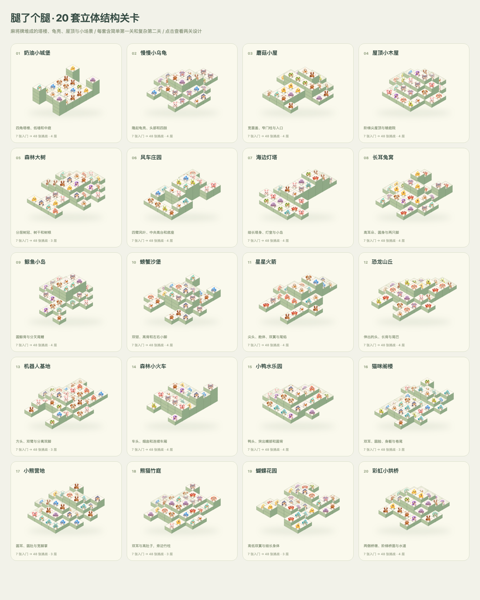
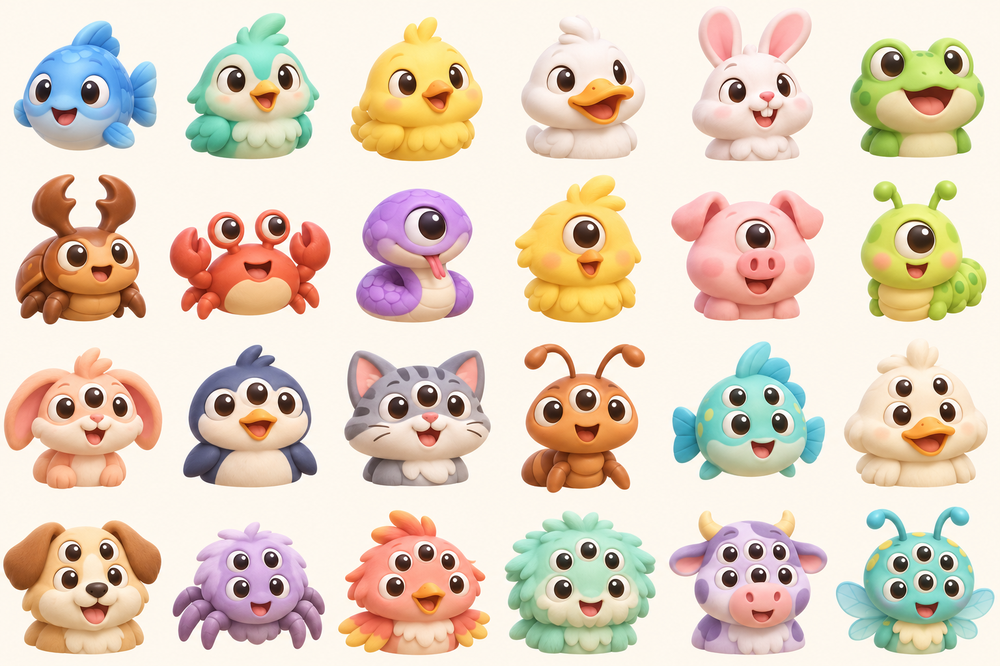
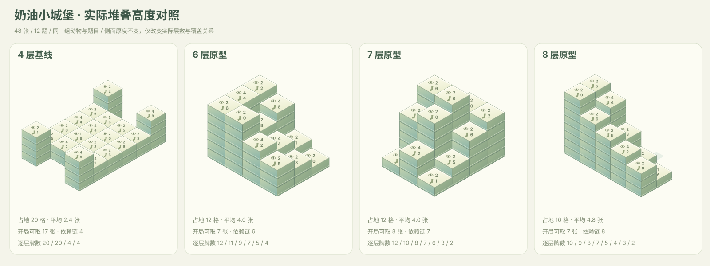
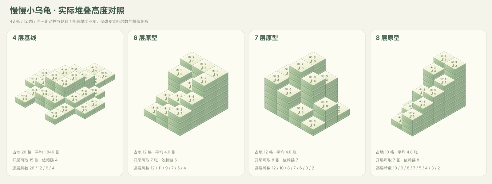

# 立体麻将牌关卡设计

20 套结构，每套包含简单第一关和复杂第二关。素材与数据位于 `assets/level-pack-v1/`。总览为 `overview.html`，两关交互浏览为 `index.html`，直接用浏览器打开即可。下文文件名均相对该素材目录。

第一关 7 张同属性牌、3 题，所有合法取牌顺序都能通过；第二关 48 张、12 题。浏览页默认显示六层体量候选，可切换原四层与七、八层对照；这些是体量实验，尚不是 20 个主题各自完成美术适配的最终关卡。第二关实际玩家难度、广告需求与时长尚未标定，不能作为已完成验收的生产关卡。

`levels.json` 和 `levels.js` 保存布局、动物、题目、覆盖关系与参考解。运行 `python3 build-levels.py` 可重建数据，然后对输出的两个数据文件执行项目 Prettier 格式化。Python 只使用标准库。浏览页的取牌与消除是本地设计预览，没有接入道具、广告或服务端。

`validation.json` 记录 40 关参考解和 20,000 次第一关随机取牌验证；`height-study/browser-validation.json` 记录四种体量共 160 关浏览器重放、逐次可点击集合及窄屏检查。

`animal-atlas.png` 使用内置 image_gen 原创生成，3D 风格的二维素材，不是三维网格模型。提示词摘要见 `artwork.json`；幻想动物的眼睛数在正式制作前仍需美术校对。

原四层完整设计包与效果图已保留；本轮原型、实验记录和手机截图位于素材目录的 `height-study/`。

## 关卡与素材存档

本节记录当前保存的设计资产及状态，不把候选图、参考解或模拟结果当作生产验收。第一关是简单教学关；第二关的原四层主题结构与六层体量候选分别保存，七、八层作为比较原型。

### 20 套主题目录

下表文件名在两个目录中各有对应版本：原四层主题图在 `height-study/baseline-svg/`，当前六层体量候选在 `svg/`。文件名的 `easy`、`hard`、`pair` 分别表示第一关、第二关、两关对照；下表列出两关对照文件。

| 编号 | 主题       | 结构特征                 | 两关 SVG 文件名          |
| ---- | ---------- | ------------------------ | ------------------------ |
| 01   | 奶油小城堡 | 四角塔楼、低墙和中庭     | `01-castle-pair.svg`     |
| 02   | 慢慢小乌龟 | 隆起龟壳、头部和四肢     | `02-turtle-pair.svg`     |
| 03   | 蘑菇小屋   | 宽菌盖、窄门柱与入口     | `03-mushroom-pair.svg`   |
| 04   | 屋顶小木屋 | 阶梯尖屋顶与矮庭院       | `04-house-pair.svg`      |
| 05   | 森林大树   | 分层树冠、树干和树根     | `05-tree-pair.svg`       |
| 06   | 风车庄园   | 四臂风叶、中央高台和底座 | `06-windmill-pair.svg`   |
| 07   | 海边灯塔   | 细长塔身、灯室与小岛     | `07-lighthouse-pair.svg` |
| 08   | 长耳兔窝   | 高耳朵、圆身与两只脚     | `08-rabbit-pair.svg`     |
| 09   | 鲸鱼小岛   | 圆鲸背与分叉尾鳍         | `09-whale-pair.svg`      |
| 10   | 螃蟹沙堡   | 双钳、高背和左右小脚     | `10-crab-pair.svg`       |
| 11   | 星星火箭   | 尖头、舱体、双翼与尾焰   | `11-rocket-pair.svg`     |
| 12   | 恐龙山丘   | 伸出的头、长背与尾巴     | `12-dinosaur-pair.svg`   |
| 13   | 机器人基地 | 方头、双臂与分离双脚     | `13-robot-pair.svg`      |
| 14   | 森林小火车 | 车头、烟囱和连续车厢     | `14-train-pair.svg`      |
| 15   | 小鸭水乐园 | 鸭头、突出嘴部和圆背     | `15-duck-pair.svg`       |
| 16   | 猫咪阁楼   | 双耳、圆脸、身躯与卷尾   | `16-cat-pair.svg`        |
| 17   | 小熊营地   | 圆耳、圆肚与宽脚掌       | `17-bear-pair.svg`       |
| 18   | 熊猫竹庭   | 双耳与高肚子，旁边竹柱   | `18-panda-pair.svg`      |
| 19   | 蝴蝶花园   | 高低双翼与细长身体       | `19-butterfly-pair.svg`  |
| 20   | 彩虹小拱桥 | 两侧桥墩、阶梯桥面与水道 | `20-bridge-pair.svg`     |

原四层 61 张 SVG 已从保留的设计包解出为独立文件，包含 40 张单关、20 张两关对照及一张总览。原版总览 PNG 保存为 `height-study/original-previews/overview.png` 并纳入设计素材；20 张两关 PNG 是保留在本地该目录的导出副本，不纳入 Git。六层候选共享体量原型，尚未完成每个主题的独立高层造型适配。

<figure>
    
    <figcaption>原四层主题结构存档。它与当前默认六层候选是不同版本，不混用测试结论。</figcaption>
</figure>

### 卡通形象与属性

卡通原图为 `animal-atlas.png`，原始生成说明为 `artwork.json`。素材包含 24 个独立单元，6 列 × 4 行，每单元 256 × 256 像素。`characters.json` 保存形象编号、名称、眼睛与腿数，以及原图中的矩形坐标；程序按视口引用，未裁切或改写原图。

这些是牌面上的 3D 风格二维形象，不是可旋转三维模型；关卡主体仍由麻将牌本身堆叠。数值以下表和数据为准，幻想形象的实际眼睛绘制数量仍需美术校对。

<figure>
    
    <figcaption>原创卡通素材原图，按从左到右、从上到下对应 A01—A24。</figcaption>
</figure>

| 编号 | 形象     | 眼睛数 | 腿数 |
| ---- | -------- | -----: | ---: |
| A01  | 泡泡鱼   |      2 |    0 |
| A02  | 跳跳鸟   |      2 |    1 |
| A03  | 小黄鸡   |      2 |    2 |
| A04  | 三脚鸭   |      2 |    3 |
| A05  | 短腿兔   |      2 |    4 |
| A06  | 五脚蛙   |      2 |    5 |
| A07  | 小甲虫   |      2 |    6 |
| A08  | 横横蟹   |      2 |    8 |
| A09  | 独眼蛇   |      1 |    0 |
| A10  | 独眼鸡   |      1 |    2 |
| A11  | 独眼猪   |      1 |    4 |
| A12  | 独眼虫   |      1 |    6 |
| A13  | 三眼跳跳 |      3 |    1 |
| A14  | 三眼企鹅 |      3 |    2 |
| A15  | 三眼猫   |      3 |    4 |
| A16  | 三眼蚂蚁 |      3 |    6 |
| A17  | 四眼鱼   |      4 |    0 |
| A18  | 四眼鸭   |      4 |    2 |
| A19  | 四眼狗   |      4 |    4 |
| A20  | 四眼蛛   |      4 |    8 |
| A21  | 五眼鸟   |      5 |    2 |
| A22  | 五眼兽   |      5 |    4 |
| A23  | 六眼牛   |      6 |    4 |
| A24  | 六眼虫   |      6 |    6 |

### 高层原型 SVG

四种高度使用同组动物、题目与牌数比较。城堡与乌龟两张对照均保存为可无损放大的纯矢量文件；PNG 仅为同图的浏览预览，不替代 SVG 源文件。

| 文件                                        | 保存内容                                   |
| ------------------------------------------- | ------------------------------------------ |
| `svg/height-comparison-castle.svg`          | 城堡四、六、七、八层对照                   |
| `svg/height-comparison-turtle.svg`          | 乌龟四、六、七、八层对照                   |
| `svg/overview.svg`                          | 当前六层候选总览                           |
| `svg-designs.zip`                           | 当前 63 张 SVG、导出源码及必要数据         |
| `height-study/baseline-svg-designs.zip`     | 原四层 SVG 设计包                          |
| `levels.json`、`height-study/variants.json` | 当前候选及四种体量的真实位置、遮挡和参考解 |

<figure>
    
    <figcaption>城堡：实际牌层数变化，单张牌厚度不变。</figcaption>
</figure>

<figure>
    
    <figcaption>乌龟：验证体量和选择空间；尚未作为最终主题美术验收。</figcaption>
</figure>

## SVG 立体结构图

运行 `python3 assets/level-pack-v1/export-svg.py`（从本设计目录执行）可导出到素材目录下的 `svg/`：40 张独立关卡图、20 张两关对照图、`overview.svg` 总览，以及城堡和乌龟两张四种高度对照，共 63 张。所有文件为不依赖外部图片的纯矢量 SVG。采用水平斜转 45°、俯视约 29.7° 的固定轴测投影，以顶面、双侧面和逐层牌缝表达立体堆叠；不是带消失点的镜头透视。布局和题目不变。

## 第二关堆叠修改指导

以下保留本轮采用的结构设计和验证标准；实际交付及未达项见后文。本轮不把体量候选视作 20 套完整主题改版或生产难度验收。第二关继续保持 48 张、12 题、7 格卡槽，有效游戏时长目标 4—6 分钟；第一关不跟随第二关增高。

### 原四层基线问题

原四层 20 套第二关占用 19—31 个底面格，单套平均堆高为 1.55—2.53 张，20 套的平均值约 1.89 张。初始可点击 10—19 张，平均 15.75 张。大树、机器人、猫、小熊、熊猫、蝴蝶六套实际只有三层；其他造型即使达到四层，也经常只有少数塔尖达到最高层。

这些数字证明主体偏平、自由牌偏多，不能单独证明真人难度低。原四层生成方案保留全部非空轮廓格，再调到 48 张，且高度上限为四层；轮廓越铺开，越难形成有厚度的主体。加大渲染厚度、阴影或层间距离，只会改变视觉，不会增加逻辑依赖。

### 结构目标

| 指标         | 下一轮候选目标                   | 判定方式                                       |
| ------------ | -------------------------------- | ---------------------------------------------- |
| 最高层数     | 先试 6 层，再比较 7、8 层        | 实际卡牌 z 层数，不是侧面厚度                  |
| 底面占地     | 10—14 个有牌格                   | 同一列只计一次；允许半格错位，但需统一坐标单位 |
| 平均堆高     | 约 3.4—4.8 张                    | 48 除以底面有牌格数量                          |
| 主体         | 2—3 个有厚度的主峰               | 不能用一根高柱代替主体；允许分离牌堆           |
| 上半部牌量   | 至少约半数牌在第三层及以上       | 同时输出逐层牌数，不能只报最高层               |
| 初始可点击   | 优先试 6—8 张                    | 依正式确定的遮挡规则计算，不按高度猜测         |
| 有效依赖深度 | 优先试 5—8 张的连续遮挡链        | 用覆盖 DAG 最长路径衡量，与层数分别报告        |
| 选择空间     | 多数中盘状态仍有至少两张可点击牌 | 记录完整过程分布；避免长时间只剩唯一合法点击   |

上述形态指标是实验筛选目标，不是难度合格证，也不要求所有指标机械同时达标。允许少量低层牌形成连接或周转区域，但不要把大量可操作牌用在翅膀、尾巴、围墙等一层装饰上；轮廓装饰优先由非交互底座、背景或色彩表达。

### 三个体量原型

先做以下三种牌量结构，确认读取、遮挡与难度后，再推广到 20 个主题。数组每个数字是同一底面格的实际牌堆高度，三个原型均已校验为 48 张；这些原始高度表不能直接视作生产关卡；本轮测试的朝向、真实坐标、参考解和结果在后文记录。

六层原型，底面 12 格，平均高 4 张：

```json
[
    [6, 5, 2, 1],
    [6, 4, 3, 2],
    [6, 6, 4, 3]
]
```

逐层牌数从底向上为 12、11、9、7、5、4。

七层原型，底面 12 格，平均高 4 张：

```json
[
    [1, 5, 7, 2],
    [3, 6, 7, 5],
    [1, 2, 4, 5]
]
```

逐层牌数从底向上为 12、10、8、7、6、3、2。

八层原型，底面 10 格，平均高 4.8 张：

```json
[
    [8, 7, 4, 2, 1],
    [8, 6, 5, 4, 3]
]
```

逐层牌数从底向上为 10、9、8、7、5、4、3、2。八层仅作为高深度对照，不默认越高越好。原型的邻接、错位与镜头需继续调整，不能仅将高度表换上去就声称达到六张可点击或八层依赖深度。

### 生成与显示修改要求

1. 先确定 48 张的逐层牌量与主峰位置，再适配主题轮廓，避免先画满大轮廓后平均补牌。高度范围必须由配置提供，不能只修改图像或缩放参数。
2. 更新生成器、数据中的 maxLayers、坐标校验、浏览器排布、SVG 输出、深度排序与点击命中；现有四层检查不能继续阻止六至八层候选，也不能只放宽校验却没有实际高层牌。
3. 纯垂直独立柱即使很高，每列顶牌仍可能全部可取。通过合理的错位、主峰连结和交叉覆盖建立实际依赖，同时保留多处选牌分支；不要改成只有一条强制点击序列的长烟囱。
4. 固定底座或阴影表达高度，牌面仍要清楚显示眼睛、腿数。手机视口内不能靠无限缩小牌面来容纳高塔；高层造型先验证数字可读和真实可点击区域。
5. 题目和顺序仍在开局固定，从最后一题参考解逆向安排牌，随后正向重放。保留“先整槽匹配，再判满槽失败”和失败后无复活。

### 必须先统一遮挡模型

当前素材生成器用轴测投影中的顶面与后绘制牌体多边形相交计算遮挡，浏览页按该结果点击；离线难度工具使用逻辑 XY 平面中的高层牌覆盖。两种规则不同，同一形状未必得到相同可点击集合，之前的广告需求数据不能直接套用到这 20 套素材。

进入难度比较前，应明确逻辑覆盖和镜头视觉遮挡各自的职责，保证前端实际允许点击的集合与模拟器一致。如果继续采用当前投影模型，需要为关卡工具增加现有设计数据的导入适配，并独立重算多边形遮挡；不得把它转换成另一个三峰模板后仍称测试了原设计。应包含同层接边、高层部分覆盖、侧面遮挡、错位、不同镜头和牌移除后的回归用例。

### 交付与难度判断

每个候选交付高度图、逐层牌量、真实位置、覆盖边、动物属性、12 道题、可重放参考解和固定种子，以及初始可点击数量、依赖最长链、每一步可点击数量分布。先报告结构参数，再报告策略结果，不能凭效果图宣布关卡够难。

先比较原四层基线与六层原型，再比较七、八层。比较时固定动物、题目与玩家决策种子，使用同一套经过适配的点击规则，分开评估布局变化和动物组合变化；筛选种子与最终评估种子分离。

难度指标包括无道具通关、第一次受阻题号、至少一次视频道具、最多一/二/三次视频奖励内通关、用满十次仍未通过、无可证修复方案、取牌步数和时长假设。零储备与每种各一次储备必须分组，不能把“需要道具”冒称为“必须看广告”。零储备约 80% 使用视频且多数在一至三次内通关是校准目标，不是每关硬塞三处付费门槛。

第一关的参考解与随机取牌验证，只能证明第一关；第二关的一条参考解只能证明存在路径。新增高层原型仍需完整验证无道具策略和三种道具，才能知道增加高度是否真正增加了有趣且可修复的难度。

## 本轮高层原型交付

本轮收口为四层基线与六、七、八层体量原型的结构、镜头和离线模拟验证。第一关保持原来的 7 张与 3 题，20 套第一关数据逐项未变。20 个主题的独立高层造型适配、真人时长和广告目标验证放在后续，不通过不断追加实验制造“达标”。

浏览页可用 `?layers=4`、`?layers=6`、`?layers=7`、`?layers=8` 比较真实布局。默认六层候选共享体量原型，通过朝向、牌属性与非交互主题底座区分；这不等于 20 种全新造型已设计完成。原四层数据保存在 `height-study/baseline-levels.json`，独立 SVG 保存在 `height-study/baseline-svg/`；`height-study/baseline-svg-designs.zip` 是本地压缩导出副本，不纳入 Git。

| 体量       | 有牌占地 |     平均堆高 | 从底到顶的逐层牌数         | 开局可取 | 最长遮挡链 |
| ---------- | -------: | -----------: | -------------------------- | -------: | ---------: |
| 原四层基线 | 19—31 格 | 1.55—2.53 张 | 每个原主题不同，部分仅三层 |    10—19 |        3—4 |
| 六层原型   |    12 格 |         4 张 | 12、11、9、7、5、4         |        7 |          6 |
| 七层原型   |    12 格 |         4 张 | 12、10、8、7、6、3、2      |   6 或 8 |          7 |
| 八层原型   |    10 格 |       4.8 张 | 10、9、8、7、5、4、3、2    |        7 |          8 |

三个高层原型第三层及以上牌量分别为 25、26、29 张。参考路径第 10—39 次取牌中，至少两张可选的比例为六层 100%、七与八层最低 96.67%。这不是所有决策路径的分布，也不保证具有两至三个独立主峰；主题轮廓与主峰关系仍需后续适配。

### 一致的点击与模拟

本轮采用固定镜头下的实际可见性规则：某牌的顶面与任何后绘制牌的完整牌体投影有正面积交叠，则该牌不可点击。仅边缘接触不算覆盖，牌侧面也可能遮住后方牌面。绘制次序固定为 `x+y`、`z`、`x`，属于明确的 2.5D 绘制约定，不冒充可任意旋转的物理三维场景。非交互底座不参与遮挡和牌数。

`geometry.py` 为生成和模拟适配提供同一几何定义；浏览器另行重算并核对导出的覆盖 DAG。`study.py` 私有加载主线 `scripts/game-design.py`，仅在该私有模块实例中替换 geometry；未修改主线源码、模板或规则。实际导入原设计的牌坐标，重排后仍使用同一套投影。独立验证器用多边形裁剪求交面积，而不是复用生成器的分离轴测试，核验每次取牌和全部道具修复证书。

12 项结构回归覆盖同层接边、侧面遮挡、半格错位、镜头参数、移除后可点击集合、位置置换、真实布局导入、失败轨迹篡改、高层配置和第一关不变。

### 配对实验结果

固定 20 组动物实例、12 道题及其顺序、参考牌组，分别放入四种真实布局。每组使用相同决策重复 10—14，每种体量、每个库存场景 100 次；四种体量乘无道具、零储备、满储备，共 1,200 次。几何朝向只按开局选择空间筛选，没有用这些决策结果挑关。决策重复与此前用于原始关卡评估的 0—4 分离，但动物组不是全新的独立真人样本。

| 体量   | 无道具通关 | 零储备至少一次视频 | 满储备至少一次视频 | 视频组最多三次内通关 |
| ------ | ---------: | -----------------: | -----------------: | -------------------: |
| 原四层 |        38% |                62% |                 5% |                 100% |
| 六层   |        42% |                58% |                 6% |                 100% |
| 七层   |        42% |                58% |                 5% |                 100% |
| 八层   |        28% |                72% |                 4% |                 100% |

模拟接受率和视频成功率均为 100%，自由策略知道全部卡牌属性与覆盖，只规划当前及下一题；道具使用完整未来信息证明修复路线，但只提示当前题。它不代表人类的心算、信息限制或观看意愿。所有带道具尝试在本轮三次内完成，用满十次仍失败为零；这不是实际广告或真人 100% 通关的证据。搜索触界总计 91 次，触界不等于数学无解，修复仍必须给出完整可重放证书。

六层变厚后反而比四层更容易；八层更难但零储备视频需求仍只有 72%，未达到约 80%。因此本轮不宣布商业目标达标，也不把高度本身作为难度指标。

### 手机与验证边界

浏览器重放四种体量的 160 关，共 4,400 次取牌，逐次核对允许点击的集合；80 份实际布局的两种独立几何算法一致。1,200 次策略记录共 54,983 个事件独立重放通过。固定镜头下，320、375、390px 的高层原型均整盘可见、无整页横向溢出；可点击牌数字的实际渲染字号均超过 10px。这是浏览器布局与字号检查，不等于真机触控和真人辨识验收。

模型沿用人工取牌 2.5 秒、每题思考 10 秒、道具交互 8 秒、自动重放每题 1.5 秒的假设；零储备中位数约 248—249.5 秒，约 4 分 8 秒。该时间没有真人校准，不能宣称 4—6 分钟已达成。

### 复现与文件

完整本地实验环境中，`study.py` 可重做配对实验，`structure-test.py` 运行结构回归。这两份实验代码依赖主线 `scripts/game-design.py`，与主线模拟能力一起纳入版本管理。主线模拟脚本 SHA-256 已记录在 `height-study/results.json`；更换该依赖后应重做实验，而非沿用旧结果。仓库保存实验结果、实际输入布局与实验源码；复现实验前须核对记录的代码指纹。

`height-study/variants.json` 保存每个真实位置、覆盖边、参考解、逐层牌数和逐步可点击数量；各体量的 `*-runs.json` 为本地策略与道具运行日志，不纳入 Git。`height-study/browser-validation.json` 保存浏览器和字号检查。SVG 对照为 `svg/height-comparison-castle.svg`、`svg/height-comparison-turtle.svg`，手机对照为 `height-study/mobile-4-layers.png`、`mobile-6-layers.png`、`mobile-7-layers.png`、`mobile-8-layers.png`。

## Git 交付范围

本次提交包含设计文档、24 种卡通形象原图与索引、原四层与当前候选的独立 SVG、两张高度对照 SVG、选定的设计总览与手机截图、布局数据及实验汇总。`build-levels.py`、`geometry.py`、`variants.py`、`export-svg.py` 和静态浏览页可以独立使用，不依赖主线模拟器。

ZIP 压缩包、逐步运行日志与重复的两关 PNG 导出副本保留本地，不作为 Git 源文件。`study.py` 和 `structure-test.py` 与主线模拟能力一同维护。浏览器与模拟结果的 JSON 是本轮证据快照，不等同于 CI 或真人验收。

## 小程序卡牌形象资源

卡通形象已整理到 `frontend/miniprogram/assets/cards/characters/`，每个形象保存为独立的 256×256 PNG，共 24 张。`frontend/miniprogram/assets/cards/characters.json` 提供形象编号、名称、资源路径、像素尺寸、透明状态、文件大小和 SHA-256；不把实验动物属性重复定义为正式后端契约。

PNG 采用原尺寸、无重采样的单元导出，并对解码后的每个像素与设计源单元核对。原图保留在本设计目录，关卡 SVG 继续用于布局设计；两者不放入小程序卡牌运行资源目录。当前 PNG 保留象牙色不透明底，尚未做透明背景处理或正式美术验收。本次仅准备可引用资源，未完成微信开发者工具或真机显示验证。

### 格式依据

采用 PNG 作为当前通用静态卡牌插画格式。[微信官方小程序示例](https://github.com/wechat-miniprogram/miniprogram-demo/blob/master/miniprogram/page/animation/index.wxml) 直接使用 PNG 图片资源；[Cocos Creator 3.8 图像格式支持表](https://docs.cocos.com/creator/3.8/manual/zh/asset/compress-texture.html) 列明 PNG 在小游戏、Android、iOS 和 Web 均支持。当前项目仍是原生微信小程序，不因参考小游戏资料而引入 Cocos、Unity 或 GPU 压缩纹理链路。

没有取得可靠的全市场格式使用占比，因此这里记录的是基于支持范围、无损特性和项目架构的格式选择，不宣称 PNG 的市场占比第一。
